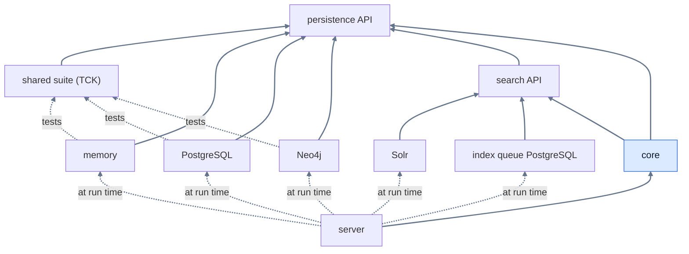
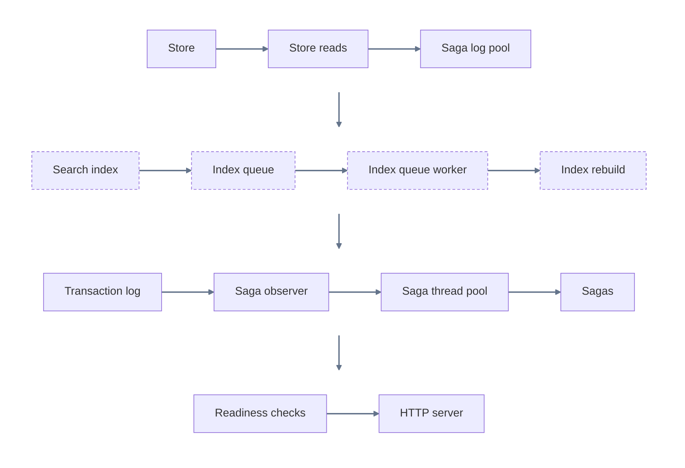
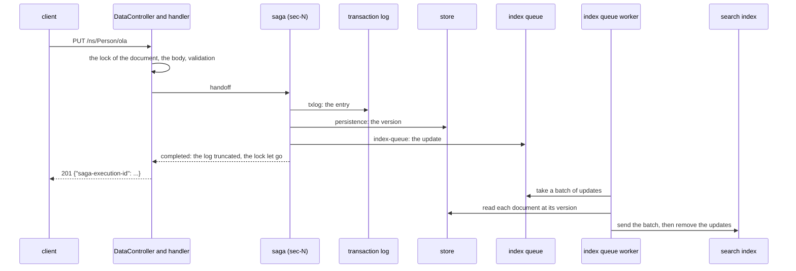
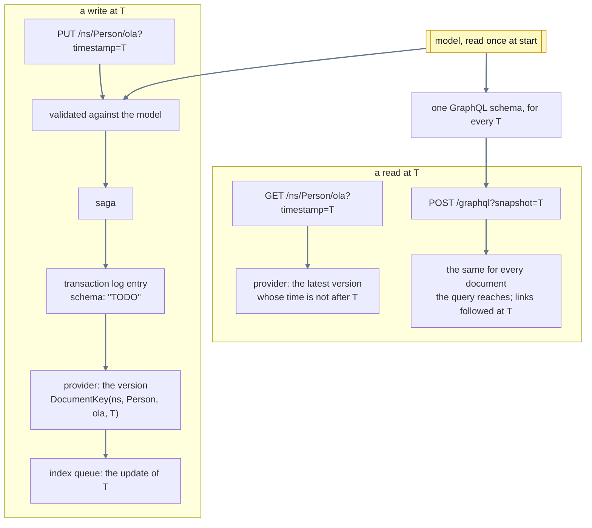

# The architecture of Linked Data Store

This document is the map of the code of Linked Data Store (LDS): the modules and how they depend on each other, the
subsystems a running LDS is made of, the way a read and a write take through them, the ideas that hold the code
together, the rules a change must keep, and what is not finished. It is for a developer who is new to the code base.
It does not hold the detail: each part has a document of its own, listed at the end.

## What LDS is

LDS is a server that gives REST and GraphQL access to versioned, linked JSON documents. A
[document](../glossary.md#document) belongs to an [entity type](../glossary.md#entity-type) of the model, such as
`Person`, in a [namespace](../glossary.md#namespace), and has an id. Its address is `/{namespace}/{Entity}/{id}`.
Every [version](../glossary.md#version) of a document has a [valid time](../glossary.md#valid-time), and an
[as-of read](../glossary.md#as-of-read) gives the document as it was at the instant asked for. A
[link](../glossary.md#link) is a field that holds a typed reference to a document of another entity type. The
[model](../glossary.md#model) is read when LDS starts. These words are explained for a user in
[the concepts](../user/concepts.md).


LDS is one process. Applications and people ask it over HTTP, by REST and GraphQL; whoever runs it asks `/ping` and
`/health/ready`. It keeps what it is given in engines of its own choosing, each named by configuration: the store of
the documents, the saga log of the steps of each write, the transaction log of every write, and, when search is on,
the index queue and the search index. What each part of the process does is the rest of this document.

The code has some words of its own:

| In the code | Means |
|---|---|
| managed domain, `managedDomain` | An entity type (`Specification.getManagedDomains`). |
| `MANAGED`, `EMBEDDED`, `REFERENCE` | The three kinds of resource (`ResourceType`): the whole document, a part of a document addressed by its path, and one link of a document. |
| `timestamp` (REST), `snapshot` (GraphQL and persistence) | The time a request asks for: the valid time of a write, or the instant of an as-of read. |
| specification | The model as a tree (`Specification`, `SpecificationElement`). It says which fields a document has and which of them are links. |
| [fragment](../glossary.md#fragment) | One leaf value (a value with nothing below it) of one version of one document. The memory and PostgreSQL providers store fragments. |
| bridge | `RxJsonPersistenceBridge`: turns a document into fragments for a write, and a stream of fragments into documents for a read. |
| [saga](../glossary.md#saga), sec | The steps of one write, run by the saga engine; `SagaExecutionCoordinator` starts them. |
| [saga log](../glossary.md#saga-log) | Where a saga writes each of its steps, so that a saga that did not complete can be run again. |
| [transaction log](../glossary.md#transaction-log), `txlog` | A log that gets one entry for every write, before the write reaches the store. |
| [index queue](../glossary.md#index-queue) | The updates the search index has not taken yet (`IndexQueue`). |
| [lifecycle](../glossary.md#lifecycle) | A subsystem that is started and stopped with LDS (`Lifecycle`, `Lifecycles`). |

## The modules


LDS is one Maven reactor with the group `io.descoped.lds` and one version, which every module has. Every module with
code is a JPMS module, except the [shared suite](../glossary.md#shared-suite) of tests for
[persistence providers](../glossary.md#persistence-provider) (the TCK).

| Maven module | JPMS module | What it is for |
|---|---|---|
| `linked-data-store-persistence-provider-api` | `io.descoped.lds.persistence.api` | The contract between LDS and a store: `RxJsonPersistence` (documents), `RxPersistence` (fragments), the bridge, `PersistenceInitializer` (how a provider is found), `Specification`, `Limits` and `IdOrder`. |
| `linked-data-store-persistence-provider-tck` | none (class path) | The shared suite: `PersistenceIntegrationTest`, the 38 tests every persistence provider must pass. |
| `linked-data-store-persistence-provider-memory` | `io.descoped.lds.persistence.memory` | Provider `mem`: fragments in sorted maps in the memory of the process. For tests and for trying LDS. |
| `linked-data-store-persistence-provider-postgres` | `io.descoped.lds.persistence.postgres` | Provider `postgres`: fragments as rows of one table, `fragment`. |
| `linked-data-store-persistence-provider-neo4j` | `io.descoped.lds.persistence.neo4j` | Provider `neo4j`: a document as a tree of nodes in a graph, a link as a relationship. |
| `linked-data-store-search-provider-api` | `io.descoped.lds.search.api` | The contract between LDS and a search index (`SearchIndexProvider`, `SearchIndex`, `IndexEntry`, `SearchQuery`), and the index queue (`IndexQueue`, `IndexQueueProvider`). |
| `linked-data-store-search-provider-solr` | `io.descoped.lds.search.provider.solr` | Provider `solr`: the index in one core of Apache Solr 10, with a schema of LDS's own. |
| `linked-data-store-index-queue-postgres` | `io.descoped.lds.index.queue.postgres` | The index queue `postgres`: the table `lds_index_queue` in the database of the transaction log. |
| `linked-data-store-core` | `io.descoped.lds.core` | The application: `UndertowApplication`, the REST handlers, GraphQL, the model, the sagas, the transaction log, the worker of the index queue, readiness and the lifecycles. |
| `linked-data-store-server` | `io.descoped.lds.server` | What makes LDS something that can be started: the main class `Server`, the defaults of the configuration, the example model, the Dockerfile and the compose file. |
| `linked-data-store-bom` | none (packaging `pom`) | Manages the versions of the modules above, and nothing else. |
| `linked-data-store-loadtest` | `io.descoped.lds.loadtest` | The load test, run by hand: scripts and a compose file that start LDS from the image of the server and drive a load at it, and the program that turns the results into plots. Not in the BOM and not released. |

### How the modules depend on each other



- The persistence API depends on no LDS module. It exposes RxJava 3 and Jackson 3 (`requires transitive`).
- The shared suite and the memory, PostgreSQL and Neo4j providers depend on the persistence API. Each of the three
  providers also depends on the shared suite, for its tests only.
- The search API depends on the persistence API (`requires transitive`). The Solr provider and the index queue in
  PostgreSQL depend on the search API.
- Core depends on the persistence API and the search API, and on no provider. Its tests use the memory provider.
- The server depends on core. At run time it adds every provider: memory, PostgreSQL, Neo4j, Solr, the index queue in
  PostgreSQL, and the saga log and the transaction log in PostgreSQL (`sagalog-postgres`,
  `rawdata-client-provider-postgres`).

So the code of core never names a provider, and a provider exports no package. The server module is the one place
where core and the providers meet, and they meet on the class path, not in code.

Core uses these libraries as they are: Undertow for HTTP, graphql-java for GraphQL,
`com.networknt:json-schema-validator` for validation, Cantara distributed saga (`no.cantara.saga`) for the sagas and
the saga log ([the saga engine](saga.md)), `io.descoped.rawdata` for the transaction log, and
`io.descoped.config:dynamic-configuration` for the configuration. Library versions are properties of the root
`pom.xml`.

## The subsystems of a running LDS

`Server.main` builds the configuration and calls `UndertowApplication.initializeUndertowApplication`. It makes the
parts in a fixed order, gives each part the ones made before it, and adds each that holds threads, connections or
clients as a [lifecycle](../glossary.md#lifecycle) to the application's `Lifecycles`. The model is read first, and a
model with no entity type, or a name past its limit, stops the start before anything is made.



The four with a dashed line are made only with search, and the rebuild only when `search.index.rebuild` is true.
`UndertowApplication.start` starts the subsystems in this order; the stop stops them in the reverse order (see
[A lifecycle for every subsystem](#a-lifecycle-for-every-subsystem)). The log of a start shows it. Started from the
image, with the defaults of the server:

```sh
docker run -d --rm --name lds -p 127.0.0.1:19104:9090 descoped/lds:3.0.1
docker logs lds
```

Each log line is shown from its message on, and the lines between them are left out:

```
Initializing specification ...
Managed domains: /Company /Person
Using persistence provider: mem
Using saga-log-pool provider-class: no.cantara.sagalog.memory.MemorySagaLogInitializer
GraphQL Search is disabled. Skipping search index initialisation
Using transaction-log provider: discard
Initializing Http handlers ...
Starting RxJava schedulers ...
Starting Linked Data Store ...
Starting Store ...
Starting Store reads ...
Starting Saga log pool ...
Starting Transaction log ...
Starting Saga observer ...
Starting Saga thread pool ...
Starting Sagas ...
Starting Readiness checks ...
Starting HTTP server ...
Listening on 0.0.0.0:9090
Server started in 402ms..
```

With the defaults of the server LDS runs in memory: the provider `mem`, a saga log in memory, a transaction log
that keeps nothing, and no search. LDS runs on the class path, also in the image.

## The path of a read

This is `GET /ns/Person/ola?timestamp=...` through the modules. The document it reads is written by the request
under [The path of a write](#the-path-of-a-write). Run that request first: on an empty LDS this read is answered 404.

1. **Undertow** takes the request. It passes the chain that the constructor of `UndertowApplication` builds:
   `CORSHandler`, then a `GracefulShutdownHandler` that answers 503 while LDS stops, then a `PathHandler`. The exact
   paths `/ping`, `/health/alive` and `/health/ready` have handlers of their own, and so have `/graphql` and
   `/graphiql` when `graphql.enabled` is true and the model is a GraphQL schema. Every other path goes to
   `NamespaceController`.
2. **`NamespaceController`** checks that the path begins with the namespace of `namespace.default` and hands the
   request to a new `DataController`. A path under `/source/` goes to `SourceHandler`, and any other path is answered
   400.
3. **`DataController`** moves the request from the I/O thread to a worker thread of Undertow. It reads the time from
   `timestamp` (or `t`), takes the time now when there is none, and turns it into UTC.
   `ResourceContext.createResourceContext` then checks every name of the path against the specification and says which
   kind of resource the path is. A time it cannot read and a name the specification does not have are answered 400.
4. **The handler of that kind**, here `ManagedResourceHandler` (the others are `EmbeddedResourceHandler` and
   `ReferenceResourceHandler`), opens a read-only transaction and calls
   `RxJsonPersistence.readDocument(tx, time, namespace, entity, id)`. This call crosses from core into the provider.
5. **The provider** gives a `Maybe<JsonDocument>`: the version that is valid at the time.
   - Memory and PostgreSQL: `RxJsonPersistenceBridge.readDocument` asks `RxPersistence.read`
     (`MemoryRxPersistence`, `PostgresPersistence`) for the fragments of that version. `toDocuments` cuts the stream
     of fragments into documents with `RxGroupByTools.groupByOrdered`, and `FlattenedDocumentToJson` builds the tree.
   - Neo4j: `Neo4jPersistence.readDocument` runs one Cypher statement, and `toDocument` builds the document from
     the record.
6. **The handler** waits for the document on its worker thread (`blockingGet`), writes it as JSON, and the
   transaction is closed. No document at that time, or a deleted one, is answered 404.

```sh
curl -i 'http://localhost:19104/ns/Person/ola?timestamp=2021-06-01T00:00:00Z'
```

```http
HTTP/1.1 200 OK
Content-Type: application/json; charset=utf-8
Content-Length: 41

{"employer": "/Company/acme", "name": "Ola"}
```

A read through GraphQL takes another way to step 5. `GraphqlHttpHandler` reads the body as it comes
(`AsyncAnswer.withBody`) and goes on on a worker thread. `GraphQLUndertowContext` works out the instant of the as-of
read, which the code calls the snapshot: the parameter `snapshot`, the variable `__snapshot`, or now. graphql-java
executes the query with `executeAsync` against the schema that `GraphQLSchemaBuilder` built at start, and the answer
is sent when the execution completes. A field that needs documents has a fetcher (package
`io.descoped.lds.graphql.fetcher`), which calls the same `RxJsonPersistence` as REST, with that instant, and waits
for the answer. The field `Search` asks the search index and reads each hit from the store on the threads of
`StoreReads`, without a thread that waits; the query then goes on on a thread of queries of `StoreReads`. GraphQL only
reads: there is no mutation. No handler, REST or GraphQL, asks who the caller is, and the listener is plain HTTP.

Not finished: a read of the store still holds a request thread while it waits: the REST handlers
(`blockingGet`, `blockingIterable`) and the GraphQL fetchers of documents and links (`blockingGet` for each field),
and each builds its whole answer in memory before it is sent. See [Streaming on RxJava 3](#streaming-on-rxjava-3).

## The path of a write

This is `PUT /ns/Person/ola?timestamp=...` with the document as the body. The request first takes steps 1 to 3 of a
read. The steps below follow them.

1. **`DataController`** asks for the [document lock](../glossary.md#document-lock) of `/ns/Person/ola`
   (`DocumentLocks`): one write at a time to a document, held until the saga of the write has completed. A write that
   waits for it holds no thread, and is answered 503 when it has waited 30 seconds.
2. **`ManagedResourceHandler.putManaged`** reads the body as it comes (`AsyncAnswer.withBody`), on a worker thread
   when it has all come, with `BodyParser` into a Jackson tree. A field that is `null` is left out (`NullFields`), and
   a value past the [limits](#limits-and-the-order-of-ids) is answered 400.
3. **`LinkedDocumentValidator`** validates the document: first with the JSON Schema of the entity type, then every
   link. A link must name an entity type its field may link to. Whether the target exists is not checked. A document
   that is not valid is answered 400, and no saga is started. The body `{"name":7}` was answered
   `Schema validation error: [$.name: integer found, string expected]`.
4. The handler makes a **`SagaInput`**: a new transaction id, the method, the namespace, the entity type, the id, the
   valid time as the version, and the document. It takes the saga `Create or update managed resource` from
   `SagaRepository`.
5. **`SagaExecutionCoordinator.handoff`** takes a saga log from the pool and a permit, and starts the saga on the
   saga thread pool. The engine writes the saga input to the saga log before the first step runs.
6. Step `txlog`: **`AppendTxLogAdapter`** writes the entry (`TxLogTools`, MessagePack) to the transaction log through
   `TxlogRawdataPool`.
7. Step `persistence`: **`PersistenceCreateOrOverwriteSagaAdapter`** calls `RxJsonPersistence.createOrOverwrite` in a
   transaction of its own and waits for it (`WriteTransaction`): the transaction is committed when the write completed
   and cancelled when it failed, so a failed write leaves nothing. In the memory and PostgreSQL providers the bridge
   flattens the document into fragments (`JsonToFlattenedDocument`) and gives them to `RxPersistence.createOrOverwrite`.
   In Neo4j `Neo4jDocumentWriter` makes the statement and its parameters.
8. Step `index-queue`, only with search: **`UpdateIndexSagaAdapter`** adds the update (namespace, entity type, id,
   version) to the index queue and is done. The worker of the queue (`IndexQueueWorker`) later reads the document
   from the store at that version and sends it to the search index.
9. When the saga has completed, the coordinator truncates its saga log and gives it back to the pool, the permit is
   given back, and the lock of the document is let go. A saga that failed keeps the entries of its log, and recovery
   runs it again.
10. **`AsyncAnswer.afterSaga`** answers from the completion of the saga, with the transaction id
    (`saga-execution-id`): no thread waits for it. With `sync=false` the answer is sent when the saga is in its log.
    With `searchable=true` it is sent when a search finds the write, at most 10 seconds later.



```sh
curl -i -X PUT 'http://localhost:19104/ns/Person/ola?timestamp=2020-01-01T00:00:00Z' \
     -H 'Content-Type: application/json' \
     -d '{
       "name": "Ola",
       "employer": "/Company/acme"
     }'
```

```http
HTTP/1.1 201 Created
Content-Type: application/json
Content-Length: 60

{"saga-execution-id": "01a20fde-7e34-7e4b-84fa-9319930e61fd"}
```

Every write ends in this saga, also a write of a part of a document or of a link: the handler reads the document as
of the valid time of the request, makes the change in it, and writes the whole document as a new version. The delete
of a whole document has a saga of its own, `Delete managed resource`, with the same steps. Its `persistence` step
removes nothing: it writes a [tombstone](../glossary.md#tombstone) (`RxJsonPersistence.markDocumentDeleted`), a
version that says the document is not there from that time on. [The write path](core-write-path.md) has the detail.

## Where LDS runs


Every way runs the same image, `descoped/lds`, configured by environment variables `LDS_...`, each setting one key of
[the configuration](../user/configuration.md):

| Way | Started with | What it keeps |
|---|---|---|
| Try it | `docker run --rm -p 127.0.0.1:9090:9090 descoped/lds:3.0.1` | Everything in memory: what is written is gone when it stops. |
| Develop | `docker compose -f linked-data-store-server/compose.yaml up --build` | Neo4j for the documents; PostgreSQL for the saga log, the transaction log and the index queue; Solr for search ([the server](server.md)). |
| As a service | The image, beside its engines, run by an orchestrator that asks `/health/alive` and `/health/ready` | The store in PostgreSQL or Neo4j, the logs and the index queue in PostgreSQL, and Solr when search is on ([running LDS](../user/operations.md)). |

Not finished: a service is one instance. Several LDS on one saga log need a `sagalog.config.cluster.instance-id` each,
which nothing derives, and cannot share a topic of the transaction log in PostgreSQL ([the saga engine](saga.md)).

## The ideas that hold the code together

### Streaming on RxJava 3

The persistence interface is reactive. A read of one document gives a `Maybe`, a read of many a `Flowable`, a write a
`Completable`. A read is a [reactive stream](../glossary.md#reactive-stream): a provider reads its store only as far
as the reader asks (backpressure).

- PostgreSQL: a read is one statement, and its rows are fetched as they are asked for (`ResultSetPublisher`).
- Memory: the entries of the sorted map are given on demand (`AsyncIterablePublisher`).
- Neo4j: a read is one statement that returns one record for each document, and a record is taken from the driver
  when a document is asked for (`Neo4jTransaction.executeCypherAsync`).
- The bridge: `RxGroupByTools.groupByOrdered` cuts one ordered stream of fragments into documents and asks the
  source for more only when the next document is asked for.

A provider gives the documents of a read in the order of its range, forward or backward, and each one's fragments in
order, so the bridge cuts them into documents as they come and never sorts. A list passes its range with its limit to
the store, which leaves deleted documents out, so the limit counts what is given. The two publishers are checked with
the Reactive Streams TCK. The rule for a change: a stream is not replaced by a call that returns a complete list, no
sort is added, and no blocking call is added to an interface. [The persistence interface](persistence-api.md) has the
detail.

Not finished: the stream does not reach the answer. The REST handlers and the GraphQL fetchers wait for the stream on
a request thread and build the whole answer in memory before it is sent, and a list over REST is not paged.

### No thread waits

A request is read and answered without a thread that waits for it. Each wait is a future or a stream, and the answer
is sent from its completion:

| What a request waits for | How |
|---|---|
| Its body | Read as it comes (`AsyncAnswer.withBody`); the request goes on on a worker thread when it has all come. |
| The lock of its document | A future, completed by the write before it (`DocumentLocks`). |
| Its saga | The future of the saga (`AsyncAnswer.afterSaga`); the request is kept open and the handler returns. |
| Search, for a searchable write | A `Single` that asks the index queue and the index (`SearchWait`). |
| A GraphQL query | `executeAsync`; the field `Search` returns a future. |
| A read of the store that is composed | A read transaction opened, read and closed on a thread of the store (`StoreReads`): the store in memory holds a lock of the thread that opened a transaction. |
| Readiness | Each check is a `Single` with a time limit; a client that only blocks is asked on a virtual thread of its own. |

A client that only blocks (JDBC, the saga log, the transaction log) is called on a thread of its own, never on an I/O
or request thread. The steps of a saga are synchronous and may block, on the saga's own bounded pool: that pool caps
how many steps run at once, so the sagas slow down with a slow store instead of piling work on it
([the saga engine](saga.md#the-threads)). Nothing blocks an event loop, a request thread or an Rx scheduler but the
application's own threads of `StoreReads`.

Not finished: besides the reads above, `SagaExecutionCoordinator.handoff` waits on the request thread for a free saga
log (at most 10 seconds) and for a permit; the start and the stop wait on the main thread.

### A lifecycle for every subsystem

LDS is a platform, not a library: every pool of threads, client, worker and server it starts is owned by a subsystem
and stopped in order. A subsystem is a `Lifecycle` (package `core.lifecycle`), added to the application's
`Lifecycles` when it is made, after the subsystems it needs. `Lifecycles` starts them in that order and stops them in
the reverse order, so a subsystem stops before what it needs. Stopped, LDS:

1. answers every new request 503, waits at most 10 seconds for the requests being handled, and stops the HTTP
   server; then the readiness checks;
2. stops the recovery of sagas, waits at most 10 seconds for the running sagas, then shuts down the saga thread pool,
   the observer and the transaction log;
3. with search, stops the rebuild, the worker of the index queue, the queue and the search index;
4. shuts down the saga log pool, the threads the store is read on, and the store.

A subsystem that fails to stop is logged, and the rest are stopped all the same. A start that fails part of the way
stops what was made, logs `LDS could not be made; what was made is stopped`, and the process ends with exit code 1.
`Server` has a `Lifecycles` of its own for the process: RxJava's shared schedulers, then LDS, which uses them, so LDS
stops first. The signal of `docker stop` reaches the JVM, the shutdown hook stops the process in order, and the
container ends with exit code 143. `ApplicationStopTest` holds the order. [The application](core-application.md#stop)
has the detail.

### The saga of a write

A write changes more than one store: the transaction log, the persistence provider and, with search, the index queue.
There is no transaction over all of them. A saga runs the steps in order and writes each step to a saga log. When a
saga does not complete, its saga log keeps what it did, and [saga recovery](../glossary.md#saga-recovery) runs it again
from there (forward recovery): by the next write that is handed that log and, when `saga.recovery.enabled` is true,
at start and by a timer (`SagaRecoveryTrigger`). So every step must be safe to run more than once with the same
input. No step has an action that undoes it.

`SagaRepository` is the only place that says which steps a write has. `SagaExecutionCoordinator` starts, tracks and
recovers sagas. The parameter `sync` of a request says whether the answer waits for the saga to complete (the
default) or only for the saga to be in its log. An answer that waits for the saga gives read-your-writes
([synchronous write](../glossary.md#synchronous-write)); one that waits only for the log is eventually consistent.

Several LDS can share one saga log in PostgreSQL. They are a cluster: the same `sagalog.config.cluster.owner` and
`sagalog.config.cluster.name`, and a [cluster instance](../glossary.md#cluster-instance) id of its own for each
(`sagalog.config.cluster.instance-id`). The timer of each then also recovers the unfinished sagas of the others. The
saga log is the one place where the code of core knows of a cluster. [The saga engine](saga.md) has the engine, the
saga log and the cluster; [the write path](core-write-path.md) the steps and the answer.

### Search through an index queue

A write does not wait for the search index, and no update of the index is lost. The last step of a saga adds the
update to the [index queue](../glossary.md#index-queue) and is done. `IndexQueueWorker` takes updates in batches of at
most 100, reads each written document from the store at its version, sends the batch to the index and waits for its
answer, then removes the updates. What the index does not take is put off (one second, doubled each attempt, a minute
at most), and a batch that fails is tried one update at a time. The queue is kept where the transaction log is: in
PostgreSQL, where several LDS share it, or in memory when the transaction log is `discard` or `memory`.

The index holds one [index entry](../glossary.md#index-entry) for each version of each document, written or deleted,
never changed. A text in an object with a `languageCode` and a `languageText` is searched by the
[stem](../glossary.md#stem) of its words in its language; every other text word for word. A search is at a moment:
of each document the newest entry up to it. The start option `search.index.rebuild` adds every version of every
document to the queue again, and then removes what the rebuild did not send. A
[searchable write](../glossary.md#searchable-write) (`searchable=true`) waits, after its saga, until the queue holds
no update of its document and the index has made it searchable. [Search](search.md) has the detail.

### Readiness

`/health/ready` asks every part a write needs, side by side, each within 2 seconds (`Readiness`): the store (a read of
one document), the saga log (its logs), the transaction log (the last message of its topic), and with search the index
and the index queue (its lag). The answer is a JSON body with the state of LDS and an entry for each check: 503 when
a part writes need fails (`DOWN`), 200 when only search fails or the oldest update in the queue has waited over a
minute (`DEGRADED`), 200 when every part answers (`UP`). `/ping` and `/health/alive` answer 200 whenever the process
does. A liveness probe asks `/health/alive`, a readiness probe `/health/ready`. Asked of the compose stack of the
server, with Neo4j, PostgreSQL and Solr:

```sh
curl -s http://localhost:19090/health/ready
```

```json
{
  "status": "UP",
  "checks": {
    "persistence": {"status": "UP", "millis": 10},
    "sagaLog": {"status": "UP", "millis": 1, "logs": 30},
    "transactionLog": {"status": "UP", "millis": 1, "keepsMessages": true},
    "search": {"status": "UP", "millis": 6},
    "indexQueue": {"status": "UP", "millis": 1, "durable": true, "updates": 0}
  }
}
```

### Limits and the order of ids

One set of limits holds for every provider, in bytes of UTF-8 (`Limits` in the persistence API): a namespace 64, the
name of an entity type 128, an id 1024, the path of a value 1024, and 32 arrays on a path. They are set by the store
with the least room, PostgreSQL, whose primary key entry of at most 2,704 bytes holds all of them. Core refuses what
goes past them: a write is answered 400, and a namespace or an entity type past its limit stops the start. The shared
suite keeps a document at every limit on every provider.

The [order of ids](../glossary.md#order-of-ids) is the order of their Unicode code points, which is the order of
their UTF-8 bytes, in every provider and in core (`IdOrder`): memory and PostgreSQL (`COLLATE "POSIX"`) compare the
bytes, the bridge and core compare with `IdOrder.CODE_POINTS` and never with `String.compareTo`, and Neo4j orders by
the property `idOrder` of every document node. An id is whole text, with no unpaired surrogate.

### The time machine

LDS calls valid-time versioning with as-of reads the [time machine](../glossary.md#time-machine). One version of one
document is one `DocumentKey`: namespace, entity type, id and valid time. The time comes in at the edge
(`DataController` for REST, `GraphQLUndertowContext` for GraphQL) and goes with every call to the provider. There is
no "current" document in a store:

- An as-of read at an instant gives the latest version whose valid time is not after that instant. Without an
  instant, the read is as of now.
- A write makes the version whose valid time is the time of the request. The valid time may be in the past or in the
  future. A write at the valid time of a version that exists replaces that version, which makes a write with a
  `timestamp` safe to send again.
- A delete writes a tombstone. Earlier versions stay, and an as-of read at their valid times still finds them.
- A link is the text `/Entity/id` in a field. No write checks that the target exists, so a link may point at a
  document that is written later (a dangling reference). A link is resolved at the time of the read.



The model is not on the timeline. `SagaInput` has a field `schema`, which goes into the transaction log with every
write. Every handler gives it the text `TODO` (`SagaRecoveryTriggerTest` gives it `testng-schema-v1.0`), nothing
reads it, and nothing else records which model a version was written under.
[Concepts](../user/concepts.md#snapshots-the-time-machine) draws [snapshots](../glossary.md#snapshot) as a user sees
them.

The example below follows the write of [The path of a write](#the-path-of-a-write) with two more: the company `acme`,
and a second version of `ola` with a link to `/Company/later`, which does not exist (a dangling reference). Each is
answered as the write of [The path of a write](#the-path-of-a-write). Then the same GraphQL query is asked twice, as
of a time in 2021 and as of now. The second block has the answers of the queries.

```sh
curl -X PUT 'http://localhost:19104/ns/Company/acme?timestamp=2020-01-01T00:00:00Z' \
     -H 'Content-Type: application/json' -d '{"name": "Acme"}'
curl -X PUT 'http://localhost:19104/ns/Person/ola?timestamp=2022-01-01T00:00:00Z' \
     -H 'Content-Type: application/json' \
     -d '{
       "name": "Ola Nordmann",
       "employer": "/Company/later"
     }'
curl 'http://localhost:19104/graphql?snapshot=2021-06-01T00:00:00Z' -H 'Content-Type: application/graphql' \
     -d '{
       PersonById(id: "ola") {
         name
         employer {
           name
         }
       }
     }'
curl 'http://localhost:19104/graphql' -H 'Content-Type: application/graphql' \
     -d '{
       PersonById(id: "ola") {
         name
         employer {
           name
         }
       }
     }'
```

```json
{
  "data": {
    "PersonById": {
      "name": "Ola",
      "employer": {"name": "Acme"}
    }
  }
}

{
  "data": {
    "PersonById": {"name": "Ola Nordmann", "employer": null}
  }
}
```

### Providers found as services

Core finds its stores as services (`java.util.ServiceLoader`), each by a name in the configuration:

- the persistence provider: `PersistenceConfigurator`, service `PersistenceInitializer`, key `persistence.provider`
  (`mem`, `postgres`, `neo4j`);
- the [search index provider](../glossary.md#search-index-provider): `SearchIndexConfigurator`, service
  `SearchIndexProvider`, key `search.index.provider` (`solr`), only when `graphql.search.enabled` is true;
- the index queue: `IndexQueueConfigurator`, service `IndexQueueProvider`, by the name of the transaction log
  provider (`postgres`), only with search; in memory, without a service, when the transaction log is `discard` or
  `memory`;
- the saga log: `UndertowApplication.configureSagaLogProvider`, service `SagaLogInitializer` of the saga engine, key
  `sagalog.provider`, which holds the name of the class;
- the transaction log: `UndertowApplication.configureTxLogRawdataClient`, found by `RawdataClient.create` of the
  rawdata library, key `txlog.rawdata.provider`.

A provider is registered in two places: `provides` in its `module-info.java`, and a file in `META-INF/services` that
names the class (`MemoryInitializer` for the memory provider). LDS runs on the class path, so the file is the one that
is read. The store, the saga log and the transaction log are tried again at start, with a random wait between tries,
for the time their `*.initialization.max-wait-seconds` give.

Every provider of persistence must pass the same suite, `PersistenceIntegrationTest`, against the real engine. A new
provider is a new module that depends on the API, registers its service and extends the suite. Core does not change.
The server module adds the provider to its class path and the keys of the provider to its defaults, because an
environment variable sets only a key that a file has.

### The model read at start

LDS knows nothing about its documents until it has read the model: the GraphQL schema named in `graphql.schema`, or,
when that key is empty, the JSON Schema 2020-12 files named in `specification.schema`.
`initializeUndertowApplication` reads it first, before anything else is made. Three things are made from it:

- a JSON Schema for every entity type (`GraphQLToJsonConverter` writes it from a GraphQL schema, `JsonSchemaBuilder`
  reads it), with which `LinkedDocumentValidator` validates a document before a write;
- the [specification](../glossary.md#specification) (`JsonSchemaBasedSpecification`), which the REST paths, the link
  check and the providers read. A provider is given the names of the entity types at start. With a write it is given
  the specification, and the one thing it takes from it is which fields are links;
- the GraphQL schema that is served (`GraphQLSchemaBuilder`), only when the model is a GraphQL schema and
  `graphql.enabled` is true: two queries for every entity type (one document by its id, and a page of documents), a
  field for every link in both directions, the field `Search` with search, and the fetchers. The constructor of
  `UndertowApplication` builds it, from the same file.

A provider stores a document as it is given and gives it back the same. Whether a document may be written is decided
by the [schema validation](../glossary.md#schema-validation) before the saga, not by the store.

## The invariants

These are the rules of LDS. A change keeps them: new and revised code meets them, and a pull request that revises a
module makes that module meet them.

- **JDK 27.** LDS is a product: it is built, tested and run on one JDK, and CI uses JDK 27 only
  (`maven.compiler.release` 27). Raising it is a deliberate change of `java.version` in the root POM, the workflows
  and the image together.
- **3.0.0 is a clean break.** Nothing was released before it, so there are no backward-compatibility shims,
  deprecated aliases, data-migration code or migration guides.
- **One reactor, one version.** Every module inherits the root POM and is released with it. Modules depend on each
  other with `${project.version}`. Dependency versions are properties in the root POM, not `dependencyManagement`, so
  the BOM manages the LDS modules only.
- **JPMS.** LDS modules are named modules. A module whose exported API exposes the types of another module
  `requires transitive` it. The module that defines a service interface declares `uses` for it. A provider is
  registered both with `provides` in `module-info.java` and in `META-INF/services`.
- **Lint and Javadoc.** The root POM sets `-Xlint:all -Werror`, and doclint `all` with warnings as errors. A module
  that is not clean of them overrides them with the exact categories it is not clean of. When the module is revised,
  the override is removed, not widened.
- **One persistence contract for every provider**: the reactive interface, checked by the
  [shared suite](../glossary.md#shared-suite) (`PersistenceIntegrationTest`) against the real engine in a container,
  not a substitute.
- **Streams stay streams.** A stream is not replaced by a call that returns a complete list, no sort is added, and no
  blocking call is added to an interface (see [Streaming on RxJava 3](#streaming-on-rxjava-3)).
- **No thread waits.** A request is read and answered without a thread that waits for it; a client that only blocks
  is called on a thread of its own; the steps of a saga block on the saga's own bounded pool and nowhere else (see
  [No thread waits](#no-thread-waits)).
- **Graceful stop, nothing left behind.** Every subsystem is a `Lifecycle`, added as it is made, after what it needs,
  and stopped in the reverse order, also when the start fails part of the way. A new subsystem is added there, never
  as a static or global pool (see [A lifecycle for every subsystem](#a-lifecycle-for-every-subsystem)).
- **No spliced identifiers.** Names of entity types, fields, namespaces and topics, and the search text of a user,
  are validated and never joined into SQL, Cypher, a Solr query, a key or a file path. The Neo4j provider meets this
  in another way: it writes the name of an entity type into Cypher as a quoted label (`Cypher.label`) and does not
  validate it, because a label as a parameter costs Neo4j its indexes for lists, and a constraint cannot be created
  with one. Everything else it is given is a parameter.
- **Limits.** One set of limits for every provider, in bytes of UTF-8 (`Limits`), set by the store with the least
  room. A limit is raised only when every provider keeps the new one (see
  [Limits and the order of ids](#limits-and-the-order-of-ids)).
- **The order of ids** is the order of their code points, in every provider and in core (`IdOrder`).
- **Time.** Versions are stored and compared as UTC instants.
- **Transactions** commit only when asked and roll back otherwise.
- **The latest stable version** of every library, plugin, action, image and engine (Neo4j 2026, Solr 10).
  Pre-releases only on request. Outdated code and configuration are removed, not carried along. Renovate moves every
  dependency, and CI on JDK 27 is the gate. Two versions are held, by the owner's decision, and the owner says when
  each is raised: PostgreSQL stays at 18, and Maven stays at 3 (`requireMavenVersion` `[3.9.0,4)`). Renovate is told
  so in `.github/renovate.json`.
- **No leftovers** of earlier hosts and pipelines.
- **Secrets.** Nothing but the documented development defaults: the database user `lds` and the Neo4j password
  `lds-development` of the tests and the compose files.
- **Releases by hand; CI publishes SNAPSHOTs only.** After a green build on `master`, or a start by hand on a branch,
  CI deploys every module but the load test as a SNAPSHOT to Descoped's repository, read at
  `https://maven.descoped.io/`; the job names the target on its command line, and the POM has no
  `<distributionManagement>`. LDS is never published to Maven Central. A release is started by hand, with the owner's
  go-ahead: the release workflow publishes the images of the server on Docker Hub (`descoped/lds`), tags the version
  and makes the release on GitHub with its notes. No jar is released. [The build](build.md) has the detail.
- **SonarCloud**: one project, `descoped_linked-data-store-project`, for the whole reactor.

Two more rules touch every part. The GraphQL schema is built with the walk of LDS (`TypeTraverser`,
`TypeCollectingVisitor`, `SchemaElements`), not with the `SchemaTraverser` of graphql-java, which walks in another
order. LDS runs on the class path, with `java` as the process of the container.

Not finished: some rules are not met everywhere. `Transaction.close()` commits, and the read handlers close their
transactions with it; the write of a saga step commits only when asked (`WriteTransaction`). The memory provider does
not store a time as an instant, and GraphQL does not turn the instant of an as-of read into UTC. The shared suite is
not a named module. In the code core declares `uses`, and the two API modules, which define the service interfaces,
do not.

## Not finished

Not finished: these are the large items that LDS does not have yet. Every document below has its own list.

- **The stream ends in the handlers, and reads hold a request thread** (see
  [Streaming on RxJava 3](#streaming-on-rxjava-3) and [No thread waits](#no-thread-waits)), and lists over REST are
  not paged:
  [the persistence interface](persistence-api.md), [the REST handlers](core-rest.md).
- **One namespace over HTTP.** The stores keep a namespace with every document, but LDS answers for the one in
  `namespace.default`: [the application](core-application.md).
- **A failed saga is answered 500 with no body**, and the caller cannot tell whether recovery will do the write.
  Nothing reads the `dead-saga` log: [the write path](core-write-path.md).
- **Several LDS in one cluster** need an instance id each, which nothing derives, and cannot share a topic of the
  transaction log in PostgreSQL: [the saga engine](saga.md), [the write path](core-write-path.md).
- **No provider reads the delete policy** that core passes (`FAIL_IF_INCOMING_LINKS`):
  [the persistence interface](persistence-api.md).
- **A single field of an embedded type** of a GraphQL schema gets no content in the JSON Schema, so it is not
  validated inside: [the model](core-model.md).
- **The memory provider has known faults**: [the memory provider](persistence-memory.md).
- **Modules still override the lint or the Javadoc rule**, and 12 tests of core are disabled: [the build](build.md).

## Where to read next

- [The persistence interface](persistence-api.md):
  Read this first. The two interfaces, fragments, how the bridge cuts a stream into documents, versions and time,
  tombstones, transactions, and how a provider is found.
- [The shared suite](persistence-tck.md):
  The 38 tests of `PersistenceIntegrationTest`, written as the contract a provider meets, and how a provider module
  extends the suite. Read it before a provider is changed or added.
- [The memory provider](persistence-memory.md):
  The two sorted maps and their keys, the lock, `AsyncIterablePublisher`, and the faults of the provider. LDS runs
  on it when nothing is configured, and so do the tests of core.
- [The PostgreSQL provider](persistence-postgres.md):
  The table `fragment`, the one statement of each read, rows on demand with `ResultSetPublisher`, the connection
  pool, and why PostgreSQL is held at 18.
- [The Neo4j provider](persistence-neo4j.md):
  How a document is laid out as a graph, the constraints and indexes, the statements that write and read, records
  on demand, and how the name of an entity type gets into Cypher.
- [Search](search.md):
  The search interface, the index queue and its worker, the rebuild, and what the Solr provider puts in the index and
  asks of it.
- [The application](core-application.md):
  `UndertowApplication`: the order in which the parts are made, how providers are found and tried again at start,
  the HTTP handler chain and its paths, CORS, readiness, the lifecycles and the order of a stop, and the configuration
  keys of core.
- [The REST handlers](core-rest.md):
  From a request path to a resource (`ResourceContext`), the three handlers and what each method does, validation,
  the body of a request, and where every error answer comes from.
- [The write path](core-write-path.md):
  The lock of a document, the two sagas and their adapters, the saga input, the answer and what `sync` and
  `searchable` wait for, the thread pools and their limits, recovery, and the transaction log with its topics and
  sources.
- [The saga engine](saga.md):
  Cantara distributed saga as LDS uses it: the saga, the saga log in memory and in PostgreSQL, recovery, the cluster,
  the threads, how LDS waits for a saga and stops them, and the limits of the engine.
- [The model](core-model.md):
  Which model is read, how a GraphQL schema becomes JSON Schema, how the specification is built, the validation of a
  document, and what `?schema` gives out.
- [GraphQL](core-graphql.md):
  How the served schema is built from the schema file in a fixed order of passes, why LDS has its own walk over a
  schema, how a request is read, the time of a query, which fetcher a field gets, pages and search.
- [The server](server.md):
  The main class, the order of the sources of the configuration, the rules for environment variables, every key of
  the server defaults, logging, the image, the compose file and the tests of the image.
- [The build](build.md):
  The reactor and the module descriptors, what a build does in order, the rules it enforces, the Maven wrapper, how
  the tests run with their containers, CI, Renovate, and how a release is made.
- [The load test](loadtest.md):
  What a run of the load test does step by step, its containers, the program that makes the plots, and the faults
  of LDS it has found.
