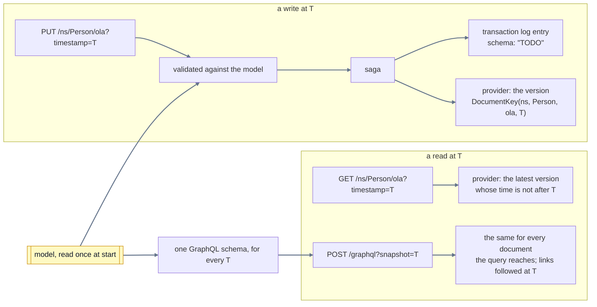

# The architecture of Linked Data Store

This document is the map of the code of Linked Data Store (LDS): the modules and how they depend on each other,
the way a read and a write take through them, the ideas that hold the code together, the rules a change must keep,
and what is not finished. It is for a developer who is new to the code base. It does not hold the detail: each part
has a document of its own, listed at the end.

## What LDS is

LDS is a server that gives REST and GraphQL access to versioned, linked JSON documents. A document belongs to an
entity (a type of the model, such as `Person`) in a namespace and has an id. Its address is
`/{namespace}/{Entity}/{id}`. Every version of a document has a time from which it is valid, and a read gives the
document as it was at the time asked for. A link is a field that points at a document of another entity. The model
is read when LDS starts. These words are explained for a user in [the concepts](../user/concepts.md).

The code has some words of its own:

| In the code | Means |
|---|---|
| managed domain, `managedDomain` | An entity (`Specification.getManagedDomains`). |
| `MANAGED`, `EMBEDDED`, `REFERENCE` | The three kinds of resource (`ResourceType`): the whole document, a part of a document addressed by its path, and one link of a document. |
| `timestamp` (REST), `snapshot` (GraphQL and persistence) | The time a request asks for. |
| specification | The model as a tree (`Specification`, `SpecificationElement`). It says which fields a document has and which of them are links. |
| fragment | One leaf value (a value with nothing below it) of one version of one document. A text that is longer than the fragment capacity of the provider is several fragments. The memory and PostgreSQL providers store fragments. |
| bridge | `RxJsonPersistenceBridge`: turns a document into fragments for a write, and a stream of fragments into documents for a read. |
| saga log | Where a saga writes each of its steps, so that a saga that did not complete can be run again. |
| transaction log, `txlog` | A log that gets one entry for every write, before the write reaches the store. |

## The modules

LDS is one Maven reactor with the group `io.descoped.lds` and one version, `3.0.0-SNAPSHOT`. Every module with
code is a JPMS module, except the shared suite of tests for persistence providers (the TCK).

| Maven module | JPMS module | What it is for |
|---|---|---|
| `linked-data-store-persistence-provider-api` | `io.descoped.lds.persistence.api` | The contract between LDS and a store: `RxJsonPersistence` (documents), `RxPersistence` (fragments), the bridge, `PersistenceInitializer` (how a provider is found) and `Specification`. |
| `linked-data-store-persistence-provider-tck` | none (class path) | The shared suite: `PersistenceIntegrationTest`, the 32 tests every persistence provider must pass. |
| `linked-data-store-persistence-provider-memory` | `io.descoped.lds.persistence.memory` | Provider `mem`: fragments in sorted maps in the memory of the process. For tests and for trying LDS. |
| `linked-data-store-persistence-provider-postgres` | `io.descoped.lds.persistence.postgres` | Provider `postgres`: fragments as rows of one table, `fragment`. |
| `linked-data-store-persistence-provider-neo4j` | `io.descoped.lds.persistence.neo4j` | Provider `neo4j`: a document as a tree of nodes in a graph, a link as a relationship. |
| `linked-data-store-search-provider-api` | `io.descoped.lds.search.api` | The contract between LDS and a search index: `SearchIndexProvider` and `SearchIndex`. |
| `linked-data-store-search-provider-solr` | `io.descoped.lds.search.provider.solr` | Provider `solr`: the index in one core of Apache Solr. |
| `linked-data-store-core` | `io.descoped.lds.core` | The application: `UndertowApplication`, the REST handlers, GraphQL, the model, the sagas and the transaction log. |
| `linked-data-store-server` | `io.descoped.lds.server` | What makes LDS something that can be started: the main class `Server`, the defaults of the configuration, the example model, the Dockerfile and the compose file. |
| `linked-data-store-bom` | none (packaging `pom`) | Manages the versions of the modules above, and nothing else. |
| `linked-data-store-loadtest` | `io.descoped.lds.loadtest` | The load test, run by hand: scripts and a compose file that start LDS from the image of the server and drive a load at it, and the program that turns the results into plots. Not in the BOM and not released. |

### How the modules depend on each other

- The persistence API depends on no LDS module. It exposes RxJava 3 and Jackson 3 (`requires transitive`).
- The shared suite and the memory, PostgreSQL and Neo4j providers depend on the persistence API. Each of the
  three providers also depends on the shared suite, for its tests only.
- The search API depends on the persistence API, because an index is given a `JsonDocument` and answers with
  `DocumentKey`.
- The Solr provider depends on the search API and the persistence API.
- Core depends on the persistence API and the search API, and on no provider. Its tests use the memory provider.
- The server depends on core. At run time it adds every provider: memory, PostgreSQL, Neo4j and Solr, and the saga
  log and the transaction log in PostgreSQL (`sagalog-postgres`, `rawdata-client-provider-postgres`).

So the code of core never names a provider, and a provider exports no package. The server module is the one place
where core and the providers meet, and they meet on the class path, not in code.

Core uses these libraries as they are: Undertow for HTTP, graphql-java for GraphQL,
`com.networknt:json-schema-validator` for validation, `no.cantara.saga` for sagas and the saga log,
`io.descoped.rawdata` for the transaction log, and `io.descoped.config:dynamic-configuration` for the configuration.
Library versions are properties of the root `pom.xml`.

## How the parts are put together at start

`Server.main` builds the configuration and calls `UndertowApplication.initializeUndertowApplication`. It builds
the parts in a fixed order and gives each part the earlier ones: the model, the persistence provider, the saga
log, the search index, the transaction log, the sagas with their thread pools, and last, in the constructor of
`UndertowApplication`, the HTTP handlers. `UndertowApplication.start` then opens the port. The log of a start
shows the order. The commands of this document were run in a folder with every jar of LDS in `lib` and the example
model in `schemas/schema.graphql`; [the server](server.md) says how to start LDS from a build. Each log line
is shown from its message on, and the lines between them are left out.

```sh
LDS_HTTP_PORT=19308 java -cp "lib/*" io.descoped.lds.server.Server
```

```
Initializing specification ...
Managed domains: /Company /Person
Using persistence provider: mem
Using saga-log-pool provider-class: no.cantara.sagalog.memory.MemorySagaLogInitializer
GraphQL Search is disabled. Skipping search index initialisation
Using transaction-log provider: discard
Initializing Http handlers ...
Listening on 0.0.0.0:19308
Server started in 421ms..
```

With the defaults of the server LDS runs in memory: the provider `mem`, a saga log in memory, a transaction log
that keeps nothing, and no search. LDS runs on the class path, also in the image.

## The path of a read

This is `GET /ns/Person/ola?timestamp=...` through the modules. The document it reads is written by the request
under [The path of a write](#the-path-of-a-write). Run that request first: on an empty LDS this read is answered 404.

1. **Undertow** takes the request. It passes the chain that the constructor of `UndertowApplication` builds:
   `CORSHandler`, then a `GracefulShutdownHandler` that answers 503 while LDS stops, then a `PathHandler`. The exact
   paths `/ping`, `/health/alive` and `/health/ready` have handlers of their own, and so have `/graphql` and
   `/graphiql` when `graphql.enabled` is true and the model is a GraphQL schema. Every other path goes to
   `NamespaceController`.
2. **`NamespaceController`** checks that the path begins with the namespace of `namespace.default` and hands the request
   to a new `DataController`. A path under `/source/` goes to `SourceHandler`, and any other path is answered 400.
3. **`DataController`** moves the request from the I/O thread to a worker thread of Undertow. It reads the time from
   `timestamp` (or `t`), takes the time now when there is none, and turns it into UTC.
   `ResourceContext.createResourceContext` then checks every name of the path against the specification and says which
   kind of resource the path is. A time it cannot read and a name the specification does not have are answered 400.
4. **The handler of that kind**, here `ManagedResourceHandler` (the others are `EmbeddedResourceHandler` and
   `ReferenceResourceHandler`), opens a read-only transaction and calls
   `RxJsonPersistence.readDocument(tx, time, namespace, entity, id)`. This call crosses from core into the provider.
5. **The provider** gives a `Maybe<JsonDocument>`: the version that is valid at the time.
   - Memory and PostgreSQL: `RxJsonPersistenceBridge.readDocument` asks `RxPersistence.read`
     (`MemoryRxPersistence`, `PostgresPersistence`) for the fragments of that version. `toDocuments` cuts the stream
     of fragments into documents with `RxGroupByTools.groupByOrdered`, and `FlattenedDocumentToJson` builds the tree.
   - Neo4j: `Neo4jPersistence.readDocument` runs one Cypher statement, and `toDocument` builds the document from
     the record.
6. **The handler** waits for the document (`blockingGet`), writes it as JSON, and the transaction is closed. No
   document at that time, or a deleted one, is answered 404.

```sh
curl -i 'http://localhost:19308/ns/Person/ola?timestamp=2021-06-01T00:00:00Z'
```

```
HTTP/1.1 200 OK
Content-Type: application/json; charset=utf-8
...

{
  "employer": "/Company/acme",
  "name": "Ola"
}
```

A read through GraphQL takes another way to step 5. `GraphqlHttpHandler` moves the request to a worker thread and
reads the query. `GraphQLUndertowContext` works out the time, here called the snapshot: the parameter `snapshot`,
the variable `__snapshot`, or now. graphql-java executes the query against the schema that
`GraphQLSchemaBuilder` built at start. A field that needs documents has a fetcher (package
`io.descoped.lds.graphql.fetcher`), which calls the same `RxJsonPersistence` as REST, with the snapshot, and waits
for the answer. GraphQL only reads: there is no mutation. No handler, REST or GraphQL, asks who the caller is,
and the listener is plain HTTP.

## The path of a write

This is `PUT /ns/Person/ola?timestamp=...` with the document as the body. The request first takes steps 1 to 3
of a read. The steps below follow them.

1. **`ManagedResourceHandler.putManaged`** reads the body with `BodyParser` into a Jackson tree.
2. **`LinkedDocumentValidator`** validates the document: first with the JSON Schema of the entity, then every link.
   A link must name an entity its field may link to. Whether the target exists is not checked. A document that is
   not valid is answered 400, and no saga is started. The body `{"name":7}` was answered
   `Schema validation error: [$.name: integer found, string expected]`.
3. The handler makes a **`SagaInput`**: a new transaction id, the method, the namespace, the entity, the id, the time
   as the version, and the document. It takes the saga `Create or update managed resource` from `SagaRepository`.
4. **`SagaExecutionCoordinator.handoff`** takes a saga log from the pool and starts the saga on the saga thread pool.
   The saga library writes the saga input to the saga log before the first step runs.
5. Step `txlog`: **`AppendTxLogAdapter`** writes the entry (`TxLogTools`, MessagePack) to the transaction log through
   `TxlogRawdataPool`.
6. Step `persistence`: **`PersistenceCreateOrOverwriteSagaAdapter`** calls `RxJsonPersistence.createOrOverwrite` in a
   transaction of its own and waits for it. In the memory and PostgreSQL providers the bridge flattens the document
   into fragments (`JsonToFlattenedDocument`) and gives them to `RxPersistence.createOrOverwrite`. In Neo4j
   `Neo4jDocumentWriter` makes the statement and its parameters.
7. Step `search-index-update`, only when search is on: **`UpdateIndexSagaAdapter`** calls
   `SearchIndex.createOrOverwrite`. It follows `txlog`, side by side with `persistence`.
8. When the saga has completed, the coordinator gives the saga log back to the pool. It truncates the log first
   when the saga succeeded. The log of a saga that failed keeps its entries.
9. The handler waits for the future of `handoff` (`join`) and answers with the transaction id (`saga-execution-id`).

```sh
curl -i -X PUT 'http://localhost:19308/ns/Person/ola?timestamp=2020-01-01T00:00:00Z' \
     -H 'Content-Type: application/json' \
     -d '{
       "name": "Ola",
       "employer": "/Company/acme"
     }'
```

```
HTTP/1.1 201 Created
Content-Type: application/json
...

{"saga-execution-id": "01a1f9cf-eb7e-7e14-925d-370c74a909fb"}
```

Every write ends in this saga, also a write of a part of a document or of a link: the handler reads the document
as it is at the time of the request, makes the change in it, and writes the whole document as a new version. The
delete of a whole document has a saga of its own, `Delete managed resource`. Its `persistence` step removes
nothing: it writes a deletion marker (`RxJsonPersistence.markDocumentDeleted`), a version that says the document
is not there from that time on.

## The ideas that hold the code together

### Streaming on RxJava 3

The persistence interface is reactive. A read of one document gives a `Maybe`, a read of many a `Flowable`, a
write a `Completable`, and a provider reads its store only as far as the reader asks.

- PostgreSQL: a read is one statement, and its rows are fetched as they are asked for (`ResultSetPublisher`).
- Memory: the entries of the sorted map are given on demand (`AsyncIterablePublisher`).
- Neo4j: a read is one statement that returns one record for each document, and a record is taken from the driver
  when a document is asked for (`Neo4jTransaction.executeCypherAsync`).
- The bridge: `RxGroupByTools.groupByOrdered` cuts one ordered stream of fragments into documents and asks the
  source for more only when the next document is asked for.

The two publishers are checked with the Reactive Streams TCK. The rule for a change: a stream is not replaced by a
call that returns a complete list, and no blocking call is added to an interface.

Not finished: the stream does not reach the answer. The REST handlers and the GraphQL fetchers wait for the
stream on a worker thread (`blockingGet`, `blockingIterable`, `toList().blockingGet()`) and build the whole answer
in memory before it is sent. For a list the bridge asks the provider for the list without its limit and sorts
every fragment before it gives the first document. See [the persistence interface](persistence-api.md) and
[the REST handlers](core-rest.md).

### The time machine

One version of one document is one `DocumentKey`: namespace, entity, id and the time the version is valid from.
The time comes in at the edge (`DataController` for REST, `GraphQLUndertowContext` for GraphQL) and goes with every
call to the provider. There is no "current" document in a store:

- A read at a time gives the latest version whose time is not after it. Without a time, the time is now.
- A write makes the version that is valid from the time of the request. The time may be in the past or in the
  future. A write at the time of a version that exists replaces that version, which makes a write with a
  `timestamp` safe to send again.
- A delete writes a deletion marker. Earlier versions stay and can be read at their times.
- A link is the text `/Entity/id` in a field. No write checks that the target exists, so a link may point at a
  document that is written later. A link is followed at the time of the read.



The model is not on the timeline. `SagaInput` has a field `schema`, which goes into the transaction log with every
write, and every handler gives it the text `TODO`; nothing else records which model a version was written under.
[Concepts](../user/concepts.md#snapshots-the-time-machine) draws snapshots as a user sees them.

The example below follows the write of [The path of a write](#the-path-of-a-write) with two more: the company `acme`,
and a second version of `ola` with a link to `/Company/later`, which does not exist. Each is answered as the write of
[The path of a write](#the-path-of-a-write). Then the same GraphQL query is asked twice, as of a time in 2021 and as of
now. The second block has the answers of the queries.

```sh
curl -X PUT 'http://localhost:19308/ns/Company/acme?timestamp=2020-01-01T00:00:00Z' \
     -H 'Content-Type: application/json' -d '{"name": "Acme"}'
curl -X PUT 'http://localhost:19308/ns/Person/ola?timestamp=2022-01-01T00:00:00Z' \
     -H 'Content-Type: application/json' \
     -d '{
       "name": "Ola Nordmann",
       "employer": "/Company/later"
     }'
curl 'http://localhost:19308/graphql?snapshot=2021-06-01T00:00:00Z' -H 'Content-Type: application/graphql' \
     -d '{
       PersonById(id: "ola") {
         name
         employer {
           name
         }
       }
     }'
curl 'http://localhost:19308/graphql' -H 'Content-Type: application/graphql' \
     -d '{
       PersonById(id: "ola") {
         name
         employer {
           name
         }
       }
     }'
```

```json
{
  "data": {
    "PersonById": {
      "name": "Ola",
      "employer": {"name": "Acme"}
    }
  }
}

{
  "data": {
    "PersonById": {"name": "Ola Nordmann", "employer": null}
  }
}
```

### Providers found as services

Core finds its stores as services (`java.util.ServiceLoader`), each by a name in the configuration:

- the persistence provider: `PersistenceConfigurator`, service `PersistenceInitializer`, key `persistence.provider`
  (`mem`, `postgres`, `neo4j`);
- the search provider: `SearchIndexConfigurator`, service `SearchIndexProvider`, key `search.index.provider`
  (`solr`), only when `graphql.search.enabled` is true;
- the saga log: `UndertowApplication.configureSagaLogProvider`, service `SagaLogInitializer` of the saga library,
  key `sagalog.provider`, which holds the name of the class;
- the transaction log: `UndertowApplication.configureTxLogRawdataClient`, found by `RawdataClient.create` of the
  rawdata library, key `txlog.rawdata.provider`.

A provider is registered in two places: `provides` in its `module-info.java`, and a file in `META-INF/services`
that names the class (`MemoryInitializer` for the memory provider). LDS runs on the class path, so the file is the
one that is read.

Every provider of persistence must pass the same suite, `PersistenceIntegrationTest`, against the real engine. A
new provider is a new module that depends on the API, registers its service and extends the suite. Core does not
change. The server module adds the provider to its class path and the keys of the provider to its defaults,
because an environment variable sets only a key that a file has.

### The saga of a write

A write changes more than one store: the transaction log, the persistence provider and, when search is on, the
index. There is no transaction over all of them. A saga runs the steps in order and writes each step to a saga
log. When a saga does not complete, its saga log keeps what it did, and recovery runs it again from there: by the
next write that is handed that log and, when `saga.recovery.enabled` is true, at start and by a timer
(`SagaRecoveryTrigger`). So every step must be safe to run more than once with the same input. No step has an
action that undoes it.

`SagaRepository` is the only place that says which steps a write has. `SagaExecutionCoordinator` starts, tracks
and recovers sagas. The parameter `sync` of a request says whether the answer waits for the saga to complete or
only for the saga to be in its log. `UndertowApplication.stop` lets the running sagas complete before their
thread pool, the saga log pool and the stores are closed.

Several LDS can share one saga log in PostgreSQL. They are a cluster: the same `sagalog.config.cluster.owner` and
`sagalog.config.cluster.name`, and an own `sagalog.config.cluster.instance-id` for each. The timer of each then
also recovers the unfinished sagas of the others (`SagaExecutionCoordinator.completeClusterWideIncompleteSagas`;
`SagaLogPostgresTest` holds it). The saga log is the one place where the code of core knows of a cluster.
[The write path](core-write-path.md) has the detail.

### The threads

A request comes in on an I/O thread of Undertow. A handler that calls a store first moves the request to a
worker thread of Undertow, and waits there for the stream of the provider. A saga runs on the saga thread pool
(threads `sec-1`, `sec-2`, ...), and the handler waits for it or not, as `sync` says. Recovery runs on a pool of
its own (`saga-recovery-1`, ...). The thread `saga-observer` waits for every saga to end and logs one that
failed. The memory provider has a pool of 8 threads (`Memory-Pool-Thread-N`). The name of the thread is in every
line of the log. [The application](core-application.md) says how the pools are built and stopped.

### The model read at start

LDS knows nothing about its documents until it has read the model: the GraphQL schema named in `graphql.schema`,
or, when that key is empty, the JSON Schema 2020-12 files named in `specification.schema`.
`initializeUndertowApplication` reads it first, before anything else is built. Three things are made from it:

- a JSON Schema for every entity (`GraphQLToJsonConverter` writes it from a GraphQL schema, `JsonSchemaBuilder`
  reads it), with which `LinkedDocumentValidator` validates a document before a write;
- the specification (`JsonSchemaBasedSpecification`), which the REST paths, the link check and the providers
  read. A provider is given the names of the entities at start. With a write it is given the specification, and
  the one thing it takes from it is which fields are links;
- the GraphQL schema that is served (`GraphQLSchemaBuilder`), only when the model is a GraphQL schema and
  `graphql.enabled` is true: two queries for every entity (one document by its id, and a page of documents), a
  field for every link in both directions, and the fetchers. The constructor of `UndertowApplication` builds it,
  from the same file.

A provider stores a document as it is given and gives it back the same. Whether a document may be written is
decided by the validation before the saga, not by the store.

## The invariants

These rules are the invariants of `.claude/CLAUDE.md`, which has the full text. A change keeps them.

- **JDK 27.** LDS is built, tested and run on one JDK (`java.version` in the root POM, the workflows, the image).
- **No compatibility code.** Nothing is released, so there are no shims, deprecated aliases or migrations.
- **One reactor, one version.** Modules depend on each other with `${project.version}`. Versions of libraries are
  properties in the root POM, so the BOM manages the LDS modules only.
- **JPMS.** LDS modules are named modules. A module whose exported API exposes the types of another module
  `requires transitive` it. A provider is registered with `provides` and in `META-INF/services`.
- **Lint and Javadoc.** `-Xlint:all -Werror` and doclint `all`. A module that is not clean overrides them with the
  exact categories, and the override is removed, not widened.
- **One persistence contract for every provider**: the reactive interface, checked by the shared suite against the
  real engine in a container.
- **No spliced identifiers.** Names of entities, fields, namespaces and topics, and search text, are validated and
  never joined into SQL, Cypher, a Solr query, a key or a file path.
- **Time.** Versions are stored and compared as UTC instants.
- **Transactions** commit only when asked and roll back otherwise.
- **The latest stable version** of every library, plugin, action, image and engine. One version is held:
  PostgreSQL stays at 18.
- **No leftovers**: no configuration for Azure Pipelines, Travis, Drone or OSSRH, which LDS does not use.
- **Secrets.** Nothing but the documented development defaults of the tests and the compose file.
- **CI publishes nothing**: no SNAPSHOTs, no releases, no images. A release is made by hand, when the owner says so.
- **SonarCloud**: one project, `descoped_linked-data-store-project`, for the whole reactor.

`.claude/CLAUDE.md` has more rules of the same weight outside that list. Three of them touch every part. A stream stays
a stream (see [Streaming on RxJava 3](#streaming-on-rxjava-3)). The GraphQL schema is built with the walk of LDS
(`TypeTraverser`, `TypeCollectingVisitor`, `SchemaElements`), not with the `SchemaTraverser` of graphql-java, which
walks in another order. LDS runs on the class path, with `java` as the process of the container.

Not finished: some invariants are not met everywhere. `Transaction.close()` commits. The memory provider does not
store a time as an instant, and GraphQL does not turn the snapshot into UTC. The Solr provider joins the search
text into its query. The Neo4j provider writes the name of an entity into Cypher as a quoted label and does not
validate it. The shared suite is not a named module. `.claude/CLAUDE.md` also says that the module that defines a
service interface declares `uses` for it; in the code core declares `uses`, and the two API modules do not.

## Not finished

Not finished: LDS 3.0 is in development and nothing is released. These are the large items. Every document below
has its own list.

- **Streaming ends in the handlers** (see [Streaming on RxJava 3](#streaming-on-rxjava-3)), and lists over REST are not
  paged: [the persistence interface](persistence-api.md), [the REST handlers](core-rest.md).
- **One namespace over HTTP.** The stores keep a namespace with every document, but LDS answers for the one in
  `namespace.default`: [the application](core-application.md).
- **A start that fails late leaves the process running** without an open port:
  [the application](core-application.md), [the server](server.md).
- **A failed saga is answered 500 with no body**, and the caller cannot tell whether recovery will do the write.
  `sync` has one default for a document and another for a part and a link: [the write path](core-write-path.md).
- **Two writes to parts or links of one document at the same time lose changes**: [the REST handlers](core-rest.md).
- **A transaction that is closed commits**, also after a failure in its block. **No provider reads the delete
  policy** that core passes (`FAIL_IF_INCOMING_LINKS`): [the persistence interface](persistence-api.md).
- **A single field of an embedded type** of a GraphQL schema gets no content in the JSON Schema, so it is not
  validated and has no path: [the model](core-model.md).
- **Search** finds a document by the texts of its fields named `languageText` only, and what search covers is under
  review: [search](search.md).
- **The memory provider has known faults**, one of which can stop every read and write:
  [the memory provider](persistence-memory.md).
- **Six modules still override the lint or the Javadoc rule** (core, the persistence API, the memory provider, the
  shared suite and the two search modules), and 13 tests of core are disabled: [the build](build.md).

## Where to read next

- [The persistence interface](persistence-api.md):
  Read this first. The two interfaces, fragments, how the bridge cuts a stream into documents, versions and time,
  deletion markers, transactions, and how a provider is found.
- [The shared suite](persistence-tck.md):
  The 32 tests of `PersistenceIntegrationTest`, written as the contract a provider meets, and how a provider module
  extends the suite. Read it before a provider is changed or added.
- [The memory provider](persistence-memory.md):
  The two sorted maps and their keys, the lock, `AsyncIterablePublisher`, and the faults of the provider. LDS runs
  on it when nothing is configured, and so do the tests of core.
- [The PostgreSQL provider](persistence-postgres.md):
  The table `fragment`, the one statement of each read, rows on demand with `ResultSetPublisher`, the connection
  pool, and why PostgreSQL is held at 18.
- [The Neo4j provider](persistence-neo4j.md):
  How a document is laid out as a graph, the constraints and indexes, the statements that write and read, records
  on demand, and how the name of an entity gets into Cypher.
- [Search](search.md):
  The search interface, how core calls the index from a saga and from the GraphQL field `Search`, and what the Solr
  provider puts in the index and asks of it.
- [The application](core-application.md):
  `UndertowApplication`: the order in which the parts are built, how providers are found and tried again at start,
  the HTTP handler chain and its paths, CORS, the order of a stop, and the configuration keys of core.
- [The REST handlers](core-rest.md):
  From a request path to a resource (`ResourceContext`), the three handlers and what each method does, validation,
  the body of a request, and where every error answer comes from.
- [The write path](core-write-path.md):
  The two sagas and their adapters, the saga input, what `sync` waits for, the thread pools and their limits, the
  saga log, recovery, and the transaction log with its topics and sources.
- [The model](core-model.md):
  Which model is read, how a GraphQL schema becomes JSON Schema, how the specification is built, the validation of a
  document, and what `?schema` gives out.
- [GraphQL](core-graphql.md):
  How the served schema is built from the schema file in a fixed order of passes, why LDS has its own walk over a
  schema, how a request is read, the time of a query, which fetcher a field gets, pages and search.
- [The server](server.md):
  The main class, the order of the sources of the configuration, the rules for environment variables, every key of
  the server defaults, logging, the image, the compose file and the two tests of the image.
- [The build](build.md):
  The reactor and the module descriptors, what a build does in order, the rules it enforces, the Maven wrapper, how
  the tests run with their containers, CI, Renovate, and how a release would be made.
- [The load test](loadtest.md):
  What a run of the load test does step by step, its containers, the program that makes the plots, and the faults
  of LDS it has found.
