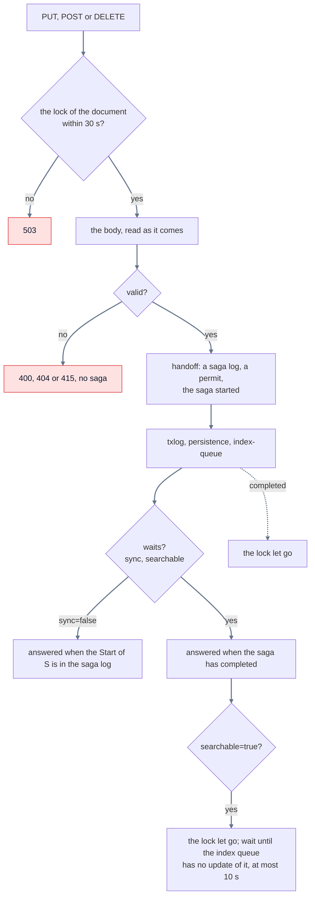

# Core: the write path

This document covers how `linked-data-store-core` carries a write: the lock of the document, the
[saga](../glossary.md#saga) of a write and of a delete and its steps, how the request is answered without a thread
that waits, the [saga log](../glossary.md#saga-log), the [recovery](../glossary.md#saga-recovery) of an unfinished
saga, the step of the [index queue](../glossary.md#index-queue), and the
[transaction log](../glossary.md#transaction-log). It is for developers and maintainers who change this code. The
saga engine itself (what a saga is, the saga log providers, the cluster, the threads, the stop) is in
[the saga engine](saga.md). What a write may contain and how a request is addressed is in
[the REST API of documents](core-rest.md). How the application is built, started and stopped as a whole is in
[the application](core-application.md).

## What this part is for

Every write of the HTTP API changes more than one store: the transaction log, the persistence provider and, when
search is on, the index queue. A saga carries the write through these stores one step at a time and writes each step
to a saga log. When a saga does not complete, the saga log holds what it did, and the saga is run again from there.

LDS uses two libraries for this as they are:

- `no.cantara.saga` 2.2.0 (`saga-api`, `saga-execution`, `sagalog-api`, `sagalog-postgres`) and
  `no.cantara.concurrent.futureselector:future-selector` of the same version: the saga as a graph of steps, its
  execution on a thread pool, and the saga log ([the saga engine](saga.md)).
- `io.descoped.rawdata` 3.1.0 (`rawdata-client-api`, `rawdata-client-provider-postgres`): the transaction log, as
  topics of messages.

## Where the code is

All of it is in `linked-data-store-core`.

| Class | Responsible for |
|---|---|
| `io.descoped.lds.core.controller.DataController` | Takes the [document lock](../glossary.md#document-lock) of a write before the handler runs, and gives a write without a `timestamp` its version. |
| `io.descoped.lds.core.domain.DocumentLocks` | The locks of the documents: one write at a time to a document in this LDS, waited for as a future. |
| `io.descoped.lds.core.domain.AsyncAnswer` | Reads the body of a request as it comes, and answers a write when its saga, and its wait for search, have completed. |
| `io.descoped.lds.core.domain.SyncParameter` | Whether a write is answered when it is done: the query parameter `sync`. |
| `io.descoped.lds.core.domain.SearchWait` | The wait of a [searchable write](../glossary.md#searchable-write) (`searchable=true`), and the header `LDS-Searchable`. |
| `io.descoped.lds.core.domain.managed.ManagedResourceHandler`, `...embedded.EmbeddedResourceHandler`, `...reference.ReferenceResourceHandler` | The callers. Each builds a `SagaInput`, calls `SagaExecutionCoordinator.handoff` and answers through `AsyncAnswer`. |
| `io.descoped.lds.core.saga.SagaRepository` | Builds the two sagas and registers their adapters. The only place that says which steps a write has. |
| `io.descoped.lds.core.saga.SagaInput` | The input of a saga: one JSON object with everything a step needs. The same object is the Start entry of the saga log and the source of an entry of the transaction log. |
| `io.descoped.lds.core.saga.SagaExecutionCoordinator` | Starts a saga (`handoff`), gives it a saga log and a permit, releases both when it completes, recovers unfinished sagas, waits for running sagas at stop, and holds the watchdog of the thread pool. |
| `io.descoped.lds.core.saga.SagaRecoveryTrigger` | The timer that asks the coordinator to recover the unfinished sagas of the whole cluster. |
| `io.descoped.lds.core.saga.SagasObserver` | One thread that logs the outcome of every saga. |
| `io.descoped.lds.core.saga.SagaCommands`, `SagaCommand` | Read the `saga` query parameter, with which a test makes a step fail. |
| `io.descoped.lds.core.txlog.AppendTxLogAdapter`, `DeleteTxLogAdapter` | The step that writes the entry of the transaction log. |
| `io.descoped.lds.core.txlog.TxlogRawdataPool` | The rawdata client of the transaction log, the name of the topic of a source, and one producer for each topic. |
| `io.descoped.lds.core.txlog.TxLogTools` | Makes an entry of the transaction log from a saga input, and back. MessagePack. |
| `io.descoped.lds.core.persistence.PersistenceCreateOrOverwriteSagaAdapter`, `PersistenceDeleteSagaAdapter` | The step that writes to the persistence provider. |
| `io.descoped.lds.core.persistence.WriteTransaction` | The transaction of that step: committed when the write completed, cancelled otherwise. |
| `io.descoped.lds.core.search.UpdateIndexSagaAdapter`, `DeleteIndexSagaAdapter` | The step that adds the update to the index queue. |
| `io.descoped.lds.core.search.IndexQueueConfigurator` | Makes the index queue where the transaction log is kept. |
| `io.descoped.lds.core.controller.SourceHandler` | `GET /source/{source}`: the `sourceId` of the last entry of the transaction log of a source. |
| `io.descoped.lds.core.UndertowApplication` | Makes all of the above from the configuration (`initializeUndertowApplication`, `configureSagaLogProvider`, `configureTxLogRawdataClient`), each as a [lifecycle](../glossary.md#lifecycle) (`sagas` for the sagas). |

`module-info.java` of core requires `no.cantara.saga.api`, `no.cantara.saga.execution`, `no.cantara.sagalog`,
`no.cantara.concurrent.futureselector`, `io.descoped.rawdata.api` and `jackson.dataformat.msgpack`, and declares
`uses no.cantara.sagalog.SagaLogInitializer` and `uses io.descoped.lds.api.search.IndexQueueProvider`. Core has
`sagalog-postgres`, `sagalog-file` and `rawdata-client-provider-postgres` in test scope only.
`linked-data-store-server` adds `sagalog-postgres`, `rawdata-client-provider-postgres` and the index queue in
PostgreSQL (`linked-data-store-index-queue-postgres`) at run time, so those are the providers a server can be
configured with.

## The two sagas

`SagaRepository` builds two sagas when LDS starts. A saga is a graph that starts in the step `S` and ends in the step
`E`; both belong to the engine. The steps of LDS follow one another.

| Saga name | Used for | Steps |
|---|---|---|
| `Create or update managed resource` | A write of a document, of a part of a document, and of a link. Also the removal of a part or of a link: the document is written again without it. | `S`, `txlog`, `persistence`, `index-queue`, `E` |
| `Delete managed resource` | A delete of a document. | `S`, `txlog`, `persistence`, `index-queue`, `E` |

1. `txlog`: the entry is written to the transaction log.
2. `persistence`: the version is written to the store. It starts when `txlog` has ended.
3. `index-queue`: the update is added to the index queue. It starts when `persistence` has ended, so the queue holds
   only versions the store has.

The step `index-queue` is in the saga only when `graphql.search.enabled` is `true` and
`SearchIndexConfigurator.configureSearchIndex` gives a search index. Without it `persistence` is followed by `E`. The
tests of core run their sagas with the step (`graphql.search.enabled=true` and `search.index.provider=testSearchIndex`
in `application_test.properties`). [The saga engine](saga.md#the-saga-of-a-write) draws the saga.

The name of a saga and the ids of its steps are written to the saga log. Recovery finds the saga by the name in the
Start entry (`SagaRepository.get`). When the name of a saga is changed, recovery fails for what an earlier build left
in a saga log. When the id of a step is changed, recovery finds no entry for the step and runs it again.

### The adapters

A step names an adapter (`SagaNode.adapter`), and the adapter does the work (`executeAction`). All adapters are
registered by name in one `AdapterLoader` in the `SagaRepository` constructor; the two of the index queue only with
search. The name of an adapter is not written to the saga log.

| Step | Adapter (class, name) | What it does |
|---|---|---|
| `txlog` | `AppendTxLogAdapter`, `TxLog-put-entry`; `DeleteTxLogAdapter`, `TxLog-delete-entry` | Both do the same: `TxlogRawdataPool.producer(source).publish(TxLogTools.sagaInputToTxEntry(input))`. |
| `persistence` of a write | `PersistenceCreateOrOverwriteSagaAdapter`, `Persistence-Create-or-Overwrite` | `RxJsonPersistence.createOrOverwrite` with the document of the input, in a transaction of its own (`WriteTransaction`): it waits for the write, commits the transaction when the write completed, and cancels it when it failed, so nothing of a failed write is kept. Any failure is thrown as `AbortSagaException`. |
| `persistence` of a delete | `PersistenceDeleteSagaAdapter`, `Persistence-Delete` | `RxJsonPersistence.markDocumentDeleted`, which writes a [tombstone](../glossary.md#tombstone), with `PersistenceDeletePolicy.FAIL_IF_INCOMING_LINKS`, in a transaction of its own (`WriteTransaction`). A failure is thrown as it is. No provider reads the policy: run with the memory provider, a document that another document links to was deleted and answered `204`. |
| `index-queue` of a write | `UpdateIndexSagaAdapter`, `Persistence-Index-Create-or-Overwrite` | `IndexQueue.add` with an `IndexUpdate` of the namespace, the entity type, the id and the version, `CREATE_OR_OVERWRITE`, and waits until the queue keeps it. |
| `index-queue` of a delete | `DeleteIndexSagaAdapter`, `Persistence-Index-Delete` | The same with `DELETE`. |

Every adapter returns `null`, and none has a compensating action. So nothing a step has done is undone when a later
step fails. An output that is `null` is not written to the End entry of the step and is read back as `null`.

Every step must be safe to run more than once with the same input, because recovery runs a step again when the saga
log does not say that it ended. [The saga engine](saga.md#the-limits-that-matter-to-lds) says how each step meets
this.

### The saga input

`SagaInput` wraps one JSON object. A handler makes it with the constructor that takes the transaction id, the
method, the schema, the `DocumentKey` of the version (namespace, entity type, id and valid time), `source`,
`sourceId` and the document; the fields below are made from them in this order.

| Field | Value |
|---|---|
| `txid` | The transaction id, from `SagaExecutionCoordinator.generateTxId`: a UUIDv7 (`RawdataIds.next`) that is greater than every id the coordinator of this server gave before. It is also the execution id of the saga and the id of the entry in the transaction log. |
| `method` | `PUT` or `DELETE`. `DELETE` only for the delete of a whole document. A write of a part or of a link, and the removal of one, is `PUT` with the whole document. |
| `schema` | The model the write was checked against. Always the text `TODO`; `SagaRecoveryTriggerTest` gives it `testng-schema-v1.0`, the name of a model version. Nothing reads it. |
| `namespace`, `entity`, `id` | The address of the document: its [document key](../glossary.md#document-key). |
| `version` | The [valid time](../glossary.md#valid-time) of the version, formatted with `DateTimeFormatter.ISO_ZONED_DATE_TIME` in the zone `Etc/UTC`, for example `2020-01-01T00:00:00Z[Etc/UTC]`. It is the `timestamp` of the request, or the time the write got the lock of its document (`DataController`). |
| `source`, `sourceId` | The query parameters of the same names. Left out when the request has none. |
| `data` | The whole document as it is to be stored. Left out for `DELETE`. |

The object is written to the saga log as JSON text in the Start entry of `S`, and recovery reads it back from there
(`startSagaForwardRecovery`). So a recovered saga writes the version and the document of the first request, not of
the time of the recovery.

## From a request to an answer

A write holds no thread while it waits: for its body, for the lock of its document, for its saga, or for search.



### The lock of a document

`DataController` asks for the lock of the document of every write (`PUT`, `POST`, `DELETE`) before the handler reads
anything, with the namespace, the entity type and the id of the path (`DocumentLocks.acquire`). The lock is held
from before the handler reads the document (a part or a link is merged into what is there) until the saga of the
write has completed, also when the request does not wait for its saga. So two writes of parts of one document do not
lose each other's change. A write that is answered before its saga starts (refused, or failed) lets the lock go when
it is answered.

- A write that waits for the lock is a future, completed by the write before it when that one lets the lock go, in
  the order the writes asked. When it has the lock, the request goes on on a worker thread of Undertow.
- A write waits at most 30 seconds. Then it is answered `503` with the text
  `The document is being written by another request. Try again.`, and the log says which document waited.
- A write without a `timestamp` gets its version when it has the lock: the time then, so it comes after the version
  of the write before it.
- The locks are striped: a document is hashed to one of 1024 locks, so two documents that share one are written one
  after the other.
- The lock is in this process only. Several LDS that write the same documents do not see each other's locks.

### The handoff

The handler validates the request, takes a transaction id (`sec.generateTxId()`), builds the `SagaInput` and calls
`SagaExecutionCoordinator.handoff(sync, adapterLoader, saga, sagaInput, commands, whenStarted)`. `handoff` does this,
in order, on the thread of the request:

1. **A saga log.** `acquireCleanSagaLog` asks the saga log pool for a log (`tryAcquire`) and waits at most 10 seconds.
   With none it throws `Timeout. No available saga-logs, please check configuration.` A log that holds entries is
   given to recovery (see [Recovery of an unfinished saga](#recovery-of-an-unfinished-saga)), and the coordinator asks
   for another. A log that comes back a second time with entries ends the attempt: `Unable to acquire clean
   saga-log.`
2. **The log is marked** as used by this execution in `executionIdBySagaLogId`. A log that is marked already fails
   the write.
3. **A permit.** `startSagaExecutionWithThrottling` takes a permit of a semaphore, and waits for one without a time
   limit.
4. **The saga is started** with `SagaExecution.executeSaga`. The engine hands the first step to the saga thread pool
   and returns.
5. **The saga is tracked**: its completion future is put in `runningSagas`, which `awaitRunningSagas` reads when the
   application stops, it is registered with the `SagasObserver`, and it is given to `whenStarted`, with which the
   handler keeps the lock of the document until the saga has completed (`DocumentLocks.holdUntil`).
6. **The future is returned**: the completion future when the write waits, the handoff future when it does not.

The owner of a saga log is kept with the log (`OwnedSagaLog`), because the pool releases a log for its owner only and
the release is done by another thread than the one that took it.

When the saga completes, the engine calls the `onComplete` function given to `executeSaga`, on the thread of the saga
thread pool that completed it, before it completes the completion future:

1. If the saga succeeded, the saga log is truncated, and the truncate is waited for.
2. The saga log is released (`releaseSagaLog`): its mark is removed and its ownership given back.
3. The permit is released.

A log is released only when its truncate has finished. Released earlier, the next saga would get the log with the
entries of this one, take them for an unfinished saga, and the late truncate would remove what the next saga wrote.
`SagaExecutionCoordinatorTest.thatASagaLogIsReleasedOnlyWhenItsTruncateHasFinished` holds this. The log and the
permit are released also when the truncate fails, and when the saga could not be started.

### The answer

`AsyncAnswer.afterSaga` keeps the request open (`dispatch` with `SameThreadExecutor`) and the handler returns. When
the future of `handoff` completes, and the wait for search when the request asked for it, the answer is sent from the
thread that completed it. A saga that failed, or an answer that could not be made, is logged
(`A write of /ns/... failed`) and answered `500` with no body; the lock is let go.

| `sync` | The answer is sent when |
|---|---|
| true (the default) | The completion future completes: every step has ended, the End entry of `E` is in the saga log, and `onComplete` has returned, so the saga log is truncated and released. The document can be read. |
| `false` | The handoff future completes: the Start entry of `S`, with the saga input, is in the saga log. The answer waits for no step: `txlog` and the steps after it run from this point on, and a failure of one of them is not told to the client. |

A write answered when its saga has completed is a [synchronous write](../glossary.md#synchronous-write): a read that
follows it sees the write (read-your-writes). A write answered at the hand-off is eventually consistent: a read that
follows at once may not see it yet. `SyncParameter.waits` reads the parameter the same way for every write: a write
waits unless a `sync` parameter is `false` (in any letter case), and always when it asks to be searchable. The
answers, run with the memory provider:

| Request | Answer |
|---|---|
| `PUT`, `POST` of a document (`ManagedResourceHandler.putManaged`) | `201` and `{"saga-execution-id":"<txid>"}`, with `sync` or without. |
| `DELETE` of a document (`ManagedResourceHandler.deleteManaged`) | `204` without a body when it waits, `202` and `{"saga-execution-id":"<txid>"}` when `sync=false`. The handler does not read the document first: a delete of a document that was never written is answered `204` as well. |
| `PUT`, `POST`, `DELETE` of a part of a document (`EmbeddedResourceHandler`) | `200` and `{"saga-execution-id":"<txid>"}`. `404` without a saga when the document is not there. |
| `PUT`, `POST` of a link (`ReferenceResourceHandler.putReferenceTo`) | `200` and `{"saga-execution-id":"<txid>"}`. `200` without a body and without a saga when the document has the link already. `404` without a saga when the document is not there. |
| `DELETE` of a link (`ReferenceResourceHandler.deleteReferenceTo`) | `200` without a body when it waits, `200` and `{"saga-execution-id":"<txid>"}` when `sync=false`. `200` without a body and without a saga when there is no such link. |

### A searchable write

A write with the query parameter `searchable=true` (in any letter case) is answered when a search finds it, or when
it has waited 10 seconds (`SearchWait`). It waits for its saga, whatever `sync` says. Then:

1. It lets the lock of its document go (`DocumentLocks.letGoAfterSaga`), so the next write of the document does not
   wait for its search.
2. It asks the index queue every 100 milliseconds whether it holds an update of the document (`IndexQueue.holds`),
   until it does not: the worker of the queue has sent every update of the document to the search index, whichever
   LDS of the ones that share the queue sent it.
3. It asks the search index to make what it has taken searchable (`SearchIndex.refresh`).
4. It is answered with the header `LDS-Searchable: true`, or `false` when the 10 seconds ran out or the index failed.
   The header is exposed to a browser by CORS.

The wait holds no thread. At most half as many writes as there are request threads wait at once (the request threads
are 8 for each I/O thread, and there is an I/O thread for each processor, two at least); a write past that is answered
when its saga has completed, with `LDS-Searchable: false`. Without search a write with `searchable=true` waits for its
saga and has no header. Run with search on Solr:

```sh
curl -s -i -X PUT 'http://localhost:19104/ns/Company/acme?searchable=true' \
     -H 'Content-Type: application/json' \
     -d '{
       "name": "Acme",
       "about": [{"languageCode": "en", "languageText": "We build bridges"}]
     }'
```

```http
HTTP/1.1 201 Created
LDS-Searchable: true
Content-Type: application/json
Content-Length: 60

{"saga-execution-id": "01a20fe2-3125-7b82-9f39-fd5bd7e1c5ed"}
```

A search for `bridge` right after it found `Acme`. [Search](search.md) has the index queue, its worker and the index.

### A saga that fails

A failure of a saga reaches `AsyncAnswer` as the failure of the future, and the write is answered `500` with an empty
body. This was run with `saga.commands.enabled=true` and one saga log (the command is at the end of
[Tests](#tests)):

```sh
curl -s -i -X PUT 'http://localhost:19104/ns/Person/f1?sync=true&saga=failBefore%20persistence' \
     -H 'Content-Type: application/json' -d '{"name": "F1"}'
```

```
HTTP/1.1 500 Internal Server Error
Connection: keep-alive
Content-Length: 0
...
```

The log of the server then has two errors with the same cause: `A write of /ns/Person/f1 failed` from `AsyncAnswer`,
and `Observed Saga failure during execution. Saga-name: "Create or update managed resource", executionId: "..."` from
`SagasObserver`.

The saga log of a failed saga is not truncated. It is released with its entries, and the saga is run again by
recovery. So after a `500` the write can still be done later:

```sh
curl -s -o /dev/null -w '%{http_code}\n' 'http://localhost:19104/ns/Person/f1'
curl -s -X PUT 'http://localhost:19104/ns/Person/n1?sync=true' \
     -H 'Content-Type: application/json' -d '{"name": "N1"}'
curl -s 'http://localhost:19104/ns/Person/f1'
```

```
404
{"saga-execution-id": "01a20fdf-281d-7129-b84f-f1c58cb8c764"}
{"name": "F1"}
```

The second write got the only saga log, found the entries of the first, and recovery completed the first saga
(`Started recovery of saga with sagaLog: ...`, `Recovery of saga succeeded, ...` in the log).

Two failures leave nothing to recover: one before the Start entry is written (the step `S` fails, or no saga log or
thread is to be had), and one where the request never becomes a saga (a validation error).

`PersistenceCreateOrOverwriteSagaAdapter` fails with `AbortSagaException`. The engine then rolls the saga back: with
no compensating actions this writes an Abort entry for the step and the end of the saga, and the saga has failed.
The coordinator treats it as any failed saga: the log keeps its entries, and recovery runs the `persistence` step
again.

## The thread pools and their limits

| Pool or limit | Size | Used for |
|---|---|---|
| Saga thread pool, threads `sec-N` | `saga.threadpool.core`, `saga.threadpool.max`, `saga.threadpool.keepalive.seconds`, a queue of `saga.threadpool.queue.capacity` | Every step of every saga, also of the sagas of recovery. A `SelectableThreadPoolExecutor` (a `ThreadPoolExecutor`) with an `ArrayBlockingQueue` and `AbortPolicy`. |
| Permits (`semaphore`) | `(saga.threadpool.max + saga.threadpool.queue.capacity) / 2` | The number of sagas started by writes that run at one time. Sagas of recovery take no permit. |
| Saga logs | `saga.number-of-logs` | A saga holds one log from its start to its end, so this is also a limit on the sagas that run at one time. |
| Document locks | 1024, a wait of 30 seconds | One write at a time to a document. |
| Searchable writes | half the request threads | The writes that wait for search at one time. |
| Recovery thread pool, threads `saga-recovery-N` | 10 (`SAGA_RECOVERY_THREADS`) | Starting the recovery of a saga log: by a write, at start and by the timer. |
| Recovery trigger, thread `saga-recovery-trigger-N` | 1 | The timer. |
| `saga-observer` | 1 | Logging outcomes. |
| `Saga-Threadpool-Watchdog` | 1 | See below. |

With the defaults of the server (`application-server-defaults.properties`: 30 logs, core 50, max 100, queue 10)
there are 55 permits and 30 saga logs, so the saga logs are the limit that is met first.

What happens when a limit is met:

- **The lock of the document is not free.** The write waits, holding no thread, at most 30 seconds, then is answered
  `503`.
- **No saga log is free.** The request waits at most 10 seconds on its worker thread, then fails with `Timeout. No
  available saga-logs, please check configuration.`, and the client gets `500`. Run with `saga.number-of-logs=0`: the
  answer came after 10.02 seconds.
- **No permit is free.** The request waits, without a time limit, on its worker thread.
- **The thread pool does not take a step** (the queue is full and `max` threads are busy, or the pool is shut down).
  The engine fails the saga with the `RejectedExecutionException` through its futures; `executeSaga` does not throw.
  The log and the permit are released
  (`SagaExecutionCoordinatorTest.thatASagaTheThreadPoolRefusesReleasesItsLogAndItsPermit`).

The rejection policy must stay one that does not run a task on the submitting thread: the engine rejects such a step
and fails the saga.

### The watchdog

A `ThreadPoolExecutor` starts a thread beyond `core` only when its queue is full. When every `core` thread runs a step
that hangs (a store or a log that does not answer) and the sagas behind them sit in a queue that is not full, they
wait with room in the pool. `initializeUndertowApplication` logs a warning when the queue is not smaller than `core`:

```
WARN  io.descoped.lds.core.UndertowApplication - Configuration: saga.threadpool.core (2) must be greater than
saga.threadpool.queue.capacity (2) in order to avoid potential deadlocks.
```

`SagaExecutionCoordinator.ThreadPoolWatchDog` looks at the pool every second. It sees a pool that is stuck when at
least one thread is active, every thread of the pool is active, the pool can still grow, and neither the number of
active threads nor the number of completed tasks has changed since the last look. It then submits
`(max - pool size) / 2 + free places in the queue` empty tasks, which fills the queue and makes the pool start
threads. `SagaExecutionCoordinatorWatchdogTest` provokes this. The engine holds no thread while a step waits for the
steps before it, so the pool gets stuck only by steps that hang.

The watchdog is not started by `UndertowApplication.start`. `Server.main` starts it after `start`, with
`enableSagaExecutionAutomaticDeadlockDetectionAndResolution`, and the lifecycle of the sagas stops it. A test that
needs it calls `sec.startThreadpoolWatchdog()`.

## The saga log

The providers, their storage and the names of the cluster are in [the saga engine](saga.md#the-saga-log). What LDS
does with them:

- `configureSagaLogProvider` takes the `SagaLogInitializer` whose class name is `sagalog.provider` and calls
  `initialize` with every key that starts with `sagalog.config.`, without that prefix. The initializer is looked for
  once. A class name that no initializer has ends LDS at once, with `java.util.NoSuchElementException: No value
  present` and exit code 1.
- Before `initialize`, a provider whose pool has connections (`connection-pool.max-size`, or the provider's default)
  is checked to have one for each saga log, one for each of the 10 recovery threads and one for its own queries
  (`checkSagaLogPool`). Too few end the start.
- A failure of `initialize` is tried again, with a wait of `sagalog.provider.initialization.retry-interval-seconds`
  give or take half, until `sagalog.provider.initialization.max-wait-seconds` have passed, whatever the failure is.
  With the defaults of the server that is 30 seconds, every 2 seconds.
- The `SagaExecutionCoordinator` constructor registers `saga.number-of-logs` logs for this instance, named `00`,
  `01` and so on (`String.format("%02d", i)`), and makes the id of one more, `dead-saga`, which it does not register.

The owner of the cluster defaults to `lds` in core, a name the saga log in PostgreSQL takes as its schema; the
compose file of the server sets `development`.

## Recovery of an unfinished saga

A saga log that holds entries holds a saga that did not complete: the server ended in the middle of it, or the saga
failed. Recovery runs such a saga again from its entries (forward recovery). There are three occasions.

| When | Which logs | Started by |
|---|---|---|
| The next write that is handed the log | The one log | `recursiveAcquireCleanSagaLog`, always, also with `saga.recovery.enabled=false`. The recovery runs on the recovery thread pool (`asyncAttemptForwardRecoveryOrElseMoveToDeadLetter`), and the write goes on to ask for another log. The pool hands out its free logs in turn, and a released log is the last in the line, so with more than one log this is not the write that follows the failure. |
| When LDS starts | The logs of this instance | The lifecycle `Sagas` calls `completeLocalIncompleteSagas`, only when `saga.recovery.enabled` is `true`. |
| Again and again | The logs of the cluster, without `dead-saga` | `SagaRecoveryTrigger`, only when `saga.recovery.enabled` is `true`. It is started when the recovery at start is done, and calls `completeClusterWideIncompleteSagas`. After each pass it waits a random number of seconds from `saga.recovery.interval.seconds.min` to `saga.recovery.interval.seconds.max`. Both must be from 1 to 86400, and the max not less than the min. |

What recovery of one log does (`doCompleteSagaLog`, `startSagaForwardRecovery`):

1. It reads every entry and groups the entries by execution id.
2. For each execution it takes the Start entry of `S`: the name of the saga and the saga input. A log without one, or
   with a saga that the `SagaRepository` does not have, fails the recovery.
3. It runs the saga with `executeSaga(..., recovery = true, ...)`, on the saga thread pool. The engine skips a step
   whose last entry says it ended and runs every other step.
4. When every saga of the log has succeeded, the log is truncated.

The recovered sagas are tracked and observed as any saga. They take no permit and no document lock.

What follows a recovery that fails depends on who started it:

- **Started by a write.** Every entry of the log is copied to the [dead-saga log](../glossary.md#dead-saga-log) of the
  instance, and the log is truncated and released. The write that found the log goes on. The log says `Failed to
  retry saga-executions from saga-log ..., moving all entries to dead-saga-log.` and `Moved all saga-log-entries from
  ... to ...`.
- **Started at start or by the timer.** The log is released with its entries, and the failure is logged (`Error during
  initial local saga-logs recovery attempt`, `Error while attempting to run cluster-wide saga recovery`). The next
  pass, or the next write, meets the same entries. Run with one saga log, the timer at one second and a saga that
  cannot complete: the error was logged on each pass, four times in four seconds, and nothing was moved to the
  `dead-saga` log. The next write moved it.

A log of another instance (cluster-wide recovery only) is taken only when no other process holds it. When it is empty,
or when its sagas are recovered, it is removed from the pool of this instance and deleted from the store
(`sagaLogPool.delete`). A log that this instance could not take or could not complete is removed from its pool and
left in the store. `SagaLogPostgresTest.anUnfinishedSagaOfAnotherInstanceIsRecoveredByTheCluster` shows an instance
`02` that completes what `01` left and deletes the logs of `01`.

Every path releases the log it took. The tests named `thatASagaLogIsReleasedWhen...` in
`SagaExecutionCoordinatorTest` hold that for each of them: a log that stays taken is lost to every write after.

Not finished: nothing in LDS reads the `dead-saga` log. Entries that are moved there stay there, and the write they
stand for is not done.

## The saga commands

A test makes a step fail with the query parameter `saga` on a write. It has an effect only when
`saga.commands.enabled` is `true`; the default is `false`, and `handoff` then gives the saga no commands.

The value is `<command> <step>`, separated by white space (`%20` or `+` in an address). The parameter can be given
more than once, and every one is read. A value of one word is left out. `SagaCommands.getSagaAdminParameterCommands`
reads it.

| Command | Effect |
|---|---|
| `failBefore` | An `IllegalStateException` is thrown before the action of the step. |
| `failAfter` | An `IllegalStateException` is thrown after the action of the step, and after its End entry is written. |

The command is compared without regard to case. The step is an id of the saga, written as the saga has it: `S`,
`txlog`, `persistence`, `index-queue`, `E`. A command that is not one of the two, or a step the saga does not have
(`PERSISTENCE` is one), does nothing. Words after the step are read into `SagaCommand.getArguments` and not used.

The commands are given to the saga of the request only. A saga that recovery runs has none, which is how the tests
get a saga that fails once and then recovers. Results that were run, with one saga log, recovery by the timer off and
no search, each followed by a write of another document:

| Request | Answer | After |
|---|---|---|
| `PUT ...?sync=true&saga=failBefore%20persistence` | `500` | The document is not there. The next write recovers the saga, and the document is there. |
| `PUT ...?saga=failBefore%20txlog` | `500` | The same. |
| `PUT ...?sync=false&saga=failAfter%20S` | `201` | The same: the client is told nothing of the failure. |
| `PUT ...?saga=failAfter%20S` | `500` | The same. |
| `PUT ...?saga=failBefore%20S` | `500` | Nothing is in the saga log. The document is never written. |
| `PUT ...?saga=failBefore%20E` | `500` | The document is there: `persistence` had run. The next write only completes the saga. |
| `PUT ...?saga=failAfter%20E` | `201` | Nothing fails. The engine has completed the saga before it calls the function that throws. |
| `DELETE ...?saga=failAfter%20persistence` | `500` | The document is deleted: the step had run. |
| `DELETE ...?sync=false&saga=failBefore%20persistence` | `202` | The document is still there. The next write recovers the saga, and the document is deleted. |
| `PUT ...?saga=failBefore%20nosuch`, `PUT ...?saga=explode%20persistence`, `PUT ...?saga=failBefore%20PERSISTENCE`, `PUT ...?saga=failBefore` | `201` | Nothing fails. |

## The index queue step

With search, the last step of a saga adds the update of the version to the index queue and is done: it does not
wait for the search index. The index is sent the update later by the worker of the queue (`IndexQueueWorker`), which
reads the document from the store at its version. [Search](search.md) describes the worker, the rebuild of the index
and the queue in PostgreSQL.

`IndexQueueConfigurator.configureIndexQueue` makes the queue where the transaction log is kept:

| `txlog.rawdata.provider` | The index queue |
|---|---|
| `discard`, `memory` | In memory (`MemoryIndexQueue`). LDS logs a warning at start: updates the index has not taken when LDS stops are lost, and are found again only by a rebuild of the index. |
| `postgres` | The `IndexQueueProvider` named `postgres`, found with `ServiceLoader`: the table `lds_index_queue` in the database of the transaction log (`txlog.config.postgres.*`). |
| any other | No queue: the start fails with `No index queue provider for the transaction log provider ...`. |

The queue is made before the transaction log and the sagas, and stops after them, so a saga that runs at the stop
can still add its update.

## The transaction log

The transaction log is a record of every write. A saga writes its entry first, before the persistence provider is
touched.

`UndertowApplication.configureTxLogRawdataClient` makes one `RawdataClient`: it passes every key that starts with
`txlog.config.`, without that prefix, and the provider name in `rawdata.client.provider`
(`RawdataClient.PROVIDER_KEY`), to `RawdataClient.create`. A failure is tried again, with a wait of
`txlog.rawdata.provider.initialization.retry-interval-seconds` give or take half, until
`txlog.rawdata.provider.initialization.max-wait-seconds` have passed. The client is the lifecycle
`Transaction log`, closed when LDS stops.

| `txlog.rawdata.provider` | What it is |
|---|---|
| `discard` | The default. Takes every entry and keeps none. In `rawdata-client-api`. |
| `memory` | Keeps the topics in memory until the client is closed. In `rawdata-client-api`. Used by `ReplayTxLogTest` and `SourceTest`. |
| `postgres` | The tables `rawdata_message`, `rawdata_content` and `rawdata_metadata`, created when missing. Needs `txlog.config.postgres.driver.user`, `.password` and `.database`. In `rawdata-client-provider-postgres`. |

These three are what the server has. A name it does not have ends LDS with exit code 1, after it has been tried again
as any other failure, so with the defaults of the server after 30 seconds:

```
Exception in thread "main" io.descoped.service.provider.api.ProviderException: No provider named 'nosuch';
available: [discard, memory, postgres]
```

A message published again with the same id, position and content is taken as nothing new, and another message
under an id that is stored is refused with `RawdataDuplicateIdException`, by the `memory` and the `postgres`
provider. So the `txlog` step can be run again by recovery: `TxLogStepTest` holds it, and
`SagaLogPostgresTest.aWriteWhoseTransactionLogStepEndedUnrecordedIsFinishedByTheNextWrite` recovers a saga whose
entry was stored in PostgreSQL and whose End was not.

### Topics and sources

A client can say where a write comes from with the query parameters
[`source` and `sourceId`](../glossary.md#source-and-source-id). `TxlogRawdataPool` decides the topic of an entry
(`topicOf`):

- `txlog.split.sources=false` (the default): one topic, `txlog.rawdata.topic-prefix` followed by
  `txlog.default-source`. With the defaults, `txlog-default`.
- `txlog.split.sources=true`: one topic for each source, the prefix followed by the `source` of the write, or by the
  default source when the write has none.

The pool keeps one producer for each topic (`producerByTopic`).

With the provider `discard` nothing is kept, and `GET /source/{source}` (`SourceHandler`) answers 409 with the text
`No transaction log is kept (txlog.rawdata.provider=discard), so the last source id of a source is not known`.
`UndertowApplication` tells the pool so from the name of the provider (`TxlogRawdataPool.keepsMessages`): the client
of `discard` is not exported by rawdata-client-api. With a log that is kept, `GET /source/{source}` answers
`{"lastSourceId":"<sourceId>"}` from the last message of the topic of the source (`RawdataClient.lastMessage`), and
`{"lastSourceId":null}` when the topic is empty or the last entry has no `sourceId`. The last message is the one with
the greatest id, and the id is the transaction id, so it is the entry of the request that was handled last, not the
entry that was published last. Without split sources only the default source has a topic, and any other source is
answered `null` without a look in the log (`TxlogRawdataPool.getLastMessage`). Run with the `memory` provider and
split sources:

```sh
curl -s -X PUT 'http://localhost:19104/ns/Person/s1?source=A&sourceId=a1' \
     -H 'Content-Type: application/json' -d '{"name": "S1"}'
curl -s -X PUT 'http://localhost:19104/ns/Person/s1/address?source=A&sourceId=a2' \
     -H 'Content-Type: application/json' -d '{"city": "Oslo"}'
curl -s 'http://localhost:19104/source/A'
curl -s 'http://localhost:19104/source/nobody'
```

```json
{"saga-execution-id": "01a20fdf-a89b-7a58-92cc-d663a7f965f2"}

{"saga-execution-id": "01a20fdf-a8ad-7fec-a408-78a269881cf3"}

{"lastSourceId": "a2"}

{"lastSourceId": null}
```

Run in the same way: a write with `source=A` and no `sourceId` after these made `GET /source/A` answer
`{"lastSourceId":null}`. `NamespaceController` sends a path that starts with `/source/` to the handler, and the
source is all that follows: `GET /source/` is answered `{"lastSourceId":null}`, `GET /source` is answered `400` with
`Unsupported namespace: "source"`, and `GET /source/a/b` is answered `500` with split sources, because `a/b` is not a
name of a topic.

The name of a topic is checked by the rawdata library, not by LDS: 1 to 100 characters, letters, digits, `_`, `.` and
`-`, starting with a letter or a digit. With split sources a `source` that breaks the rule fails in the `txlog` step.
This was run with `source=a%20b`: the write was answered `500`, `GET /source/a%20b` was answered `500`, and the next
write moved the saga to the `dead-saga` log with

```
java.lang.IllegalArgumentException: Invalid topic name (1-100 of A-Z a-z 0-9 _ . -, starting with a letter
or digit): 'txlog-a b'
```

### An entry

`TxLogTools.sagaInputToTxEntry` makes one `RawdataMessage` from a saga input.

| Part | Value |
|---|---|
| id | The `txid` of the saga input, as a UUID. |
| position | `<entity>/<id>/<version>`, the version as milliseconds since 1970-01-01T00:00Z. For example `contact/utc1/1577833200000`. |
| content `data` | The `data` of the saga input in MessagePack. Not there for `DELETE`. |
| content `meta` | A MessagePack map with `method`, `schema`, `namespace`, `entity`, `id`, `version` and, when the write has them, `source` and `sourceId`. `version` is the text of the saga input. |

`TxLogTools.txEntryToSagaInput` makes the saga input from a message again. MessagePack is written and read with a
`MessagePackMapper` (`org.komamitsu:jackson-dataformat-msgpack`, for Jackson 3). `TxLogToolsTest` holds the bytes of
a message with every kind of value (`src/test/resources/txlog/message.json` and `message.msgpack.hex`): a change that
writes other bytes for the same message fails it.

The id of an entry is taken when the request is handled, and the entry is published later, on a thread of the saga
thread pool. Two writes of different documents that run at the same time can be published in another order than
their ids.

Not finished: LDS writes the transaction log and does not read it back, but for the last message of a topic in
`SourceHandler`. There is no replay of a transaction log into a store; `txEntryToSagaInput` is called by tests only.

## Stopping

The parts of the write path are [lifecycles](../glossary.md#lifecycle) of the application, stopped in the reverse
order of the one they were made in. [The application](core-application.md#stop) has the whole order; for the write
path it is:

1. The HTTP server: new requests are answered `503`, and the requests being handled are waited for, at most 10
   seconds (`STOP_TIMEOUT`). A write that waits for its saga is such a request.
2. The sagas (`Sagas`): the recovery trigger and the recovery thread pool stop, the running sagas are waited for, at
   most 10 seconds (`awaitRunningSagas`), and the watchdog stops.
3. The saga thread pool: a step that still runs is waited for, at most 10 seconds, and then interrupted. A saga that
   is interrupted fails, and its saga log keeps what it did.
4. The saga observer, the transaction log, and with search the index rebuild, the worker of the index queue, the
   queue and the search index.
5. The saga log pool is shut down. After that it gives out no log.
6. The threads the store is read on, then the store.

A part that fails to stop is logged and the rest is stopped all the same. `ApplicationStopTest` holds the order. A
start that fails part of the way stops what was made in the same way, logs `LDS could not be made; what was made is
stopped`, and the process ends with exit code 1. Run with `saga.recovery.interval.seconds.min=90` (more than the
max), LDS logged that line and `java.lang.IllegalArgumentException: illegal configuration: intervalMaxSec <
intervalMinSec`, and ended with exit code 1.

## Configuration

The keys are read in `UndertowApplication.initializeUndertowApplication`. The first default is that of core
(`application-defaults.properties`), the second that of the server (`application-server-defaults.properties`) where
it differs.

| Key | Default | Meaning |
|---|---|---|
| `saga.number-of-logs` | `50`, server `30` | The number of saga logs of this instance. |
| `saga.threadpool.core` | `100`, server `50` | The threads the saga thread pool keeps. Must be greater than the queue capacity. |
| `saga.threadpool.max` | `200`, server `100` | The most threads of the saga thread pool. |
| `saga.threadpool.keepalive.seconds` | `60` | How long a thread beyond `core` stays without work. |
| `saga.threadpool.queue.capacity` | `20`, server `10` | The places in the queue of the saga thread pool. |
| `saga.recovery.enabled` | `true` | Recovery at start and by the timer. Read as `false` when no properties file has the key. |
| `saga.recovery.interval.seconds.min`, `.max` | `30`, `60` | The wait between two passes of the timer. |
| `saga.commands.enabled` | `false` | Whether the `saga` query parameter has an effect. |
| `sagalog.provider` | `no.cantara.sagalog.memory.MemorySagaLogInitializer` | The class name of the `SagaLogInitializer`. |
| `sagalog.provider.initialization.max-wait-seconds` | `0`, server `30` | How long the saga log pool is tried at start. |
| `sagalog.provider.initialization.retry-interval-seconds` | `1`, server `2` | The wait between two tries, give or take half. |
| `sagalog.config.cluster.owner` | `lds` | See [the saga engine](saga.md#the-cluster-owner-name-and-instance-id). |
| `sagalog.config.cluster.name` | `lds-test` | See [the saga engine](saga.md#the-cluster-owner-name-and-instance-id). |
| `sagalog.config.cluster.instance-id` | `01` | See [the saga engine](saga.md#the-cluster-owner-name-and-instance-id). |
| `sagalog.config.postgres.driver.host`, `.port`, `.user`, `.password`, `.database` | server: `localhost`, `5432`, `lds`, empty, `sagalog` | The database of the PostgreSQL saga log. |
| `sagalog.config.connection-pool.max-size` | server: `50` | The connections of the PostgreSQL saga log: at least `saga.number-of-logs` + 11. |
| `graphql.search.enabled` | `false` | With a search index, the sagas have the step `index-queue`. |
| `txlog.rawdata.provider` | `discard` | The provider of the transaction log, and where the index queue is kept. |
| `txlog.rawdata.provider.initialization.max-wait-seconds` | `0`, server `30` | How long the transaction log is tried at start. |
| `txlog.rawdata.provider.initialization.retry-interval-seconds` | `1`, server `2` | The wait between two tries, give or take half. |
| `txlog.split.sources` | `false` | One topic for each source. |
| `txlog.default-source` | `default` | The source of a write that names none. A blank value is read as `default`. |
| `txlog.rawdata.topic-prefix` | `txlog-` | What every topic name starts with. |
| `txlog.config.postgres.driver.host`, `.port`, `.user`, `.password`, `.database` | server: `localhost`, `5432`, `lds`, empty, `txlog` | The database of the PostgreSQL transaction log, and of the index queue in PostgreSQL. |

Any other key under `sagalog.config.` or `txlog.config.` is passed to the provider as it is. An environment variable
sets only a key that a properties file has, so a key that neither defaults file has must be in
`conf/application.properties` before it can be set from outside. The compose file of the server
(`linked-data-store-server/compose.yaml`) sets the saga log and the transaction log to PostgreSQL, in the databases
`sagalog` and `txlog` that `postgres-init.sql` makes, with the cluster owner `development`, the cluster name `lds`
and the instance id `01`.

Keys that the two PostgreSQL providers read and no defaults file has, read in their source and not run here:

- The saga log (`PostgresSagaLogInitializer`): `postgres.driver.sslmode`, `postgres.driver.sslrootcert`,
  `postgres.driver.socket-timeout`, `postgres.driver.tcp-keep-alive`, `postgres.driver.property.<name>`,
  `postgres.statement-timeout`, `postgres.lock-timeout` and `connection-pool.connection-timeout`, each after
  `sagalog.config.`. The three timeouts are none unless they are set.
- The transaction log: `postgres.driver.max-pool-size` (10), after `txlog.config.`.

## Rules to keep

- **A step can be run again.** Recovery runs a step again with the same input when the saga log does not say that it
  ended. An adapter must give the same result the second time.
- **The steps are synchronous, on the saga thread pool.** A step may wait for its store there (`WriteTransaction`,
  `blockingAwait`), and nowhere else: never on an I/O thread, a request thread or an Rx scheduler.
- **A write holds no thread while it waits.** Its body, its lock, its saga and its wait for search are futures, and
  it is answered from their completion (`AsyncAnswer`). No `join`, `blockingGet` or `sleep` is added to a handler.
- **The lock of a document is held until the saga has completed, and let go on every path.** A write that is answered
  before its saga starts lets it go when it is answered.
- **The names in the saga log stay.** The name of a saga, the ids of its steps and the fields of the saga input are
  read back by recovery, also by another instance of the cluster and after a restart with a new build.
- **A saga log is released when its truncate has finished, and always released.** See the tests named above. Release
  takes the owner that took the log.
- **A permit and a mark are given back on every path**, also when the saga could not be started.
- **The saga thread pool does not run a task on the thread that submits it.** Keep `AbortPolicy`, or another policy
  that rejects.
- **The index queue gets only what the store has.** The step `index-queue` follows `persistence`.
- **The bytes of a transaction log entry stay.** `TxLogToolsTest` holds them.
- **The version is a UTC instant.** `DataController` moves the `timestamp` of a request, the valid time of the write,
  to `Etc/UTC` before the saga input is made, so one instant is not written to the transaction log in two forms
  (`ReplayTxLogTest.thatTheVersionOfAnEntryIsInUtc`).
- **No spliced identifiers.** Entity type, field, namespace and topic names are validated and never concatenated into
  SQL, keys or file paths (see [the invariants](architecture.md#the-invariants)). The topic name is built from a query
  parameter and checked by the rawdata library; the names of the saga log are checked by `sagalog-postgres`.
- **Stop in order.** A new part of the write path is a lifecycle, made before the sagas that use it, so it stops after
  them.
- **No backward-compatibility code.** Nothing of LDS 3 was released before 3.0.0, so LDS carries no alias and no
  migration for an earlier saga input or earlier configuration keys.
- **Lint and Javadoc.** The `pom.xml` of core switches some lint categories and the doclint check for missing Javadoc
  off, for the code of core that is not revised. New and revised code meets `-Xlint:all -Werror` and doclint `all`.

## Tests

All in `linked-data-store-core/src/test/java/io/descoped/lds/core`.

| Test | What it holds |
|---|---|
| `saga/SagaExecutionCoordinatorTest` (TestNG) | Recovery by the next write; the move to the `dead-saga` log when recovery fails; that a saga log is released on every path and only for its owner; that a saga the thread pool refuses gives back its log and its permit. |
| `saga/SagaLogPostgresTest` (TestNG, PostgreSQL 18 in a container) | The write path with the saga log in PostgreSQL, under core's default owner: 200 concurrent writes leave the logs empty; an unfinished saga is recovered by the next write, after a restart, and by another instance of the cluster; a saga whose `txlog` step ended without its End entry is finished by the next write. |
| `saga/TxLogStepTest` (JUnit) | The `txlog` step run again by recovery stores its entry once. |
| `saga/SagaInputTest` (JUnit) | The saga input gives back what it is made of, and leaves out what is not given. |
| `saga/ApplicationStopTest` (JUnit) | The order of the stop: running sagas complete, a saga that outlasts the wait fails and leaves its log for recovery, requests during the stop get `503`, the worker of the index queue and the threads of the store have ended. |
| `saga/SagaRecoveryTriggerTest` (TestNG) | The timer recovers an unfinished saga that is in a saga log. |
| `saga/SagaExecutionCoordinatorWatchdogTest` (TestNG) | A stuck thread pool is seen and made to grow by the watchdog. |
| `saga/SagaCommandTest` (TestNG) | The `saga` parameter fails a step only when `saga.commands.enabled` is `true`. |
| `SagaLogPoolAtStartTest` (JUnit) | A saga log whose pool is too small for its logs, the recovery and its own queries is refused at start. |
| `domain/DocumentLocksTest` (JUnit) | The lock of a document is waited for as a future, in the order asked, until the saga has completed, and not after the longest wait. |
| `domain/AsyncAnswerTest` (JUnit) | A write whose saga fails, or whose answer cannot be sent, is answered `500` and lets the lock go. |
| `domain/SearchWaitTest` (JUnit) | A searchable write waits for the index queue and the index, at most the longest wait, not past the most that may wait, and says in its answer whether it is found. |
| `persistence/WriteTransactionTest` (JUnit) | A write of the `persistence` step is committed when it completes, and cancelled, not committed, when it fails or throws before it starts. |
| `search/IndexQueueWorkerTest`, `search/MemoryIndexQueueTest` (JUnit) | The worker of the index queue, and the queue in memory. |
| `txlog/TxLogToolsTest` (JUnit) | The bytes of an entry. |
| `txlog/ReplayTxLogTest` (TestNG) | Seven writes give seven entries in order, each with the right entity type, id and method; the version of an entry is in UTC. |
| `controller/SourceTest` (TestNG) | `GET /source/{source}` with and without split sources, and 409 with the provider `discard`. |

Helpers: `saga/SlowTruncateSagaLogInitializer` is the memory saga log with a `write` and a `truncate` that take time,
as in a database, and switches that make a truncate fail or do nothing. `saga/LostEntrySagaLogInitializer` is the
PostgreSQL saga log that loses the End entry of a step when asked. Both are registered in
`src/test/resources/META-INF/services/no.cantara.sagalog.SagaLogInitializer`. `saga/LoopbackPorts` publishes the
ports of the test containers on 127.0.0.1 only.

The TestNG tests take a server from `TestServerListener`: one server for each configuration, in the JVM, on a free
port, with `application-defaults.properties` and `application_test.properties` (file saga log in
`./target/test-sagalog`, 5 saga logs, recovery off, transaction log `discard`) and the keys of
`@ConfigurationOverride` on the test method. `ApplicationStopTest` and `SagaLogPostgresTest` start their own servers.

One test class is run with `./mvnw test -pl linked-data-store-core -Dtest=<Class>`. The build needs JDK 27 and
Docker. No test was run for this document.

A change that switches tests on is run about ten times before it is pushed:

```sh
for n in $(seq 1 10); do ./mvnw -B -q verify || break; done
```

To try the write path by hand, start LDS with the commands on. The examples of this document that need no search were
run against it:

```sh
docker run -d --rm --name lds -p 127.0.0.1:19104:9090 \
  -e LDS_SAGA_COMMANDS_ENABLED=true -e LDS_TXLOG_RAWDATA_PROVIDER=memory \
  -e LDS_TXLOG_SPLIT_SOURCES=true -e LDS_SAGA_NUMBER_OF_LOGS=1 -e LDS_SAGA_RECOVERY_ENABLED=false \
  descoped/lds:3.0.1
```

## Unfinished and known to be wrong

Not finished: the field `schema` of the saga input, and so of every entry of the transaction log, is always the text
`TODO`.

Not finished: nothing reads the `dead-saga` log, and nothing reads the transaction log back but `SourceHandler` (see
above).

Not finished: a failed saga is answered `500` with an empty body. The client cannot tell a write that will be done by
recovery from one that will not, or from a delete that was done before the failure.

Not finished: taking a saga log and a permit waits on the request thread: up to 10 seconds for a log, and without a
time limit for a permit (see [The handoff](#the-handoff)).

Not finished: a `source` is not checked before the saga starts. With split sources a source that is not a valid
topic name becomes a saga that cannot complete and ends in the `dead-saga` log.

Not finished: a failure of the saga log pool or of the transaction log at start is tried again for the whole of its
`max-wait-seconds`, also one that cannot go away: a name of a transaction log provider that is not there, a missing
password. With the defaults of the server that is 30 seconds before LDS ends.

Not finished: recovery at start and by the timer does not move a saga that cannot complete to the `dead-saga` log. It
is tried again on every pass until a write is handed its log.

Not finished: `PersistenceCreateOrOverwriteSagaAdapter` throws `AbortSagaException` for a failure, and
`PersistenceDeleteSagaAdapter` throws the failure as it is. With no compensating actions the outcome is the same.

Not finished: two LDS cannot share a topic of the transaction log in PostgreSQL. The provider lets one process write a
topic: a publish fails with `RawdataWriterConflictException` when another process has published to the topic since
this one last did. Run with two LDS on one transaction log in PostgreSQL, writes to the first, the second and the
first again: the third was answered `500`, with `RawdataWriterConflictException: Another client published to topic
'...': only one process may write a topic`. `SagaLogPostgresTest` runs its cluster with the `discard` provider.

Not finished: `PersistenceDeleteSagaAdapter` passes `PersistenceDeletePolicy.FAIL_IF_INCOMING_LINKS`, and no
persistence provider reads the policy. A document that another document links to is deleted.
