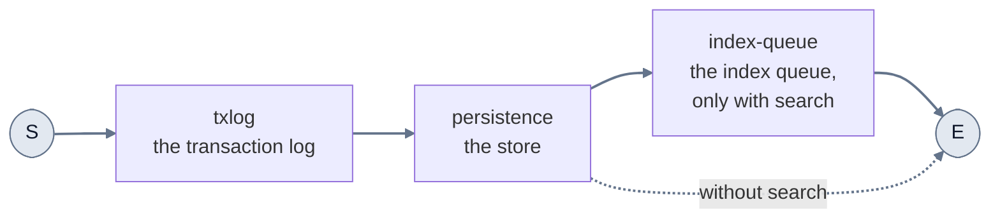

# The saga engine

Linked Data Store (LDS) carries every write with a [saga](../glossary.md#saga), run by the saga engine of Cantara,
[distributed saga](https://github.com/Cantara/distributed-saga) 2.2.0. This document says what a developer of LDS
needs to know of the engine: how LDS defines its saga, what the engine writes to the
[saga log](../glossary.md#saga-log) and reads back, how LDS recovers a saga that did not complete, what the three
names of a cluster do, which threads run a saga, how LDS waits for a saga without holding a thread, how it stops
the sagas, and the limits of the engine that matter to LDS. What the steps do to the stores is in
[the write path](core-write-path.md). For the engine itself, read its own documentation:
[concepts](https://github.com/Cantara/distributed-saga/blob/master/docs/concepts.md),
[architecture](https://github.com/Cantara/distributed-saga/blob/master/docs/architecture.md),
[known limitations](https://github.com/Cantara/distributed-saga/blob/master/docs/limitations.md) and
[design decisions](https://github.com/Cantara/distributed-saga/blob/master/docs/design-decisions.md).

## The libraries

LDS uses these modules of the engine, all of version 2.2.0 (the property `cantara-saga.version` of the root
`pom.xml`). They are not on Maven Central; the root `pom.xml` names the repository they are fetched from.

| Artifact | What LDS takes from it |
|---|---|
| `no.cantara.saga:saga-api` | `Saga`, `SagaNode` and the builder of a saga. |
| `no.cantara.saga:saga-execution` | `SagaExecution`, which runs a saga; `Adapter`, `AdapterLoader` and `AbortSagaException`. |
| `no.cantara.saga:sagalog-api` | `SagaLog`, `SagaLogPool`, `SagaLogInitializer`, and the saga log in memory. |
| `no.cantara.saga:sagalog-postgres` | The saga log in PostgreSQL. The server has it at run time. |
| `no.cantara.saga:sagalog-file` | The saga log in files. In the tests of core only. |
| `no.cantara.concurrent.futureselector:future-selector` | `SelectableThreadPoolExecutor`, the thread pool of the sagas, and the `FutureSelector` of the observer. |

The module descriptor of core requires `no.cantara.saga.api`, `no.cantara.saga.execution`, `no.cantara.sagalog`
and `no.cantara.concurrent.futureselector`, and declares `uses no.cantara.sagalog.SagaLogInitializer`. LDS does not
use `saga-serialization`: its sagas are built in code, and there is no JSON definition of a saga.

## What a saga is in the engine

A saga is a named graph of steps that starts in the step `S` and ends in the step `E`, both of the engine. Every
other step names an adapter, the code that does its work. The engine runs a step when every step before it has
ended, and writes each step to a saga log: a Start entry before it runs, and an End entry after. The first entry of
an execution is the Start of `S`, with the name of the saga and its input; the last is the End of `E`. An execution
without an End of `E` is a saga that did not complete, and running it again with the same input continues it: a
step whose last entry is End is not run again, every other step is (forward recovery).
So a step runs at least once, and may run more than once. A step that throws `AbortSagaException` makes the engine
run the compensating actions of the steps before it; any other exception only stops the saga.

## The saga of a write

`SagaRepository` builds two sagas when LDS starts, `Create or update managed resource` and `Delete managed resource`,
with the builder of `saga-api`. It is the one place that says which steps a write has; [the two
sagas](core-write-path.md#the-two-sagas) says what each is used for and which adapter each step names. Both have the
same steps, which follow one another: each starts when the one before it has ended. The step `index-queue` is in the
saga only when LDS has search (`graphql.search.enabled`); without it `persistence` links to `E`.



The order is the design: the transaction log has the write before the store is touched, and the
[index queue](../glossary.md#index-queue) gets the update only when the store holds the version, so the worker that
sends the queue to the search index finds the document at that version.

The engine walks the graph of the saga it is given and finds the entries of each step by the id of the step. So a
saga logged before search was turned on or off is recovered with the graph LDS has now: the step `index-queue` runs
for it, or its entries are passed over.

Every adapter extends the engine's `Adapter<JsonNode>`, overrides `executeAction`, returns `null` and has no
compensating action. A `null` output is not written to the End entry and is read back as `null`, so no step passes
anything to the next. With no compensating action, an `AbortSagaException` (which the `persistence` step of a write
throws for any failure) undoes nothing: the engine writes an Abort entry for the step and the End of `E`, and the
saga has failed. The saga log of a failed saga keeps its entries, so LDS recovers it as any saga that did not
complete (see [Recovery](#recovery)).

### The input of a step

Every step gets the same input, one JSON object (`SagaInput`) that the engine writes to the Start entry of `S` as JSON
text and recovery reads back from there, so a recovered saga writes the document and the version of the request that
started it; [the saga input](core-write-path.md#the-saga-input) lists its fields. The name of a saga and the ids of
its steps are in the saga log too, and [the two sagas](core-write-path.md#the-two-sagas) says what renaming one does.

## The saga log

A saga log is an append-only log of the entries of the sagas run with it. LDS has a pool of them (`SagaLogPool`),
made at start by the provider whose class `sagalog.provider` names: `UndertowApplication.configureSagaLogProvider`
finds the `SagaLogInitializer` of that class with `ServiceLoader`, and gives its `initialize` every key that starts
with `sagalog.config.`, without that prefix. A class name that no `SagaLogInitializer` has ends the start with
`NoSuchElementException`. A failure of `initialize` is tried again for
`sagalog.provider.initialization.max-wait-seconds`, with a wait of about
`sagalog.provider.initialization.retry-interval-seconds` between tries.

The `SagaExecutionCoordinator` registers `saga.number-of-logs` logs of its own instance with the pool, named `00`,
`01` and so on, and makes the id of one more, `dead-saga`, which it does not register, so the pool never hands it out
for a saga. A saga holds one log from its start to its end, and a log holds one saga at a time. When the saga has
completed, the coordinator truncates the log if the saga succeeded, then releases it. So a log that holds entries
holds a saga that did not complete or that failed, and LDS recovers either (see [Recovery](#recovery)).

| Provider | `sagalog.provider` | Where the logs are |
|---|---|---|
| Memory | `no.cantara.sagalog.memory.MemorySagaLogInitializer` (in `sagalog-api`) | In the memory of the process. The default. The logs are gone when the process ends, so nothing is recovered after a restart. |
| PostgreSQL | `no.cantara.sagalog.postgres.PostgresSagaLogInitializer` (in `sagalog-postgres`) | One table for each log, in a schema of a PostgreSQL database. The logs outlive the process, and every instance of the cluster can read them. |
| File | `no.cantara.sagalog.file.FileSagaLogInitializer` (in `sagalog-file`) | One file for each log, in the folder `sagalog.config.filesagalog.folder`. Only the tests of core use it (`application_test.properties`); the server does not have it. |

The engine calls a saga log on the threads of the saga, and every call of the PostgreSQL and the file log does its
I/O on the calling thread: a write of an entry returns when it is stored. This is the design of the engine, which
waits for each entry before it goes on.

Not finished: LDS also calls the saga log on the request thread. The handoff of a write reads the log it is given,
to see whether it holds entries (`readIncompleteSagas`, in PostgreSQL a query of the whole table), and a log that is
not open yet is opened there (a connection, its advisory lock, and its table when it is missing). The request thread
waits for that I/O on every write. [The write path](core-write-path.md#unfinished-and-known-to-be-wrong) has the
other waits of a write on its request thread.

### The saga log in PostgreSQL

The provider makes the schema named by `cluster.owner` and, in it, a table `Locks` and one table for each log,
`SAGALOG_<cluster.name>_<cluster.instance-id>_<log name>`, when they are missing. A log is opened when it is first
taken, and stays open with a connection of its own, which holds an advisory lock on the log, so one process at a
time writes a log. The recovery at start (on by default) takes every log of the instance, so all of them are open
after a start.
Started with its saga log in PostgreSQL and nothing else set but the host and the password of the database, LDS
made these tables:

```console
$ psql -U lds -d sagalog -c '\dt lds.*'
                 List of tables
 Schema |          Name          | Type  | Owner
--------+------------------------+-------+-------
 lds    | Locks                  | table | lds
 lds    | SAGALOG_lds-test_01_00 | table | lds
 lds    | SAGALOG_lds-test_01_01 | table | lds
 ...
```

Thirty logs (the default of the server) and `Locks`, in the schema `lds`, the default owner of core. The connection
pool of the provider (`sagalog.config.connection-pool.max-size`, 50 in the defaults of the server, 10 in the provider)
holds all of its connections while LDS runs: the provider takes them all at start, and ends the start when the
database does not give them. LDS checks the size of the pool before that, without a connection: the pool needs one
connection for each of its logs, one for each of the 10 logs of other instances that recovery opens at once, and
one for its own queries (`UndertowApplication.checkSagaLogPool`). Run with 30 logs and a pool of 40, LDS did not start:

```
Exception in thread "main" java.lang.IllegalStateException: The saga log has 40 connections in its pool
(sagalog.config.connection-pool.max-size) for 30 saga logs (saga.number-of-logs): each open saga log holds a
connection, recovery opens up to 10 logs of other instances at once, and the pool needs one for its own queries.
Give the pool at least 41 connections, or use fewer saga logs.
```

A database that has room for one pool of 50 and not for two refuses a second LDS: run against the PostgreSQL of a
running LDS, the second ended its start with `PostgresSagaLogException: initialize failed on the connection pool:
the database gave the pool 36 of its 50 connections (connection-pool.max-size) and refused more`, and the numbers of
the database. The provider reads more keys than the defaults files have (TLS, the timeouts of a statement, of a
lock, of a socket); [the configuration](../user/configuration.md#keys-that-no-file-has) lists them.

## The cluster: owner, name and instance id

Several LDS that share one saga log in PostgreSQL are a cluster: each recovers the sagas the others did not
complete. Three keys, each under `sagalog.config.`, say which cluster an LDS belongs to and which
[cluster instance](../glossary.md#cluster-instance) it is.

| Key | Default of core | Memory | PostgreSQL | File |
|---|---|---|---|---|
| `cluster.owner` | `lds` | Not read. | The schema of the tables. Letters, digits, `_` and `-`. | Not read. |
| `cluster.name` | `lds-test` | Not read. | Part of the name of every table. The tables of the schema whose names start with `SAGALOG_<cluster.name>_` are the logs of the cluster. Letters, digits and `-`. | Not read. |
| `cluster.instance-id` | `01` | The instance of every log id. The logs of the cluster are the logs of this instance. | Part of the name of every table of the instance. Letters, digits and `-`. | Part of the name of every file of the instance; the files of the folder are the logs of the cluster. |

The PostgreSQL provider checks the three names before it opens a connection, because they become SQL identifiers. It
also refuses a schema or a table name longer than 63 bytes, the limit of PostgreSQL for an identifier, so the name and
the instance id together must leave room in `SAGALOG_<cluster.name>_<cluster.instance-id>_<log name>`. The instance id
names the `dead-saga` log too. The compose file of the server sets the owner `development`, the name `lds` and the
instance id `01`.

Each LDS of a cluster needs an instance id of its own. Every LDS that is not told otherwise has `01`, and a second
LDS with the same id as a running one finds every log of its instance held by the first: its writes fail. Run with
two LDS on one saga log in PostgreSQL, both with the instance id `01`, a write to the second was answered `500`, and
its log said:

```
no.cantara.sagalog.SagaLogBusyException: Unable to acquire exclusive lock on
PostgresSagaLogId{schema='lds', table='SAGALOG_lds-test_01_00'} with lock-key 829871626.
```

Not finished: the instance id is not derived from anything that differs between processes, so an LDS started a
second time beside a running one, as an autoscaler does, cannot write until it is given an id of its own.

## Recovery

[Saga recovery](../glossary.md#saga-recovery) runs a saga that did not complete again from its saga log. The engine does
not look for such sagas: LDS finds them (`SagaExecutionCoordinator`) and calls `SagaExecution.executeSaga` again with
`recovery = true`, the execution id and the input of the Start entry of `S`. The engine then skips every step whose last
entry is End and runs the others. A log that has been recovered is truncated. LDS recovers a log that a write is handed
with entries in it, the logs of its instance when it starts, and the logs of the cluster again and again on a timer
(`SagaRecoveryTrigger`); [recovery of an unfinished saga](core-write-path.md#recovery-of-an-unfinished-saga) says when
each runs, what it does and what follows when it fails, the move to the [dead-saga log](../glossary.md#dead-saga-log)
included.

What each saga log does for the cluster follows from the table of the cluster: in memory the logs of the cluster
are the logs of the instance, so nothing of another instance is recovered, and nothing at all after a restart; in
PostgreSQL the timer of each LDS also takes the logs of the other instances, when no process holds them. A log of
another instance that is empty, or whose sagas are recovered, is removed from the pool and its table dropped
(`SagaLogPool.delete`). A log that another process holds (`SagaLogBusyException`) is left to it.

## The threads

The engine starts no thread of its own. LDS gives it the saga thread pool (`sec-N`), on which every step of every saga
runs, with its writes to the saga log and the truncate and release of its log; [the thread pools and their
limits](core-write-path.md#the-thread-pools-and-their-limits) lists that pool and the others of the sagas (recovery, the
timer, the observer, the watchdog), the permits and the saga logs, and what happens when each limit is met.

A step runs on a thread of the saga thread pool from its Start to its End, and it may block there: the steps of LDS wait
for the transaction log, for the store (`WriteTransaction`) and for the index queue, and the saga log waits for its
database. This is on purpose. The pool is bounded, so its threads cap how many steps run at once: when a store slows
down the sagas slow down with it, and when the pool and its queue are full a new saga is refused at once
(`RejectedExecutionException`) instead of piling up work on the store. An asynchronous step would only move the wait of
a blocking client to a pool without a bound. The rule is that blocking belongs on this pool and nowhere else: never on
an I/O thread, a request thread or an Rx scheduler.

## The observer

`SagasObserver` keeps the completion of every saga, started by a write or by recovery, in a `FutureSelector`, and its
thread `saga-observer` takes each as it completes. A saga that failed is logged as an error, with its name and its
execution id: `Observed Saga failure during execution. Saga-name: "Create or update managed resource", executionId:
"..."`. A saga that succeeded is logged at the level trace. The observer only logs: the answer to the client and the
release of the saga log do not wait for it.

## How LDS waits for a saga

`SagaExecutionCoordinator.handoff` starts a saga with `SagaExecution.executeSaga` and gives back one of the two
futures of the engine: the completion future when the write waits for its saga, or the handoff future, which completes
when the Start entry of `S` is in the saga log, when it does not (`sync=false` without `searchable=true`). No thread
waits for either: [the handoff](core-write-path.md#the-handoff) has the steps, and
[the answer](core-write-path.md#the-answer) how the write is answered when its future completes.

## How LDS stops the sagas

The sagas are a [lifecycle](../glossary.md#lifecycle) of their own, `Sagas` (`UndertowApplication.sagas`). It is made
after the saga thread pool, the observer, the transaction log, the index queue and the saga log pool, so it stops
before them, and after the HTTP server has stopped taking requests:

1. The recovery stops: the trigger and the recovery thread pool are shut down (`SagaRecoveryTrigger.stop`), or the
   recovery thread pool alone when recovery is off.
2. The running sagas are waited for, at most 10 seconds (`awaitRunningSagas`). Each still has its thread pool, its
   saga log and the stores it writes to.
3. The coordinator stops its watchdog (`shutdown`).

Then the saga thread pool is shut down: it takes no new step, waits up to 10 seconds for the steps that run, and then
interrupts them (`shutdownNow`). A saga that is interrupted or refused fails, its saga log keeps what it did, and
recovery runs it again, after a restart when the log is in PostgreSQL. The observer stops, and later the saga log
pool is shut down: after that it gives out no log (`SagaPoolShutdownException`, which the trigger takes as the stop
and not as a fault).
[The application](core-application.md#stop) has the whole order.

## The readiness of the saga log

`/health/ready` asks the saga log for the list of the logs of the cluster (`SagaLogPool.clusterWideLogIds`), on a
virtual thread of its own; [readiness](core-application.md#readiness) has the check, its time limit and its answer.

Not finished: the check asks only whether the saga log answers. An LDS with no saga log a write can take
(`saga.number-of-logs=0` was run) is `UP`, and each write is answered `500` after 10 seconds.

## The limits that matter to LDS

These are limits of the engine, each with what LDS does about it. The engine's
[known limitations](https://github.com/Cantara/distributed-saga/blob/master/docs/limitations.md) have the detail.

- **At least once.** A step whose End did not reach the saga log is run again by recovery, so every step must give
  the same result the second time. The store replaces a version written at the same valid time; the transaction log
  takes the same message again as nothing new and refuses another message under the same id (`TxLogStepTest`); the
  index queue gets the update twice, and the worker sends the same entry twice.
- **Only an abort rolls back, and LDS has nothing to roll back.** No step has a compensating action. Any failure,
  an abort or not, leaves the saga log for forward recovery.
- **No timeouts.** The engine has no timeout on a step or on the saga log. A step that never returns holds its
  thread, its saga, its saga log and the lock of its document, which is one of 1024 striped locks, so it holds the
  other documents of that stripe too; the next writes of them are answered `503` after their wait of 30 seconds. The
  PostgreSQL saga log has no timeout of a statement, a lock or a socket unless one is configured (the keys are in
  [the configuration](../user/configuration.md#keys-that-no-file-has)).
- **A late rerun.** Recovery can run a saga after newer writes of the same document, and takes no document lock, so
  it can also run at the same time as a write of that document. It writes the version of the request that started
  it, which is its valid time, so it replaces that version only.
- **The saga log is read whole.** A recovery reads every entry of a log into memory. LDS truncates a log when its saga
  has succeeded, so a log holds one saga at most, and the entries of the sagas that failed.
- **The rejection policy.** A policy that runs a task on the thread that submits it cannot run a saga. LDS uses
  `AbortPolicy`: a saga the full pool refuses fails at once and gives back its log and its permit.
- **A saga left in the queue at the stop.** The engine fails a saga whose next step `shutdownNow` takes out of the
  queue only when the task `shutdownNow` gives back is cancelled. LDS shuts the saga thread pool down with
  `shutdownNow` when it has not ended within 10 seconds and does not cancel those tasks, so such a saga does not
  complete. Its saga log keeps it.

## Rules to keep

- **The steps stay synchronous, on the saga thread pool.** A step may block there and nowhere else.
- **A step can be run again.** It must give the same result the second time.
- **The names in the saga log stay.** The name of a saga, the ids of its steps and the fields of the saga input are
  read back by recovery, by another instance of the cluster and by the next build.
- **A saga log is released on every path,** after its truncate has finished, and by the owner that took it. A log
  that stays taken is lost to every write after.
- **The pool rejects; it never runs a task on the submitting thread.** Keep `AbortPolicy`.
- **The sagas stop before what they need.** A new subsystem a step uses is made before the lifecycle `Sagas`, so it
  stops after it.
