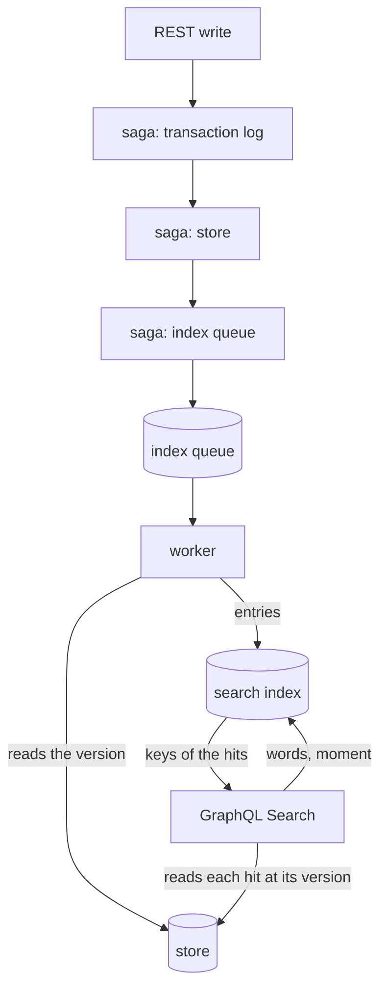

# Search: the interface, the index queue and the Solr provider

This document describes how Linked Data Store (LDS) searches: the search interface, what the index is given of a
document, the index queue that carries every write to the index, the rebuild of the index from storage, and the
provider that implements the index on Apache Solr. It is for developers who change this code or write another
search provider.

## What this part is for

Search finds documents by the words of their texts, as they were at a moment. The index holds one entry for each
[version](../glossary.md#version) of each [document](../glossary.md#document), written or deleted. An entry is never
changed: a new version is a new entry. A search takes, of each document, the newest entry up to the moment it
searches at, and only then tests it for the words, so a word that only an older version had does not find the
document. The index answers with the [document key](../glossary.md#document-key) of each hit, the version
included, never with the document. Core reads that version from the
[persistence provider](../glossary.md#persistence-provider).

A write does not wait for the index, and no update of the index is lost. The last step of the
[saga](../glossary.md#saga) of a write adds an update (the document and its version, written or deleted) to the
index queue, and is done. A worker takes the updates from the queue, reads each written version from storage,
sends them to the index, and removes them when the index has taken them. An update the index does not take stays
in the queue and is sent again. One exception is asked for by the client: a write with `searchable=true` is
answered when a search finds it, at most 10 seconds after its saga (see
[A write that asks to be searchable](#a-write-that-asks-to-be-searchable)).



Search is optional. It is off unless `graphql.search.enabled` is `true`. It is asked for through the GraphQL field
`Search` and in no other way; the REST handlers do not read the index. The field is there only when LDS has a
GraphQL schema as its model (see [How a provider is found](#how-a-provider-is-found)).

## Layout

| Module | JPMS module | Package | Holds |
|---|---|---|---|
| `linked-data-store-search-provider-api` | `io.descoped.lds.search.api` | `io.descoped.lds.api.search` | The interface: `SearchIndexProvider`, `SearchIndex`, what an index is given (`IndexEntry`, `Language`) and asked (`SearchQuery`) and what it answers (`SearchPage`, `SearchHit`); the index queue: `IndexQueue`, `IndexUpdate`, `IndexQueueProvider`. |
| `linked-data-store-search-provider-solr` | `io.descoped.lds.search.provider.solr` | `io.descoped.lds.core.search.solr` | The provider `solr`: `SolrProvider` makes the index, `SolrSearchIndex` is the index, `SolrSchema` is the schema it puts in its core. |
| `linked-data-store-index-queue-postgres` | `io.descoped.lds.index.queue.postgres` | `io.descoped.lds.core.search.queue.postgres` | The index queue `postgres`: `PostgresIndexQueueProvider` makes it, `PostgresIndexQueue` is the queue, in the table `lds_index_queue`. |

The interface module depends on `linked-data-store-persistence-provider-api` (a hit is a `DocumentKey`) and on
RxJava 3, and `requires transitive` both. Its POM and its `module-info.java` also name Jackson 3
(`tools.jackson.core`, `tools.jackson.databind`), which no class of the module uses. The Solr module depends on the
interface module, on `solr-solrj`, on Jackson 3 (it writes the schema it puts in) and on SLF4J. The queue module
depends on the interface module, HikariCP, the PostgreSQL JDBC driver and SLF4J.

Core depends on the interface module only. The server module (`linked-data-store-server`) brings the Solr provider
and the PostgreSQL queue. These classes of core use the interface; they belong to core and are named here to show
where the interface is called. The sagas are described in [the write path](core-write-path.md), the GraphQL schema
in [GraphQL](core-graphql.md), and the start and the stop of LDS in [the application](core-application.md).

| Class in `linked-data-store-core` | What it does with search |
|---|---|
| `SearchIndexConfigurator` | Finds the search provider at start and makes the index. |
| `IndexQueueConfigurator` | Makes the index queue where the transaction log is kept. |
| `SagaRepository` | Adds the step `index-queue` to the two sagas when there is search. |
| `UpdateIndexSagaAdapter`, `DeleteIndexSagaAdapter` | The steps of the sagas: each adds an update to the queue. |
| `IndexEntries` | What the index is given of a version of a document: its texts, each in its language, read with the model. |
| `IndexQueueWorker` | Takes the updates from the queue, reads the documents, sends the entries, removes the updates. |
| `MemoryIndexQueue` | The index queue in memory. |
| `IndexRebuild` | The rebuild of the index from storage (`search.index.rebuild`), and its clean-up. |
| `SearchWait` | The wait of a write that asks to be searchable (`searchable=true`). |
| `Readiness` | The checks `search` and `indexQueue` of `/health/ready`. |
| `GraphQLSchemaBuilder`, `AddSearchTypesVisitor`, `RegistrySetupVisitor` | Add the field `Search` to the GraphQL schema when there is an index, and give it its fetcher. |
| `QueryConnectionFetcher` | The fetcher of `Search`: it asks the index, and reads every hit from storage at its version. |
| `TestSearchIndex`, `SimpleSearchIndex` | A provider `testSearchIndex` that keeps the entries in a map in memory, for the tests of core. |

`SimpleSearchIndex` keeps the entries and finds them at a moment as the Solr index does. It matches the words more
simply: an entry matches when one of its texts holds the words as they are written, in any case, and `*:*` matches
every entry. A test of core that searches therefore says nothing about the stems or the folded letters of Solr.

## The interface

### SearchIndexProvider

A [search index provider](../glossary.md#search-index-provider) is a class that implements `SearchIndexProvider`
and has a constructor without parameters.

| Method | What it promises |
|---|---|
| `String getProviderId()` | The name the provider is chosen by, compared with `search.index.provider`. The Solr provider answers `solr`. |
| `Set<String> configurationKeys()` | The configuration keys the provider reads. The Solr provider answers `search.index.url` and `search.index.commit-within`. Nothing in core calls this method for a search provider. |
| `SearchIndex getSearchIndex(Map<String, String> configuration)` | Makes the index. Core calls it once, at start, with the whole configuration of LDS as a map (`DynamicConfiguration.asMap`). |

### SearchIndex

Every method but `close` returns a type of RxJava 3, and nothing is done until it is subscribed to.

| Method | What it promises |
|---|---|
| `Completable put(List<IndexEntry> entries)` | Adds the entries in one request. An entry the index has already (the same document and version, sent again by a retry or a rebuild) is replaced by the one given, which holds the same. Complete when the index has taken every entry; an error when it refuses them or cannot be reached. |
| `Completable removeOlderThan(String namespace, Duration age)` | Removes the entries of the namespace that the index took longer ago than the age, by the index's own clock, and in every namespace the entries in the form of the search before 3.0.0. The clean-up after a rebuild. A negative age is an `IllegalArgumentException`. |
| `Completable refresh()` | Makes every entry the index has taken searchable now, instead of within the time it takes otherwise. |
| `Completable health()` | Complete when the index answers; an error when it cannot be reached or says it is not ready. |
| `Single<SearchPage> search(SearchQuery query)` | The page of hits the query asks for, and the number of hits in all. |
| `void close()` | Lets go of what the index holds to reach the engine (its client, connections and threads). Called once, when LDS stops, after the last update and search. |

What an index is given and asked:

| Type | What it holds |
|---|---|
| `IndexEntry` | One version of one document: namespace, entity type, id, version, whether the document is deleted at the version, and its texts by language (`Map<Language, List<String>>`, empty for a deletion). Made by `IndexEntry.written` and `IndexEntry.deleted`. |
| `Language` | The language a text is searched in: `NONE` (word for word), `NORWEGIAN` (`no`, `nb`, `nn`), `SWEDISH` (`sv`), `ENGLISH` (`en`), `GERMAN` (`de`), `FRENCH` (`fr`). `Language.of(code)` reads a code in any case, alone or with a region (`nb-NO`, `en_GB`); any other code is `NONE`. |
| `SearchQuery` | The namespace, the words as the user wrote them, the entity types (empty for all), the moment (`snapshot`), `history`, and the page (`from`, `size`, neither negative). |
| `SearchPage` | The number of hits in all (`total`) and the hits of the page, best match first. |
| `SearchHit` | The `DocumentKey` of the version that matched: namespace, entity type, id and version. |

Without `history`, a hit is a document whose newest version up to the moment matches the words and is not a
deletion. With `history`, a hit is every version up to the moment that matches the words and is not a deletion.

### IndexQueue

The updates the index has not taken. An update is the record `IndexUpdate`: namespace, entity type, id, version
(with the zone it was written with) and the operation, `CREATE_OR_OVERWRITE` or `DELETE`. It does not hold the
document: the worker reads it from storage when it sends the update.

| Method | What it promises |
|---|---|
| `Completable add(IndexUpdate update)` | Complete when the update is kept. |
| `Single<Boolean> holds(String namespace, String entity, String id)` | Whether the queue holds an update of the document, taken or not. |
| `Single<List<Entry>> take(int max, Duration lease)` | The oldest updates that are not taken and not put off, at most `max`, in the order they were added; each is the taker's for the lease, and can be taken again after it. |
| `Completable remove(Collection<Entry> entries)` | Removes updates the index has taken. |
| `Completable postpone(Collection<Entry> entries, Duration delay)` | Puts off updates the index did not take: each can be taken again after the delay, and has one attempt more. |
| `Single<Lag> lag()` | The number of updates in the queue (counted up to a limit the queue may set) and when the oldest was added. |
| `boolean durable()` | Whether the queue is kept when LDS stops: false for the queue in memory. |
| `void close()` | Lets go of what the queue holds open; a durable queue keeps its updates. |

An `Entry` is an update with its place in the queue (`sequence`) and the number of times it was put off
(`attempts`). Several LDS may share one durable queue: each takes other updates.

`IndexQueueProvider` makes a durable queue. Its `providerId()` is the name of the transaction log provider whose
store it shares (`postgres`), and `indexQueue(configuration)` makes the queue and creates what it is kept in when
that is missing.

## How a provider is found

`UndertowApplication.initializeUndertowApplication` makes search after the store and the saga log, and before the
transaction log:

1. `SearchIndexConfigurator.configureSearchIndex` reads `graphql.search.enabled` (default `false`). When it is
   `false` there is no search, and the log says `GraphQL Search is disabled. Skipping search index
   initialisation`.
2. It reads `search.index.provider`, loads every `SearchIndexProvider` with `java.util.ServiceLoader`, and the first
   whose `getProviderId()` equals the value makes the index. The log says `Search index provider configured: solr`.
   When no provider has that name, the start fails with
   `IllegalStateException: No search index provider found for providerId: <the value>`.
3. `IndexQueueConfigurator.configureIndexQueue` reads `txlog.rawdata.provider` (default `discard`). For `discard`
   and `memory` the queue is a `MemoryIndexQueue`, and the log warns: `The index queue is in memory, as the
   transaction log (discard) is: updates the search index has not taken when LDS stops are lost, and are found
   again only by a rebuild of the index`. For any other name the first `IndexQueueProvider` of that name makes the
   queue (`The index queue is kept in postgres, where the transaction log is`); when there is none, the start fails
   with `No index queue provider for the transaction log provider <name>: the queue is kept where the transaction
   log is`.
4. The worker of the queue is made, and the rebuild when `search.index.rebuild` is `true`.

Each of the index, the queue, the worker and the rebuild is a `Lifecycle` of the application, added in that order:
they start in that order and stop in the reverse order ([the application](core-application.md)). A start that
fails after the index was made stops what was made, the index included.

A provider is registered in two places: `provides ... with ...` in its `module-info.java`, and a file
`META-INF/services/io.descoped.lds.api.search.SearchIndexProvider` (or `...IndexQueueProvider`) with the name of the
class. LDS runs on the class path, where the file is the one that is read. Core declares `uses` for both
interfaces.

When there is no index, the sagas have no index step, and `GraphQLSchemaBuilder` adds no `Search` field: a GraphQL
request for it is answered `Field 'Search' in type 'Query' is undefined`. When there is an index, the sagas always
have their index step. The `Search` field needs more: the GraphQL schema is built only when `graphql.enabled` is
`true` and `graphql.schema` names a file. With a model of JSON Schema files and no GraphQL schema, every write goes
to the index and nothing can search it.

`AddSearchTypesVisitor` makes the enum `TypeFilters` and the union `SearchResult` of every type of the model that
has `@domain` and is searched (not `@domain(searchable: false)`), and adds
`Search(query: String!, filter: [TypeFilters], history: Boolean = false)` to the query type. When no type is
searched, there is no `Search` field. `AddConnectionVisitor` then gives the field the paging arguments (`first`,
`after`, `last`, `before`) and the type `SearchResultConnection`. `RegistrySetupVisitor` finds the field by the
applied directive `search` and gives it a `QueryConnectionFetcher`.

`TestSearchIndex` is in the main code of core and in its `module-info.java`, but its `META-INF/services` file is
among the test resources of core. A running LDS does not find it.

## What the index is given: `IndexEntries`

`IndexEntries` makes the entry of a version from the document as storage holds it, with the model:

- A text in an object that has a `languageCode` and a `languageText`, both texts, is in the language of the code
  (`Language.of`). The code itself is not text.
- Every other text is in no language (`NONE`), and is matched word for word.
- A link (a field the model calls a link) is not text, nor is a text whose `format` in the model is `date-time`,
  `date` or `time`. A number, a boolean and a null are not text.
- A field the model does not have is read as text when it holds text.
- An empty text, or one of only spaces, is left out.
- An entity type the model marks `@domain(searchable: false)` has no entries (`searched(entity)` is false).

The document

```json
{
  "name": "Fjordbryggeriet",
  "founded": "2001-05-01T00:00:00Z",
  "about": [
    {"languageCode": "nb", "languageText": "Et lite bryggeri ved fjorden som brygger øl"},
    {"languageCode": "en-GB", "languageText": "A small brewery by the fjord"},
    {"languageCode": "fi", "languageText": "Pieni panimo"}
  ]
}
```

of `Company` in the example model gives the texts `NONE`: `Fjordbryggeriet`, `Pieni panimo`; `NORWEGIAN`:
`Et lite bryggeri ved fjorden som brygger øl`; `ENGLISH`: `A small brewery by the fjord`. `founded` is a
date-time and is left out.

## The index queue

### The step of the saga

Both sagas end with the step `index-queue` when there is search: the transaction log, then the store, then the
queue (`SagaRepository`). The queue holds only what the store has: the step follows the store, and the saga never
undoes the store. `UpdateIndexSagaAdapter` (adapter `Persistence-Index-Create-or-Overwrite`) adds a
`CREATE_OR_OVERWRITE` update, and `DeleteIndexSagaAdapter` (adapter `Persistence-Index-Delete`) a `DELETE` update.
Each waits for the add (`blockingAwait`) on the saga's own bounded pool, as every step of a saga does, and is done.
The version of the update is the [valid time](../glossary.md#valid-time) of the request, in the zone `Etc/UTC`.

### The worker

`IndexQueueWorker` runs on one thread of its own, `lds-index-queue-<n>`. It works in rounds:

1. It takes at most 100 updates (`BATCH`) for a lease of two minutes (`LEASE`).
2. It reads each written version from storage as of its version, one after another, in one read transaction that
   is opened and closed on its own thread: the memory store holds a lock of the thread that opened a transaction.
   `IndexEntries` makes the entry. A deletion is an entry of its own. An update of an entity type that is not
   searched, or of a version storage does not have, gives no entry.
3. It sends the entries of the batch in one `put`, and removes the updates when the index has taken them.
4. When the index does not take the batch, each of its updates is sent alone, so that one update the index refuses
   does not hold back the others. An update that is not taken alone is put off: one second, twice as long after
   each attempt, a minute at most (`delay`). The log says so at WARN, and from the tenth attempt at ERROR. An update
   is never dropped: it is sent again, a minute apart, for as long as LDS runs.
5. A round that took updates is followed by the next at once; one that took none by the next after 200 ms
   (`INDEX_QUEUE_POLL`). A round that fails is logged, and the next follows after 200 ms.

When LDS stops, the worker lets the round that runs finish, within the time of the stop, and starts no other. What
it had taken and not removed is taken again after the lease.

### The queue in PostgreSQL

`PostgresIndexQueue` keeps the updates in the table `lds_index_queue` of the database of the transaction log
(`txlog.config.postgres.driver.*`), with a pool of four connections (`lds-index-queue`). The provider creates the
table and its indexes at start when they are missing (`init-queue.sql`):

```sql
CREATE TABLE IF NOT EXISTS lds_index_queue (
    sequence     bigint GENERATED ALWAYS AS IDENTITY PRIMARY KEY,
    namespace    text        NOT NULL,
    entity       text        NOT NULL,
    id           text        NOT NULL,
    version      text        NOT NULL,
    operation    text        NOT NULL CHECK (operation IN ('CREATE_OR_OVERWRITE', 'DELETE')),
    added        timestamptz NOT NULL DEFAULT now(),
    available_at timestamptz NOT NULL DEFAULT now(),
    attempts     integer     NOT NULL DEFAULT 0
);
CREATE INDEX IF NOT EXISTS lds_index_queue_available ON lds_index_queue (available_at, sequence);
CREATE INDEX IF NOT EXISTS lds_index_queue_document ON lds_index_queue (namespace, entity, id);
```

`version` is the version as `ISO_ZONED_DATE_TIME` writes it, so it comes back with its zone. Each call is one
statement in a transaction of its own, run on a virtual thread of its own, as JDBC blocks. `take` marks the rows it
takes with `FOR UPDATE SKIP LOCKED` and sets `available_at` to the end of the lease, so several LDS on one database
take different rows. The times are the database's. `lag` counts at most 100,000 rows (`LAG_COUNT_LIMIT`), so that
a queue a rebuild has filled is not read whole to answer.

### The queue in memory

`MemoryIndexQueue` keeps the updates in a sorted map, by a number it gives each. It is the queue when the
transaction log is `discard` (the default) or `memory`: what the index has not taken when LDS stops is lost, and is
found again only by a rebuild.

### Readiness

With search, `/health/ready` has two more checks, asked side by side with the others, each within 2 seconds
([the application](core-application.md)):

| Check | Asks | When it fails |
|---|---|---|
| `search` | `SearchIndex.health()` | DEGRADED: search is not needed for a write. |
| `indexQueue` | `IndexQueue.lag()`; the answer has `durable`, `updates` and, when there are updates, `oldest` | DOWN: a write needs the queue. DEGRADED when the oldest update has waited over a minute (`INDEX_LAG_DEGRADED`), the longest the worker puts an update off. |

The stack of the compose file of the server, with every part up:

```sh
curl -s http://localhost:19090/health/ready
```

```json
{
  "status": "UP",
  "checks": {
    "persistence": {"status": "UP", "millis": 8},
    "sagaLog": {"status": "UP", "millis": 1, "logs": 30},
    "transactionLog": {"status": "UP", "millis": 1, "keepsMessages": true},
    "search": {"status": "UP", "millis": 3},
    "indexQueue": {
      "status": "UP",
      "millis": 0,
      "durable": true,
      "updates": 0
    }
  }
}
```

## A write that asks to be searchable

A write with the query parameter `searchable=true` (in any case) is answered when a search finds it
(`SearchWait`). It is a write of a document, a part of one or a link, PUT, POST or DELETE. It waits for its saga,
whatever `sync` says. After the saga, the write lets the lock of its document go
([the REST API](core-rest.md#one-write-at-a-time-to-a-document)), so no other write of the document waits for its
search, and then:

1. it asks the queue every 100 ms whether it holds an update of the document (`IndexQueue.holds`), until it holds
   none, whichever LDS took the update;
2. it asks the index to make what it has taken searchable (`SearchIndex.refresh`);
3. it is answered as any write is, with the header `LDS-Searchable: true`.

The wait is at most 10 seconds. When that is not enough, or the index fails, the write is answered with
`LDS-Searchable: false`, and its update reaches the index as every update does. No thread waits: the answer is
sent from the completion of the wait. At most half as many writes as there are request threads wait at once
(`REQUEST_THREADS / 2`; the request threads are eight for each processor, 16 at least). A write past that is
answered when it is done, with `LDS-Searchable: false`. The CORS handler exposes the header, so a browser can read
it. Without search, `searchable=true` makes the write wait for its saga and nothing more, and the answer has no
such header.

These were run against LDS in memory with search in Solr, the namespace `f-docs`, on port 19106:

```sh
curl -s -i -X PUT 'http://localhost:19106/f-docs/Company/f-acme?timestamp=2020-01-01T00:00:00Z&searchable=true' \
     -H 'Content-Type: application/json' \
     -d '{
       "name": "Acme",
       "about": [{"languageCode": "en", "languageText": "Makes anvils and rockets"}]
     }'
```

```http
HTTP/1.1 201 Created
LDS-Searchable: true
Content-Type: application/json

{"saga-execution-id": "01a20fe6-75c3-731d-9b77-fcad1529da48"}
```

```sh
curl -s -i -X DELETE 'http://localhost:19106/f-docs/Person/f-kari?timestamp=2023-01-01T00:00:00Z&searchable=true'
```

```
HTTP/1.1 204 No Content
LDS-Searchable: true
```

The headers `Connection`, `Content-Length` and `Date` are left out.

## The rebuild

`IndexRebuild` rebuilds the index from storage when LDS starts with `search.index.rebuild=true`. It reads every
version of every document of every entity type of the namespace with `readAllDocumentVersions` (the persistence
interface, held by the [shared suite](../glossary.md#shared-suite)), and adds an update for each to the queue: a
version that marks a document as deleted as a `DELETE`, the versions before it as `CREATE_OR_OVERWRITE`. The worker
sends them as it sends every update. The index is never cleared, so search answers during a rebuild: each version is
sent again under the key it has, and replaces the same entry.

The versions of one entity type are read in one read transaction, opened, read and closed on the rebuild's own
thread (`lds-index-rebuild`, a virtual thread). Storage is read only as fast as the queue takes: eight updates are
added at a time (`CONCURRENT_ADDS`).

When every update is added, the rebuild waits until the queue is empty, asking every second, and then has the index
remove the entries of the namespace it took before the rebuild started (`SearchIndex.removeOlderThan`): what was
not sent again is what storage no longer holds, or what an earlier model searched. The age given is the time since
the rebuild started and one minute more (`MARGIN`), because the start is measured in LDS and the index reads its own
clock later. The margin is on the side of keeping: an old entry left is found by no search unless it is a version
storage no longer holds, and the next rebuild removes it; an entry removed by mistake is lost without a word. The
same request removes every entry in the form of the search before 3.0.0. A queue that is never empty puts the
clean-up off, and the log says so every five minutes with the lag of the queue. A rebuild that is stopped leaves
the old entries.

The log of a rebuild, from LDS in memory whose store was emptied by a restart:

```
INFO  IndexRebuild - Rebuilding the search index from storage: [Company, Person] in the namespace f-docs
WARN  IndexRebuild - search.index.rebuild is on: every start of every LDS with it rebuilds the search index. It is
      meant for one start of one LDS; turn it off when the rebuild is done
INFO  IndexRebuild - Every version is added to the index queue (0); the entries the search index took before the
      rebuild are removed when the queue is empty
INFO  IndexRebuild - The search index is rebuilt from storage: 0 versions sent, and the entries it took before
      the rebuild removed
```

The six entries Solr held for that namespace were removed. A rebuild started less than a minute after they were
taken removed none of them.

## The Solr provider

### The client

`SolrSearchIndex` has one client of `solr-solrj` (version `solr.version` in the root POM, 10.1.0),
`HttpJdkSolrClient`, the client that uses the HTTP client of the JDK, made from the address in `search.index.url`.
It sends the updates, the queries and the requests of the schema and the configuration. Every request is sent with
`requestAsync`, and the `Completable` or `Single` ends with Solr's answer: no thread waits for it.

The client speaks HTTP/1.1 (`useHttp1_1`), waits at most 10 seconds for a connection and at most 60 seconds for an
answer; the builder's defaults are HTTP/2, 60 seconds and 10 minutes. HTTP/1.1 because of what the JDK's client does
over HTTP/2 without TLS: Solr closes a connection that has been idle for two minutes (`solr.jetty.http.idleTimeout`,
120 seconds), and on the new connection every update arrives at Solr without its body and is refused, for as long
as the client lives. `close` closes the client, which holds the JDK's HTTP client and a pool of threads.

The address names one core, for example `http://localhost:8983/solr/lds-index`. Every namespace and every entity
type is in that one core. The provider does not make the core. The tests and the compose file of the server make it
with the command `solr-precreate lds-index` of the Solr image, from the configuration the image comes with. The
address is not tried at start: LDS starts when nothing answers there, and the first write or search fails, and is
tried again.

### The schema LDS puts in

The schema of the core is LDS's own (`SolrSchema`), the same for every model, so a model that changes needs nothing
of Solr. The fields of an entry:

| Field | Type | Value |
|---|---|---|
| `id` | the core's own | the document key and the version: `<lds_doc>!<seconds>.<nanoseconds>` |
| `lds_namespace` | `lds_string` (`StrField`) | the namespace |
| `lds_entity` | `lds_string` | the entity type |
| `lds_id` | `lds_string` | the id of the document |
| `lds_doc` | `lds_string` | one value for every version of a document: SHA-256 of the namespace, the entity type and the id, each with its length in bytes before it |
| `lds_version_s` | `lds_long` (`LongPointField`) | the seconds of the version since 1970 |
| `lds_version_n` | `lds_long` | the nanoseconds of the version within its second, so every instant a store keeps is kept exactly |
| `lds_deleted` | `lds_boolean` | whether the document is deleted at the version |
| `lds_indexed` | `lds_date` (`DatePointField`), default `NOW` | when Solr took the entry, set by Solr |
| `lds_text`, `lds_text_no`, `lds_text_sv`, `lds_text_en`, `lds_text_de`, `lds_text_fr` | `lds_text_<language>` | the texts of each language, as they are written |
| the same with `_folded` | `lds_text_<language>_folded` | the same texts, with the letters folded |

The text fields are indexed, not stored, and take many values. Every text type has the standard tokenizer and
lower case, no stop words (so a phrase is kept whole), and depends on no file of the configuration of the core.
French takes the article off first (`ElisionFilterFactory`: `l'école`). Then the stemmer of the language, the light
ones that Solr's own `text_<language>` types use:

| Language | Stemming |
|---|---|
| none | none |
| Norwegian | `NorwegianLightStemFilterFactory`, variant `no` (bokmål and nynorsk) |
| Swedish | `SwedishLightStemFilterFactory` |
| English | `EnglishPossessiveFilterFactory`, `PorterStemFilterFactory` |
| German | `GermanNormalizationFilterFactory`, `GermanLightStemFilterFactory` |
| French | `FrenchLightStemFilterFactory` |

A folded type folds the letters before the stem is taken, so that a word written with or without them has one
stem: in Norwegian, Swedish and texts of no language `ScandinavianFoldingFilterFactory` (ø, ö and oe as o; å, ä, æ,
aa and ae as a), then in every language `ASCIIFoldingFilterFactory` (é as e).

The schema is put in once, before the first write or search of an index, and again after a failure (Solr may not be
up when LDS starts). LDS sees whether the core has it by a mark it keeps among the user properties of the core's
configuration: `lds.schema`, the first 16 hex digits of the SHA-256 of the field types and the fields. The core has
the schema when its configuration has this mark and `update.autoCreateFields` is `false`. When it does not:

1. LDS reads the field types and the fields of the core, and sends one request of the Schema API (`/schema`) that
   adds what the core does not have and replaces what it has, every field type before the fields. When the core had
   another mark and a field type or field is replaced, the log warns that what was indexed before is searched as it
   was indexed until the index is rebuilt.
2. It sends one change of the configuration (`/config`, `set-user-property`) with both properties:
   `update.autoCreateFields` `false`, so that the default chain of updates of the image does not make a field of
   every name it does not know (it would, and refuse every update once the core has 1000 fields; off, Solr refuses a
   field it does not know), and the mark.
3. It reads the configuration back (`/config/overlay`), and fails when it does not hold both.
4. The log says `The schema of the search index is put in (<mark>)`.

A try that fails is made again after 100 ms, then 200, 400 and 800 ms (`SCHEMA_ATTEMPTS` 5, `SCHEMA_PAUSE`), on a
timer: no thread waits. After the fifth, the write or the search fails, and the next one starts again.

Why this way: several LDS may put the schema in at once, and each must end with it. The one that adds a field second
is refused, tries again, reads the core again, and replaces what the other added with the same. Solr standalone
changes its configuration without a lock: it reads `configoverlay.json`, writes it whole and reloads the core. One
that reads it while another writes it is answered "Error reading config overlay", and of two that change it at
once, the one that writes last wins. So LDS changes it once, last, with every property it needs in that one change,
the same in every LDS of this schema, and reads it back. `SolrSearchIndexTest.theSchemaIsPutInWhenTheCoreDoesNotHaveIt`
has six indexes put the schema in at the same time.

The overlay of the core of the compose file, after LDS put the schema in:

```sh
curl -s 'http://localhost:18983/solr/lds-index/config/overlay?wt=json'
```

```json
{
  "responseHeader": {"status": 0, "QTime": 0},
  "overlay": {
    "znodeVersion": 266226991,
    "userProps": {
      "update.autoCreateFields": "false",
      "lds.schema": "e677ad91548f1751"
    }
  }
}
```

### What an entry becomes

`put` makes one Solr document of each entry. Each text is put in one Unicode form (NFC) and goes into the text
field of its language and into its folded field. These are the entries Solr held for the namespace `f-docs` after
the writes above and a second version of `f-acme`, read with
`/select?q=lds_namespace:f-docs&fl=id,lds_id,lds_version_s,lds_version_n,lds_deleted,lds_indexed`:

| `lds_id` | `lds_version_s` | `lds_version_n` | `lds_deleted` | `lds_indexed` |
|---|---|---|---|---|
| `f-acme` | 1577836800 | 0 | false | `2026-11-24T23:31:31.518Z` |
| `f-acme` | 1640995200 | 0 | false | `2026-11-24T23:31:32.150Z` |
| `f-bryggeri` | 1577836800 | 0 | false | `2026-11-24T23:31:31.728Z` |
| `f-kari` | 1577836800 | 0 | false | `2026-11-24T23:31:31.934Z` |
| `f-kari` | 1672531200 | 0 | true | `2026-11-24T23:31:32.360Z` |
| `f-ola` | 1577836800 | 0 | false | `2026-11-24T23:31:32.568Z` |

The `id` of the first was `f96bb607483a3c097d5b7de4f8f447fac0282b6fcaabc95d290d2ae517fdb180!1577836800.0`, its
`lds_doc` the part before `!`.

### Writing

`put` sends one update with every entry and `commitWithin` set to `search.index.commit-within` (1000 ms by default,
at least 1): Solr makes what it has taken searchable within that time. The `Completable` completes when Solr has
answered the update, and fails when Solr refuses it or cannot be reached; the worker then puts the updates off. An
empty list sends nothing.

`refresh` sends a soft commit that waits until a new searcher sees what Solr has taken (`waitFlush`,
`waitSearcher`, `softCommit`). `health` sends a query of no rows on the core, which Solr answers when the core is
loaded and can search. Solr's ping of a core is deprecated in Solr 10.1, and its health check is of the node, not
the core.

`removeOlderThan` sends one update with two deletes by query and `commitWithin`: the entries of the namespace with
`lds_indexed` before `NOW-<age>MILLIS` (by Solr's clock), and every entry without `lds_indexed`, which only the
search before 3.0.0 wrote. The namespace is a parameter of the request (`$ldsNamespace`).

### Searching

`search` answers a query with no words (empty or only spaces) with no hits, and does not ask Solr, which refuses a
query of no words. Otherwise it puts the schema in when needed and sends one query, as a POST to `/select`. Every
value from outside (the words, the namespace, the entity types) is a parameter of its own that the query names with
`$`, so none is read as query syntax:

| Parameter | Value |
|---|---|
| `ldsText` | the words, in NFC |
| `ldsWords` | `{!edismax qf=$ldsFields uf=-* q.op=OR sow=true v=$ldsText}` |
| `ldsFields` | every text field: those as written with `^2`, the folded ones without |
| `fq` | `{!term f=lds_namespace v=$ldsNamespace}` |
| `fq` | with entity types: `{!bool should=$ldsEntity0 should=$ldsEntity1 ...}`, each a `{!term f=lds_entity v=$ldsEntityName<i>}` |
| `fq` | up to the moment, to the nanosecond: an earlier second, or the same second and no later nanosecond |
| `q`, `fq` | see below |
| `sort` | `score desc,lds_doc asc,lds_version_s desc,lds_version_n desc` |
| `fl` | `lds_namespace,lds_entity,lds_id,lds_version_s,lds_version_n` |
| `start`, `rows` | `from` and `size`; `0` and `0` when `from + size` is past the largest `int` |

edismax reads the words in every text field. `uf=-*` lets no word name a field, so a field name in the words is read
as words. A word as it is written counts twice what a word with its letters folded does, so it ranks first. A phrase
in quotes, `AND`, `OR` and `-word` are understood, and several words are any of them. Words that are no well-formed
query (an open quote or bracket, an operator alone) are read as words and never fail.

Without `history`, every version up to the moment is a candidate: `q` is `{!bool filter=$ldsAll should=$ldsWords}`,
so each is scored by the words. The filter `{!collapse field=lds_doc sort='lds_version_s desc,lds_version_n desc'}`
keeps the newest version of each document, with its score. Only then does
`{!frange l=0 incl=false cache=false cost=200}query($ldsLive,0)` keep a newest version that has the words and is
not a deletion. The collapse comes before the test of the words: tested first, the words would pick an older
version of a document that does not have them any more. With `history`, `q` is the words and a filter leaves out
the deletions, so every version that has the words is a hit.

From the answer, `search` reads `numFound` and the fields of each hit, and makes a `SearchHit` whose version is the
instant of `lds_version_s` and `lds_version_n` in the zone UTC. The hits are in the order Solr gives them.

### Search through GraphQL

`QueryConnectionFetcher` makes a `SearchQuery` of the arguments of `Search`, in the namespace of LDS
(`namespace.default`), at the snapshot of the request ([GraphQL](core-graphql.md#search)). Without a `filter`, the
entity types are those of the union `SearchResult`, so that entries the index has of a type no longer searched are
left out. It reads the version of each hit from storage as of that version, 16 at a time, and gives them in the
order of the hits. A hit that storage does not have is left out, and the log warns: `The search index has
<namespace>/<entity>/<id> at <version>, and storage does not: rebuild the index (search.index.rebuild)`.

These were run against the LDS above. `f-acme` had "Makes anvils and rockets" from 2020 and "Makes anvils" from
2022, `f-kari` (`name` "Kari Rocket", `born` 1990-05-17) was deleted in 2023:

| Search | At | Hits |
|---|---|---|
| `rocket` | 2021-01-01 | `f-kari` (the word in a text of no language), then `f-acme` (the stem of "rockets" in English) |
| `rocket` | now | none: the newest version of `f-acme` does not have the word, and `f-kari` is deleted |
| `rocket`, `history: true` | now | `f-kari` and the 2020 version of `f-acme` |
| `rocket`, `filter: [Company]` | 2021-01-01 | `f-acme` |
| `fjord brygge` | now | `f-bryggeri`: "fjorden" and "bryggeri" by their Norwegian stems |
| `ol` | now | `f-bryggeri`: "øl" with its letter folded |
| `"anvils and rockets"` | 2021-01-01 | `f-acme` |
| `anvil -rocket` | 2021-01-01 | none |
| `1990` | 2021-01-01 | none: a date is not text |
| `name:Acme` | now | none: the words are read as words |
| `*` or `*:*` | now | every document of the namespace that is not deleted |

```sh
curl -s 'http://localhost:19106/graphql?snapshot=2021-01-01T00:00:00Z' -H 'Content-Type: application/graphql' \
  -d '{
    Search(query: "rocket") {
      edges {
        cursor
        node {
          __typename
          ... on Company {
            name
          }
          ... on Person {
            name
          }
        }
      }
      pageInfo {
        hasNextPage
        hasPreviousPage
      }
    }
  }'
```

```json
{
  "data": {
    "Search": {
      "edges": [
        {
          "cursor": "cWM6MA",
          "node": {"__typename": "Person", "name": "Kari Rocket"}
        },
        {
          "cursor": "cWM6MQ",
          "node": {"__typename": "Company", "name": "Acme"}
        }
      ],
      "pageInfo": {"hasNextPage": false, "hasPreviousPage": false}
    }
  }
}
```

## Configuration

| Key | Default in core | Default in the server | Meaning |
|---|---|---|---|
| `graphql.search.enabled` | `false` | `false` | `true` makes the index and its queue at start, adds the index step to the sagas and the field `Search` to the GraphQL schema. |
| `search.index.provider` | empty | `solr` | The name of the provider (`getProviderId()`). Read only when search is enabled. The comment above the key in `application-defaults.properties` says it is a class name; that is wrong. |
| `search.index.url` | not there | `http://localhost:8983/solr/lds-index` | Read by the Solr provider: the address of the core. |
| `search.index.commit-within` | `1000` | `1000` | Read by the Solr provider: within how many milliseconds Solr makes what it took searchable. At least 1; a value that is no number stops the start. |
| `search.index.rebuild` | `false` | `false` | `true` rebuilds the index from storage at start. Every start of every LDS with it rebuilds. |
| `txlog.rawdata.provider` | not there | `discard` | Decides where the index queue is kept: in memory for `discard` and `memory`, else by the queue provider of that name (`postgres`, in the database of `txlog.config.postgres.driver.*`). |

The defaults of core are in `application-defaults.properties` in `linked-data-store-core`, those of the server in
`application-server-defaults.properties` in `linked-data-store-server`. An environment variable sets only a key that
one of the files has. The compose file of the server sets `LDS_GRAPHQL_SEARCH_ENABLED`, `LDS_SEARCH_INDEX_PROVIDER`
and `LDS_SEARCH_INDEX_URL` to `true`, `solr` and `http://solr:8983/solr/lds-index`, and the transaction log, and so
the queue, to `postgres`.

## Rules to keep

These are from the rules of the project (see [the invariants](architecture.md#the-invariants)) and from the code.

- **A write does not wait for the index, and no update is lost.** The saga step only adds to the queue; an update
  leaves the queue only when the index has taken it. Only a write that asks (`searchable=true`) waits, after its
  saga, with the lock of its document let go.
- **The worker reads storage.** The index gets what storage holds at the version, not what the write sent. A read
  transaction is opened and closed on the worker's own thread, as on the rebuild's.
- **An entry is never changed in place.** A version is an entry; a deletion is an entry. Sent again, an entry
  replaces itself with the same.
- **The collapse to the newest version comes before the test of the words.**
- **The words are a parameter** that edismax reads in the text fields with `uf=-*`, never part of the query, and
  so are the namespace and the entity types. A text and the words are put in NFC before Solr sees them.
- **The clean-up keeps the margin on the side of keeping.** The index is never cleared by a rebuild.
- **The schema is LDS's own and does not depend on the model.** It is put in with one change of the
  configuration, read back, and tried again after a pause that doubles; the mark changes with the schema.
- **Core does not know Solr.** Core depends on the interface module, and a provider is found by its name.
- **JPMS.** The interface module `requires transitive` RxJava 3 and the persistence interface. A provider is
  registered with `provides` and in `META-INF/services`. `uses` is in core, which calls `ServiceLoader`.
- **No thread waits.** Every request to Solr is sent with `requestAsync`; the waits of the schema, of a searchable
  write and of the clean-up are timers. The PostgreSQL queue blocks on JDBC, on virtual threads of its own, never on
  a request thread.
- **The newest stable Solr.** The client is `solr.version` in the root POM. The image is `solr:10.1` in `Solr10`
  (the tests) and in `compose.yaml` of the server: the tests start Solr as the compose file does.
- **Jackson.** The client of Solr brings Jackson 2 for its own use. LDS code uses Jackson 3.
- **Lint.** The Solr module overrides the rule of the root POM with `-Xlint:all,-requires-automatic`: `solr-solrj`
  has no module name of its own (`requires solr.solrj` is taken from the name of the jar). The queue module has
  `@SuppressWarnings("requires-automatic")` on its module for the JDBC driver.
- **Tests run on a real Solr and a real PostgreSQL**, in containers published on 127.0.0.1 only.

## Tests

The Solr provider has one test class, `SolrSearchIndexTest` (JUnit 6, AssertJ), on a real Solr 10 that
Testcontainers starts, so it needs Docker. `Solr10` starts one container of `solr:10.1` with
`solr-precreate lds-index` and an idle timeout of 2 seconds, and waits until `/solr/lds-index/admin/ping` answers
200. Each test writes in a namespace of its own. A write is searchable within the second of `commitWithin`, so a
test that waits for it searches every 100 ms for at most 30 seconds (`awaitHits`, with Awaitility). It holds:

- the moment: of each document the version valid at it is searched; `history` gives every matching version; a
  hit has the key of the version that matched; a version is kept to the nanosecond;
- the words: the stem of a word in its language; a word typed with or without its letters; the word as written
  ranks first; a phrase, all words or any of them; words that cannot name a field or a query; words that are no
  well-formed query; no words find nothing; a letter with its accent as a mark of its own; texts of every script;
  a very long text and word;
- the page and the filters: the namespace, the entity types and the page; a page of no hits gives the total; a
  page past every place Solr can give is empty; documents whose names joined are the same are two;
- the updates: a hundred entries in one request; nothing to put asks nothing; an entry sent again is kept once;
  the entries of a namespace taken longer ago than the age are removed, and a negative age is refused; `refresh`;
  `commit-within` at least 1 ms and a number; an index with nothing in it is searched;
- the schema: put in when the core does not have it, by six indexes at once, and a field the schema does not have
  is refused; put in again when the core has the mark but makes fields again;
- the connection: a write after Solr has closed the idle connection reaches the index; an update Solr refuses, or
  that cannot reach Solr, fails for its caller and is tried again; the index is healthy when its core answers.

The PostgreSQL queue has `PostgresIndexQueueTest` (JUnit), on a real PostgreSQL 18: the provider is found under the
name of the transaction log provider; an update is held until it is removed, and comes back with the zone of its
version; updates are taken in order, at most the number asked, and not again while the lease lasts; two LDS on one
database take different updates; an update put off waits and has one attempt more; the lag, also of a full queue;
the queue is kept when LDS stops, and the table is made once.

The interface module has no tests.

Tests in core:

| Test | What it checks |
|---|---|
| `IndexEntriesTest` | Each text in the language of its code and the rest in none; a link, a date and a time are not text; a type not searched has no entry; a code in any case and with a region. |
| `IndexQueueWorkerTest` | A written document is sent as storage holds it at its version, and the update removed; a delete is sent as a delete; an update whose document storage does not have is removed unsent; a round sends at most a hundred in one batch; while the index is down the updates stay, are put off and then sent; an update the index refuses does not hold back the others; the wait doubles from a second to a minute. |
| `IndexQueueWorkerLifecycleTest` | The worker sends nothing before it is started; a stop lets the round that sends finish; after a stop nothing is sent and its thread has ended; a queue that fails does not stop it. |
| `MemoryIndexQueueTest` | Order, lease, put off, lag. |
| `IndexRebuildTest` | Every version of every entity type is added, the deleted ones included; storage is read only as fast as the queue takes; a stop ends the rebuild and the store takes writes again; the worker sends what the rebuild adds and the index is never cleared; the entries not sent again are removed when the queue is empty, and not before. |
| `SearchWaitTest` | A write waits until the queue holds no update of its document, then is made searchable; the answer says whether a search finds it; the longest wait; another write of the document does not wait for its search; a write past the most that may wait is answered at once. |
| `SimpleSearchIndexTest` | No words find nothing; a letter with its accent as a mark of its own; a negative age is refused. |
| `QueryConnectionFetcherTest` (JUnit) | The places of the index a range asks for, the cursors of a page. |
| `SearchIndexConfiguratorTest` (TestNG) | A provider is loaded by its name, none when search is off, and a name no provider has fails. |
| `QueryVisitorsTest`, `GraphQLSchemaGoldenTest` | The `Search` field and its types, and the whole schema built with an index. |
| `ReadinessTest`, `ReadinessHandlerTest` | The checks `search` and `indexQueue`. |
| `GraphQLIntegrationTest` (TestNG) | Search through LDS with `testSearchIndex`: a write that asks to be searchable is found by the first search after it; a word only an older version had is found only with `history`. |

`ServerStackIT` in the server starts the compose file and finds a document through LDS and Solr by a word of it
(`aDocumentIsFoundByATextOfIt`).

The tests of a module run with the build of the module and what it needs. The other commands are in
[the build](build.md):

```sh
./mvnw verify -pl linked-data-store-search-provider-solr -am
./mvnw verify -pl linked-data-store-index-queue-postgres -am
```

## What is unfinished or known to be wrong

Not finished: with a model of JSON Schema files and no GraphQL schema, search can be on, and every write goes to
the index, but LDS has no `Search` field and so nothing reads the index.

Not finished: a search looks at every version of the namespace up to the moment, before the collapse to the newest
of each document, so its cost grows with the history. That cost has not been measured.

Not finished: `SearchIndexProvider.configurationKeys()` is not called by anything for search.

Not finished: `TestSearchIndex` and `SimpleSearchIndex` are in the main code of core, not in its tests.

Not finished: the comment above `search.index.provider` in `application-defaults.properties` of core says the
value is the class name of a provider. The value is the name `getProviderId()` answers.

Not finished: the interface module names Jackson 3, which no class of it uses, and has test dependencies (TestNG,
AssertJ, JSONassert) that no test uses.
