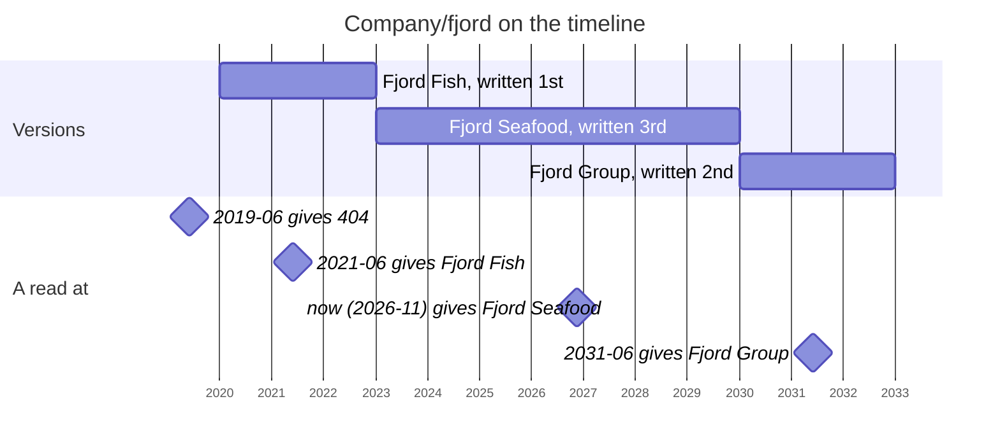
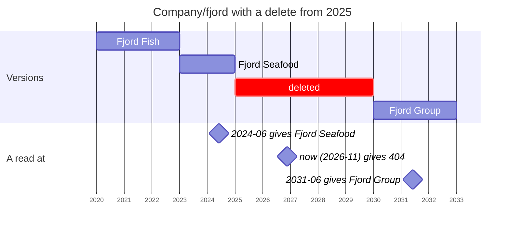
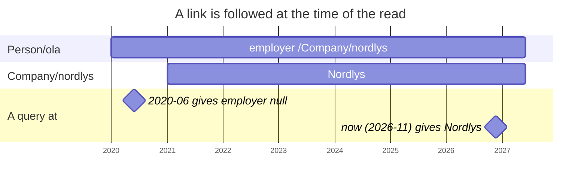
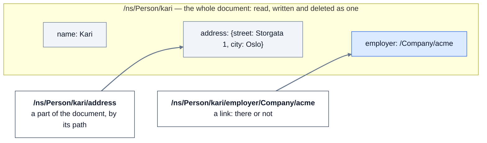
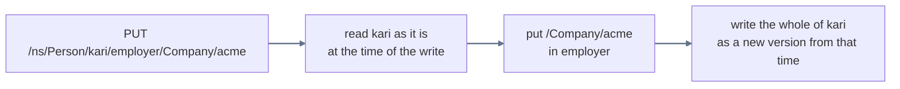
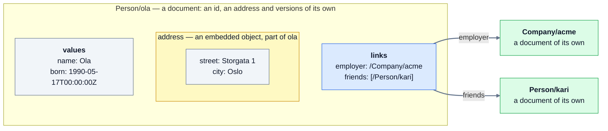
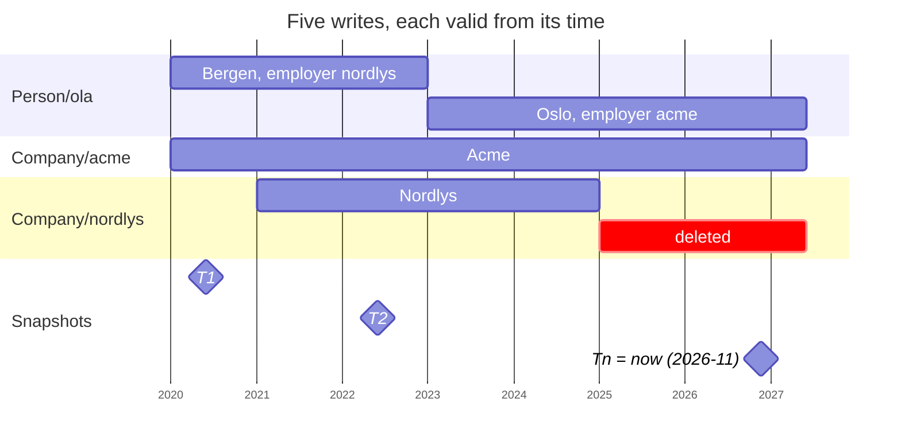
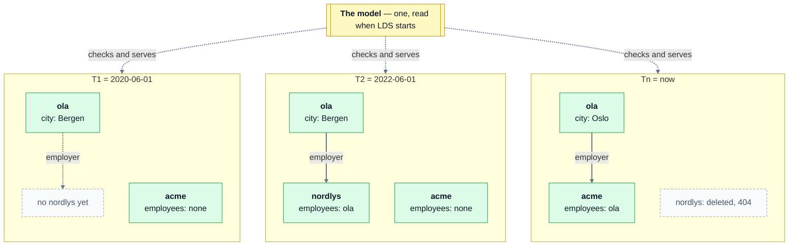
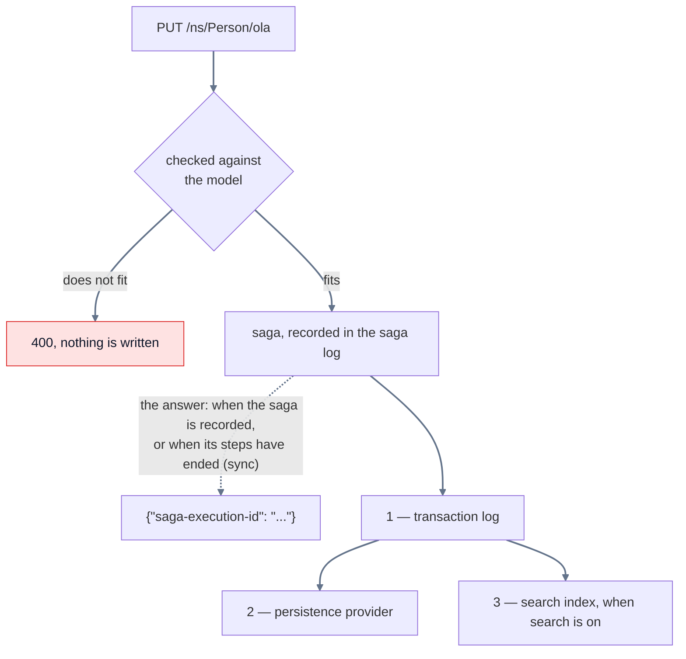

# Concepts

This document explains what Linked Data Store (LDS) is and the ideas it is built on: document, entity, namespace,
id, version, link, the three kinds of resource, model, provider, and what happens to a write. It is for people who
use LDS, and it is the document to read before the references. A few requests are shown to make an idea concrete.
The complete description of every request is in [the REST API](rest-api.md) and
[the GraphQL API](graphql-api.md).

## What LDS is

LDS is a server that keeps JSON documents and gives access to them over HTTP: a REST API that reads and writes,
and a GraphQL API that reads. It stands between the applications that work with the documents and the database
that keeps them. Four ideas make it what it is:

- **A model.** LDS reads a model when it starts. The model says which kinds of document there are and what a
  document of each kind holds. The addresses of the REST API and the queries of the GraphQL API follow from the
  model.
- **Time.** LDS is a time machine. A write adds a version of a document that is valid from a time, and leaves the
  other versions as they are. A read gives the document as it was at the time asked for.
- **Links.** A document can point at other documents. A link can be followed from both ends.
- **Providers.** LDS does not keep the documents itself. A persistence provider keeps them, and a search provider
  finds them by text. Each is chosen by configuration, and the requests stay the same.

Version `3.0.0` of LDS is in development and nothing is released. Where something does not work as a user would
expect, this document says so in a paragraph that starts with "Not finished:".

## About the examples

The examples were run against LDS `3.0.0-SNAPSHOT` with nothing configured but its port. LDS then has the example
model, with the entities `Person` and `Company`, and keeps everything in memory.
[Getting started](getting-started.md) tells how to start LDS that way.

The examples start with an LDS that has no documents. LDS in memory has none when it starts, so start it anew if
it has the documents of another guide.

In the commands `$LDS` stands for the address of LDS. Set it first. This is the address when the port is not
changed:

```sh
LDS=http://localhost:9090
```

The examples were run in the order they stand, on 20 November 2026, and a later example uses the documents of an
earlier one. LDS sends a JSON answer on one line; here it is shown formatted, with the fields in the order LDS
sent them. A GraphQL query is sent as `application/graphql`, the query itself as the body, so that it can be shown
formatted. A query with variables is sent as JSON.

## Document, entity, namespace and id

A **document** is a JSON object: what LDS keeps and gives back.

An **entity** is a kind of document, named in the model: `Person`, `Company`. Every document belongs to one entity.
The name is written as the model writes it, and upper and lower case letters count: `Company` is an entity of the
example model, `company` is not.

A **namespace** is the first part of every address of a document. One LDS serves one namespace. Its name is the
value of the configuration key `namespace.default`, which is `ns` when nothing else is set. An address with
another namespace, such as `/other/Company/acme`, is answered `400` with `Unsupported namespace: "other"`. The
namespace is kept with every document, and with PostgreSQL and Neo4j one database can hold the documents of
several namespaces.

An **id** names one document among the documents of its entity. The one who writes the document chooses the id. LDS
does not make ids.

Together they are the address of a document:

```
/{namespace}/{Entity}/{id}
```

| Part | In `/ns/Company/acme` | What it is |
|---|---|---|
| namespace | `ns` | The namespace the running LDS serves. |
| entity | `Company` | The kind of document, named as the model names it. |
| id | `acme` | Chosen by the one who writes the document. |

Write a document of the entity `Company` with the id `acme`, and read it:

```sh
curl -X PUT "$LDS/ns/Company/acme" -H 'Content-Type: application/json' -d '{"name": "Acme"}'
```

```json
{"saga-execution-id": "01a1f9de-1074-7733-a1ad-9ebe08cc9a57"}
```

```sh
curl "$LDS/ns/Company/acme"
```

```json
{"name": "Acme"}
```

The write is answered `201`. Its answer is not the document. It is the id of the saga that carried the write,
which is explained in [What a write goes through](#what-a-write-goes-through).

Not finished: a write with a body that LDS cannot read is answered `500` with no body. That is the answer to a
body that is not JSON. It is also the answer to `curl -d` without the header `Content-Type: application/json`,
because curl then names another content type.

LDS gives a document back with the values it was written with. Two things can differ. The fields can come in
another order than they were written in. A whole number that does not fit in 64 bits, and a decimal number with
more digits than a 64-bit floating point number holds, come back changed: `12345678901234567890` was read back as
`1.2345678901234567E19`.

## Version and time

LDS is a time machine. It does not keep one state of a document, it keeps the document through time:

- A write does not change the document that is there. It adds a **version**: the whole document as it is from a
  time on.
- The time comes with the write, in the query parameter `timestamp`. A write without it gets the time at which
  LDS receives the request.
- The time can be in the past, the present or the future. A version for a time in the future is kept now, and
  becomes the document that is read when that time has come.
- A version is valid from its time until the time of the next version.
- A read gives the version that is valid at the time asked for: the latest version whose time is not after it. A
  read without a time asks for now. At a time before the first version there is no document.
- Versions can be written in any order of time. A write at the exact time of a version that is there replaces
  that version. No other version is changed.

Three writes of the company `fjord`, each with the time from which it is valid. The last one written is the one
in the middle:

```sh
curl -X PUT "$LDS/ns/Company/fjord?timestamp=2020-01-01T00:00:00Z" -H 'Content-Type: application/json' \
     -d '{"name": "Fjord Fish"}'
curl -X PUT "$LDS/ns/Company/fjord?timestamp=2030-01-01T00:00:00Z" -H 'Content-Type: application/json' \
     -d '{"name": "Fjord Group"}'
curl -X PUT "$LDS/ns/Company/fjord?timestamp=2023-01-01T00:00:00Z" -H 'Content-Type: application/json' \
     -d '{"name": "Fjord Seafood"}'
```

Each was answered `201` with a `saga-execution-id`. What a read gives depends on the time it asks for:

| Request | Answer |
|---|---|
| `curl "$LDS/ns/Company/fjord?timestamp=2019-06-01T00:00:00Z"` | `404`, no body |
| `curl "$LDS/ns/Company/fjord?timestamp=2021-06-01T00:00:00Z"` | `{"name":"Fjord Fish"}` |
| `curl "$LDS/ns/Company/fjord"` (in November 2026) | `{"name":"Fjord Seafood"}` |
| `curl "$LDS/ns/Company/fjord?timestamp=2031-06-01T00:00:00Z"` | `{"name":"Fjord Group"}` |

On the timeline:



Every version of a document, oldest first, is its timeline:

```sh
curl "$LDS/ns/Company/fjord?timeline"
```

```json
[
  {
    "version": "2020-01-01T00:00Z[Etc/UTC]",
    "document": {"name": "Fjord Fish"}
  },
  {
    "version": "2023-01-01T00:00Z[Etc/UTC]",
    "document": {"name": "Fjord Seafood"}
  },
  {
    "version": "2030-01-01T00:00Z[Etc/UTC]",
    "document": {"name": "Fjord Group"}
  }
]
```

A time is written with an offset or with `Z`, as in `2020-01-01T00:00:00Z`. A time without one is refused with
`400`. LDS keeps the time of a version in UTC, so the same instant written with another offset is the same
version: a write to `fjord` with `timestamp=2020-01-01T01:00:00%2B01:00` replaced the first version, and the
timeline still had three. (In an address the plus sign of an offset is written `%2B`.)

The GraphQL API reads at a time too. There the time is given once for a whole query, in the query parameter
`snapshot`, and every document the query reaches is read at that time.

Not finished: the GraphQL API does not read a time as the REST API does. A `snapshot` that is not a time, or that
has no offset, is not refused: the query is answered as of now. And with LDS in memory, a `snapshot` with another
offset than `Z` gave a document at a time before its first version, where the REST API answered `404` for the
same time. Write a `snapshot` with `Z`.

### A delete in time

A delete does not take a document away. It adds a version that says: from this time the document is deleted. The
versions before that time stay and are still read at their times, and so do the versions after it. From the time
of the delete until the next version, the document is not there: a read of it is answered `404`, and it is not
in the list of the documents of its entity.

Delete `fjord` from the start of 2025:

```sh
curl -X DELETE "$LDS/ns/Company/fjord?timestamp=2025-01-01T00:00:00Z"
```

The answer is `204` with no body. After it:

| Request | Answer |
|---|---|
| `curl "$LDS/ns/Company/fjord?timestamp=2024-06-01T00:00:00Z"` | `{"name":"Fjord Seafood"}` |
| `curl "$LDS/ns/Company/fjord"` (in November 2026) | `404`, no body |
| `curl "$LDS/ns/Company/fjord?timestamp=2031-06-01T00:00:00Z"` | `{"name":"Fjord Group"}` |

On the timeline:



In the timeline the delete is a version with an empty document:

```json
[
  {
    "version": "2020-01-01T00:00Z[Etc/UTC]",
    "document": {"name": "Fjord Fish"}
  },
  {
    "version": "2023-01-01T00:00Z[Etc/UTC]",
    "document": {"name": "Fjord Seafood"}
  },
  {
    "version": "2025-01-01T00:00Z[Etc/UTC]",
    "document": {}
  },
  {
    "version": "2030-01-01T00:00Z[Etc/UTC]",
    "document": {"name": "Fjord Group"}
  }
]
```

A delete at the time of a version replaces that version, as a write does, and a write at the time of a delete
replaces the delete. A delete is accepted for an id that was never written: the timeline of that id then has a
deleted version and nothing else. No request of LDS takes a version away. A version changes only when a write or
a delete at its exact time replaces it.

## Link

A **link** is a field of a document that points at another document. The model says which fields are links, and
which entities each of them may point at. In the document a link is a text of the form `/Entity/id`, for example
`/Company/acme`. A field holds one link, or a list of links. A link has no namespace: it points at a document of
the same namespace.

When a document is written, LDS checks that a link has this form and names an entity that the field may link to.
LDS does not check that the document it points at exists. This is on purpose:

- Documents can be written in any order. The one that points can come before the one it points at.
- Documents live in time. The document a link points at may get its first version at a later time than the
  document that points at it, and may be deleted for a while.

Not finished: a link inside a part of a document is not always checked. With a model that is a GraphQL schema, a
document was written whose link, in a part that is an element of a list, was the text `not a link`.
[The model](model.md) says what is checked.

A link is followed at the time of the read. It leads to the document it points at as that document was at that
time, and it leads nowhere when there is no such document at that time.

Write a person whose `employer` is a company that does not exist:

```sh
curl -X PUT "$LDS/ns/Person/ola?timestamp=2020-01-01T00:00:00Z" -H 'Content-Type: application/json' \
     -d '{
       "name": "Ola",
       "employer": "/Company/nordlys"
     }'
```

The write is answered `201`. The REST API gives the link as the text it is. The GraphQL API follows it, and here
it leads nowhere:

```sh
curl "$LDS/graphql" -H 'Content-Type: application/graphql' \
     -d '{
       PersonById(id: "ola") {
         name
         employer {
           name
         }
       }
     }'
```

```json
{
  "data": {
    "PersonById": {"name": "Ola", "employer": null}
  }
}
```

Now write the company, valid from 2021, and send the same query again:

```sh
curl -X PUT "$LDS/ns/Company/nordlys?timestamp=2021-01-01T00:00:00Z" -H 'Content-Type: application/json' \
     -d '{"name": "Nordlys"}'
```

The write is answered `201`, and the query now gives:

```json
{
  "data": {
    "PersonById": {
      "name": "Ola",
      "employer": {"name": "Nordlys"}
    }
  }
}
```

The same query as of the middle of 2020, when Ola had the link and the company was not there yet:

```sh
curl "$LDS/graphql?snapshot=2020-06-01T00:00:00Z" -H 'Content-Type: application/graphql' \
     -d '{
       PersonById(id: "ola") {
         name
         employer {
           name
         }
       }
     }'
```

```json
{
  "data": {
    "PersonById": {"name": "Ola", "employer": null}
  }
}
```

A link can be read from the other end too. The example model gives the other end of `employer` the name
`employees`, so a company can be asked who links to it:

```sh
curl "$LDS/graphql" -H 'Content-Type: application/graphql' \
     -d '{
       CompanyById(id: "nordlys") {
         name
         employees {
           edges {
             node {
               name
             }
           }
         }
       }
     }'
```

```json
{
  "data": {
    "CompanyById": {
      "name": "Nordlys",
      "employees": {
        "edges": [
          {
            "node": {"name": "Ola"}
          }
        ]
      }
    }
  }
}
```

On the timeline:



| A query at | `ola` → `employer` leads to | Answer |
|---|---|---|
| 2020-06-01 | `nordlys`, which has no version yet | `"employer": null` |
| now | `nordlys` as it is now | `"employer": {"name": "Nordlys"}` |

Asked from the other end, `nordlys` has `ola` among its `employees`: that is the reverse link.

A delete does not look at links either. A document that other documents link to can be deleted. The links stay
in those documents as they are, and lead nowhere from the time of the delete.

## The three kinds of resource

The REST API has three kinds of resource. All three are read at a time and written at a time, as described
above.

| Kind | Address | What it is |
|---|---|---|
| The whole document | `/{namespace}/{Entity}/{id}` | One document. Without the id, the address is the list of the documents of the entity. |
| A part of a document | `/{namespace}/{Entity}/{id}/{field}` | One field of the document, or a field deeper in it, addressed by its path. It is a value, an object or a list. |
| A link | `/{namespace}/{Entity}/{id}/{link field}/{TargetEntity}/{target id}` | One link from the document to another document. It is there or it is not. |

In its own messages LDS calls them a managed resource, an embedded resource and a reference resource.



A write of a part or of a link is a write of the whole document:



Write the person `kari` and read a part of that document:

```sh
curl -X PUT "$LDS/ns/Person/kari" -H 'Content-Type: application/json' \
     -d '{
       "name": "Kari",
       "address": {"street": "Storgata 1", "city": "Oslo"}
     }'
curl "$LDS/ns/Person/kari/address"
```

```json
{"saga-execution-id": "01a1f9de-1286-7220-912c-c551bc2ca161"}

{
  "city": "Oslo",
  "street": "Storgata 1"
}
```

Then add a link to the document and read the whole document. (`sync=true` makes the answer to the write of the
link wait until the write is done; see [What a write goes through](#what-a-write-goes-through).)

```sh
curl -X PUT "$LDS/ns/Person/kari/employer/Company/acme?sync=true"
curl "$LDS/ns/Person/kari"
```

```json
{"saga-execution-id": "01a1f9de-12a0-72ac-8c2a-d60619db82d6"}

{
  "employer": "/Company/acme",
  "name": "Kari",
  "address": {"city": "Oslo", "street": "Storgata 1"}
}
```

A write to a part or to a link is a write of the whole document. LDS reads the document as it is at the time of
the write, changes it, and writes it as a new version. After the write of the document and the write of the link,
the timeline of `kari` had two versions: one without the link and one with it. So a part or a link can be written
only to a document that is there at that time; otherwise the answer is `404` with no body.

Not finished: writes to parts and links of one document are not kept apart. Two that run at the same time each
read the document, and each writes it without the change of the other. With LDS in memory, 20 links added to one
document at the same time were all answered `200`, and the document then had 12 of them. Sent one after the
other, all 20 were there.

Not finished: a path does not reach every field of a document. With the example model,
`/ns/Person/kari/address/city` is answered `400` with `Not a valid path element: "city"`.

Which paths a model gives, and every method and answer, is in [the REST API](rest-api.md).

## The model

The **model** says what LDS keeps: the entities, the fields of the documents of each entity and the kind of value
of each field, the fields a document must have, and which fields are links and to which entities. A model is
written in one of two forms:

- a GraphQL schema, in one file;
- JSON Schema 2020-12 files, one file for each entity.

This is the entity `Person` of the example model, a GraphQL schema. `@domain` makes the type an entity. `!` marks
a field that a document must have. `@link` makes a field a link: `employer` is one link to a `Company`, `friends`
is a list of links to documents of `Person`. `Address` is a type without `@domain`, an embedded type: it is not
an entity, and its values are parts of the documents it is used in.

```graphql
type Person @domain {
  name: String!
  born: DateTime
  address: Address
  employer: Company @link(reverseName: "employees")
  friends: [Person] @link
}
```

### What a field holds

This is the heart of a model. A field of a document holds one of three things:



- **A value**: a text, a number, `true` or `false`, a date-time, the name of an enum, or a list of them.
- **An embedded object**, when the type of the field is an embedded type, a type without `@domain`: `address` is
  an `Address`. A list of them is written `[Chapter]`. The object is part of the document it is in. It has no id
  and no versions of its own; it is written and read with its document, and it can be reached by its path, as
  [the three kinds of resource](#the-three-kinds-of-resource) shows. An embedded type has fields of the same three
  kinds in its turn.
- **A link**, when the type of the field is an entity and the field has `@link`: the text `/Entity/id`, or a list
  of them. The document it
  points at is not copied into this one. It is a document of its own, with versions of its own, and a read
  follows the link to that document as it is at the time the read asks for (see
  [snapshots](#snapshots-the-time-machine)). A field may also link to a document of one of several entities: in a
  GraphQL schema the type of the field is then a union of them, and in JSON Schema files the field names each.

A field whose type is an entity can also hold the values of that entity in the document itself, as an embedded
object: a copy, not a link. That is a list of an entity without `@link`, such as `support: [Support]`, where the
entity `Support` has a link of its own (`technical: [Contact] @link`). The values are then part of the document
they are in, as an embedded object is, and are reached by their path: `/ns/Agreement/a1/support`, and the link
inside it at `/ns/Agreement/a1/support/technical/Contact/c1`. They have no id and no versions of their own, and a
later version of a `Support` document does not change them. Any other field whose type is an entity is read as a
link when `@link` is left out: `owner: Support` holds the text `/Support/id`.

Not finished: the copy does not work as written. The field holds one object, not a list: a list is refused with
`$.support: array found, object expected`. Of the fields of the entity each list is read as a list of links,
also a list of texts, and the others are not checked: `level` is taken as it comes. The GraphQL API still reads the field as a list, and answers it with `null` and the error
`Can't resolve value (/AgreementById/support) : type mismatch error, expected type LIST`.
[The model](model.md#shapes-that-do-not-work-as-written) lists it with the other shapes.

Not finished: a field whose type is an interface is none of the three. The fields of the interface become fields
of the entity, and the field itself is not checked. [The model](model.md#shapes-that-do-not-work-as-written) lists
this with other shapes LDS does not read as they are written.

### Checked when a document is written

LDS reads the model once, when it starts. To change the model, LDS is started again with the new one.

Before a document is written, LDS checks it against the model. A document that does not fit is refused with
`400` and a text that says what is wrong, and nothing is written:

```sh
curl -X PUT "$LDS/ns/Person/per" -H 'Content-Type: application/json' -d '{"name": 7}'
curl -X PUT "$LDS/ns/Person/per" -H 'Content-Type: application/json' \
     -d '{
       "name": "Per",
       "employer": "/Person/ola"
     }'
```

```
Schema validation error: [$.name: integer found, string expected]
Schema validation error: Illegal linked-domain: "Person". Navigation: employer: "/Person/ola"
```

Not finished: the check does not cover everything a model says. With the example model the value of `address` is
not checked: a person was written with `"address":7`, and another with an address that has no `city`.

The addresses follow the model as well. A request for an entity the model does not have, such as
`/ns/Robot/r2`, is answered `400` with `Not a managed resource name: "Robot"`.

The two forms are not equal in one thing: LDS makes its GraphQL API from a GraphQL schema, so a model given as
JSON Schema files has the REST API only.

How to write a model, what exactly LDS checks in a document and what it does not check, is in
[the model](model.md).

## Snapshots: the time machine

A **snapshot** is what LDS keeps, as it was at one time: every document in the version that is valid at that time,
and every link followed at that time. A read asks for a snapshot by its time: `timestamp` in the REST API,
`snapshot` in the GraphQL API, and now when no time is given. T1, T2 and Tn are three snapshots of one history:



The snapshots of that history: every document as it was at T, and every link followed at T.



These are the five writes, and the GraphQL query that was sent at T1, T2 and Tn:

```sh
curl -X PUT "$LDS/ns/Company/acme?sync=true&timestamp=2020-01-01T00:00:00Z" -H 'Content-Type: application/json' \
     -d '{"name": "Acme"}'
curl -X PUT "$LDS/ns/Person/ola?sync=true&timestamp=2020-01-01T00:00:00Z" -H 'Content-Type: application/json' \
     -d '{
       "name": "Ola",
       "address": {"city": "Bergen"},
       "employer": "/Company/nordlys"
     }'
curl -X PUT "$LDS/ns/Company/nordlys?sync=true&timestamp=2021-01-01T00:00:00Z" -H 'Content-Type: application/json' \
     -d '{"name": "Nordlys"}'
curl -X PUT "$LDS/ns/Person/ola?sync=true&timestamp=2023-01-01T00:00:00Z" -H 'Content-Type: application/json' \
     -d '{
       "name": "Ola",
       "address": {"city": "Oslo"},
       "employer": "/Company/acme"
     }'
curl -X DELETE "$LDS/ns/Company/nordlys?sync=true&timestamp=2025-01-01T00:00:00Z"
curl "$LDS/graphql?snapshot=2020-06-01T00:00:00Z" -H 'Content-Type: application/graphql' \
     -d '{
       PersonById(id: "ola") {
         name
         address {
           city
         }
         employer {
           name
         }
       }
       CompanyById(id: "acme") {
         name
         employees {
           edges {
             node {
               name
             }
           }
         }
       }
     }'
```

The writes were answered `201`, and the delete `204`. The answers to the query, at T1, at T2
(`snapshot=2022-06-01T00:00:00Z`) and now (no `snapshot`):

```json
{
  "data": {
    "PersonById": {
      "name": "Ola",
      "address": {"city": "Bergen"},
      "employer": null
    },
    "CompanyById": {
      "name": "Acme",
      "employees": {
        "edges": []
      }
    }
  }
}

{
  "data": {
    "PersonById": {
      "name": "Ola",
      "address": {"city": "Bergen"},
      "employer": {"name": "Nordlys"}
    },
    "CompanyById": {
      "name": "Acme",
      "employees": {
        "edges": []
      }
    }
  }
}

{
  "data": {
    "PersonById": {
      "name": "Ola",
      "address": {"city": "Oslo"},
      "employer": {"name": "Acme"}
    },
    "CompanyById": {
      "name": "Acme",
      "employees": {
        "edges": [
          {
            "node": {"name": "Ola"}
          }
        ]
      }
    }
  }
}
```

A snapshot is whole: a link is not followed to the document as it is now, but as it was at the time of the
snapshot. At T2 `nordlys` was there and `ola` worked for it; at Tn `nordlys` is deleted (`GET
/ns/Company/nordlys` is answered `404`) and the earlier link leads nowhere, while T2 still gives it.

The model is the same for every snapshot. LDS reads one model when it starts, and uses it for every time: a write is
checked against it whatever time the write is for, and the GraphQL API is made from it, the same for T1 as for Tn.
A person written for 2019 without the `name` that the model asks for is refused as one written for now would be:

```sh
curl -X PUT "$LDS/ns/Person/per?sync=true&timestamp=2019-01-01T00:00:00Z" -H 'Content-Type: application/json' \
     -d '{"born": "1970-01-01T00:00:00Z"}'
```

```
Schema validation error: [$: required property 'name' not found]
```

The versions that are stored are not checked again when LDS is started with another model. They are given back
as they were written.

Not finished: the model is not kept on the timeline. A snapshot holds the documents of its time, not the model
they were written under. Every write goes into the transaction log with a place for the model it was checked
against, `schema`, which a test of LDS fills with the name of a model version, `testng-schema-v1.0`. LDS itself
writes the text `TODO` there. When LDS is started with another model, every snapshot, T1 as well as Tn, is checked
and served with that model.

## Providers

LDS leaves two jobs to **providers**, parts that can be exchanged by configuration: keeping the documents
(persistence) and finding them by text (search).

### Persistence

The persistence provider keeps every version of every document. There are three, chosen with the configuration
key `persistence.provider`:

| Provider | Where the documents are |
|---|---|
| `mem` | In the memory of the LDS process. Nothing is left when LDS stops. It is for trying LDS and for tests, and it is what LDS uses when nothing else is configured. |
| `postgres` | In a PostgreSQL database. |
| `neo4j` | In a Neo4j database, as a graph: documents are nodes and links are relationships between them. |

The addresses and the requests are the same with every provider, and so are the rules for versions, deletes and
links that this document describes: every provider passes the same tests for them. The choice decides where the
documents are, whether they are there after LDS has stopped, and what has to run beside LDS.
[Configuration](configuration.md) has the keys of each provider, and [operations](operations.md) says
what each one stores and what to keep safe.

### Search

Search is optional, and it is off when nothing else is configured (the key `graphql.search.enabled`). There is one
search provider, `solr`, which uses Apache Solr. With search on, every write and every delete of a document also
goes to the search index, and the GraphQL API gets a field `Search`. Search is reached through the GraphQL API
only, so it needs a model that is a GraphQL schema.

Search finds a document by the texts of its fields named `languageText`, and by nothing else in the document.
What search covers is under review.

## What a write goes through

Every write of the REST API is carried by a **saga**: a short list of steps that LDS records as it does them, so
that a write that was begun is also completed. That holds for a write and a delete of a whole document, of a part
and of a link. The steps are:

1. An entry for the write is put in the **transaction log**, a log with one entry for every write.
2. The document is written to the persistence provider, or marked as deleted there.
3. When search is on, the search index is updated.

Step 1 is done first. Steps 2 and 3 both come after it, and neither waits for the other.



LDS records the start of a saga, with the whole request, and the start and the end of each step in a **saga log**.
A saga that does not complete, because a step failed or because LDS stopped, stays in the saga log and is run
again later, with the request as it was first sent: the same document and the same time. LDS goes forward only: a
step that was done is not undone when a later step fails.

Not finished: a saga is not run again without end. When it is run again because a later write needs its place in
the saga log, and it fails once more, LDS moves it to a log that nothing reads, and its write is not done.
[Operations](operations.md) says when a saga is run again.

The answer to a write holds the id of its saga, `{"saga-execution-id":"..."}`. It is the id of the entry in the
transaction log too. A few answers have no body, such as the `204` to a delete of a whole document;
[the REST API](rest-api.md) has the answer of every request.

The saga log and the transaction log have providers of their own. With nothing configured, the saga log is in
memory, so a saga that has not completed when LDS ends is lost, and the transaction log is not kept at all. Both
can be kept in PostgreSQL; see [configuration](configuration.md) and [operations](operations.md).

Not finished: LDS writes the transaction log and reads it back for one thing only: to tell a source of writes
which of its writes was the last. Nothing in LDS builds the documents again from a transaction log.

### What `sync` means

The query parameter `sync` of a write says whether the answer waits for the saga.

- **The answer waits.** It is sent when every step has ended. A read sent after the answer gives what was written.
- **The answer does not wait.** It is sent when the saga, with the request, is in the saga log. The steps are done
  shortly after. A read sent right after the answer may not give what was written yet, and when a step fails,
  the one who sent the write is not told.

When `sync` is not given, a write or a delete of a whole document waits, and a write or a delete of a part or
of a link does not wait. `sync=true` makes every write wait, and `sync=false` makes none wait.
[The REST API](rest-api.md#when-lds-answers-a-write-sync) has the table of every case.

Not finished: a write whose saga fails while the answer waits is answered `500` with no body, and the `500` does
not say whether the document was written. A saga that failed is run again later, so the write may also be done
after the `500`. [The REST API](rest-api.md#when-a-write-fails) shows what a failed write can leave behind.

## A call is safe to send again

Every call of the HTTP API is idempotent: a call can be sent a second time, and a read then gives what it gave
after the first. So when no answer comes, or the answer is `500`, the call is sent again. No call needs to be
looked up first to find out whether it was done.

- A read changes nothing. A read with a `timestamp` gives the same answer every time, until a write adds or
  replaces a version at or before that time.
- A write of a document with a `timestamp` writes the version of that time. Sent again, it replaces that version
  with the same document.
- A delete with a `timestamp` writes the same deleted version again. A delete of a document that is not there is
  answered `204`, as a delete of a document that is there.
- A write of a link that the document has is answered `200` and writes nothing. A delete of a link that the
  document does not have is answered `200` and writes nothing.

The same write sent twice with a `timestamp`, and the timeline after it:

```sh
curl -X PUT "$LDS/ns/Company/hav?timestamp=2024-03-01T00:00:00Z" -H 'Content-Type: application/json' \
     -d '{"name": "Hav"}'
curl -X PUT "$LDS/ns/Company/hav?timestamp=2024-03-01T00:00:00Z" -H 'Content-Type: application/json' \
     -d '{"name": "Hav"}'
curl "$LDS/ns/Company/hav?timeline"
```

```json
{"saga-execution-id": "01a1f9de-132e-7ff3-881c-4244047f7318"}

{"saga-execution-id": "01a1f9de-133b-7fe7-a137-63ec95e5e356"}

[
  {
    "version": "2024-03-01T00:00Z[Etc/UTC]",
    "document": {"name": "Hav"}
  }
]
```

One thing follows from time. A write without a `timestamp` gets the time at which LDS receives it, so each time it
is sent it adds a version. A read gives the same document after the second as after the first, and the timeline
has one version more. A delete without a `timestamp` adds a deleted version each time in the same way. The same
write sent twice without a `timestamp`:

```sh
curl -X PUT "$LDS/ns/Company/vind" -H 'Content-Type: application/json' -d '{"name": "Vind"}'
curl -X PUT "$LDS/ns/Company/vind" -H 'Content-Type: application/json' -d '{"name": "Vind"}'
curl "$LDS/ns/Company/vind?timeline"
```

```json
{"saga-execution-id": "01a1f9de-1353-7e41-830b-28eb4c54befc"}

{"saga-execution-id": "01a1f9de-1360-7964-9445-947a2c18689a"}

[
  {
    "version": "2026-11-20T16:50:43.155Z[Etc/UTC]",
    "document": {"name": "Vind"}
  },
  {
    "version": "2026-11-20T16:50:43.168Z[Etc/UTC]",
    "document": {"name": "Vind"}
  }
]
```

A caller that wants a write to be exactly the same when it is sent again gives it a `timestamp`.

## Where to read next

- [Getting started](getting-started.md): start LDS and write a first document.
- [The model](model.md): how to write a model, and what LDS checks.
- [The REST API](rest-api.md): every address, method, parameter and answer.
- [The GraphQL API](graphql-api.md): the queries LDS makes from a model.
- [Configuration](configuration.md): every key, and how to choose providers.
- [Operations](operations.md): running LDS, the saga log and recovery.
