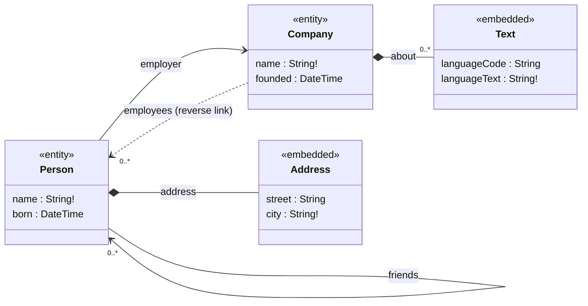

# Getting started with Linked Data Store

This guide takes you from nothing to a first document in Linked Data Store (LDS). You start LDS, write two
documents, read them, read one as it was at an earlier time, link them, and ask for them with GraphQL. It is for
people who want to use LDS and have not used it before.

LDS is a server that keeps JSON [documents](../glossary.md#document). A document has [versions](../glossary.md#version),
and a document can [link](../glossary.md#link) to other documents. You read and write documents over HTTP. The guide
shows this at work; [Concepts](concepts.md) explains the ideas.

## What is needed

- A copy of the LDS repository. LDS 3.0 is in development and nothing is released: there is no image and no
  program to fetch. You build version `3.0.0-SNAPSHOT` from the repository.
- JDK 27, to build LDS and to start it on the JDK.
- Docker with `docker compose`, only for the two ways to start LDS that use containers.
- `curl`, or another program that sends HTTP requests. The examples use `curl`.

## Build LDS

In the root of the repository:

```sh
./mvnw package -DskipTests
```

`./mvnw` is in the repository and fetches Maven itself.

## Start LDS

There are three ways. Choose one. As it comes, that is with no configuration of your own, LDS keeps everything in
memory, has an example [model](../glossary.md#model) and answers on port 9090.

### In a container

```sh
docker build -t lds-server linked-data-store-server
docker run --rm -p 127.0.0.1:9090:9090 lds-server
```

This is LDS as it comes, in an image that is built on your machine.

### The whole stack with compose

```sh
docker compose -f linked-data-store-server/compose.yaml up --build
```

This starts LDS together with three other programs: Neo4j, which keeps the documents; PostgreSQL, which keeps the two
logs LDS writes for every write (the [saga log](../glossary.md#saga-log) and the [transaction
log](../glossary.md#transaction-log)); and Solr, which is the search index. It is for development only: the passwords
are written in the file.

Two things differ from the other ways:

- The documents are kept when the stack is stopped and started again. This command removes them:

  ```sh
  docker compose -f linked-data-store-server/compose.yaml down -v
  ```
- Search is on. Search finds a document by the texts of its fields named `languageText`. What search covers is
  under review. [The GraphQL API](graphql-api.md) tells how to search.

[Operations](operations.md) tells more about the image and the stack.

### On the JDK

```sh
cd linked-data-store-server
java -cp "target/*:target/lib/*" io.descoped.lds.server.Server
```

Start LDS in this directory: it reads the example model from `schemas/schema.graphql`, and that path is relative
to the directory LDS is started in.

LDS writes its log to the terminal. It has started when the log has a line that ends like this one, with a
number of its own:

```
Server started in 457ms..
```

### Check that LDS answers

```sh
curl -i 'http://localhost:9090/ping'
```

```http
HTTP/1.1 200 OK
```

If another program uses port 9090, LDS on the JDK ends with an error that says `Address already in use`.
Give LDS another port with the environment variable `LDS_HTTP_PORT`: write `LDS_HTTP_PORT=9190` in front of
`java`. For the stack, write `LDS_PORT=9190` in front of `docker compose`. Then use that port in every address
below. [Configuration](configuration.md) has every setting.

The answers in this guide come from LDS started on the JDK, in memory. Each answer is shown as its status line
and its body; the headers are left out. LDS sends a body on one line; here it is shown
formatted, with the fields in the order LDS sent them.

## The example model

The model says which documents LDS keeps and what a document must look like. LDS reads the model when it starts.
The example model is the file `linked-data-store-server/schemas/schema.graphql`, a GraphQL schema. These are its
main lines:

```graphql
type Person @domain {
  name: String!
  born: DateTime
  address: Address
  employer: Company @link(reverseName: "employees")
  friends: [Person] @link
}

type Address {
  street: String
  city: String!
}

type Company @domain {
  name: String!
  founded: DateTime
  about: [Text]
}
```

- A type with `@domain` is an *[entity type](../glossary.md#entity-type)*: LDS keeps documents of it. The entity types
  here are `Person` and `Company`.
- A type without `@domain` is an embedded type: its values are *[embedded objects](../glossary.md#embedded-object)*,
  parts of the documents they are in. An `Address` is a part of a `Person`.
- A field with `@link` holds a *link*, a typed reference to another document. `employer` links a person to a
  company, and `friends` links a person to other persons.
- The `!` in `name: String!` says that every person must have a `name`.

The whole model, drawn:



A filled diamond is an embedded type: its values are embedded objects, part of the document they are in (composition).
An arrow is a link: the document holds the text `/Entity/id`, and what it points at is a document of its own
(association). A dotted arrow back is the [reverse link](../glossary.md#reverse-link), which only the GraphQL API has.

Ask LDS which entity types it has:

```sh
curl -i 'http://localhost:9090/ns?schema'
```

```http
HTTP/1.1 200 OK

["/ns/Company?schema", "/ns/Person?schema"]
```

Each of the two addresses gives the JSON Schema that LDS checks a document of that entity type against.
[The model](model.md) tells how to write a model of your own.

## Write two documents

The address of a document is `/{namespace}/{Entity}/{id}`.

- The *[namespace](../glossary.md#namespace)* is the first part of the address. It is `ns`, as LDS comes.
- The entity type is `Person` or `Company`, written as in the model.
- The *id* is yours to choose. LDS does not make ids.

An address with another namespace, or with an entity type that the model does not have, is answered `400 Bad Request`.

Write a company with the id `acme`. The body is the document, and the header `Content-Type: application/json`
says that it is JSON:

```sh
curl -i -X PUT 'http://localhost:9090/ns/Company/acme?sync=true' -H 'Content-Type: application/json' \
     -d '{
       "name": "Acme",
       "founded": "1990-05-17T00:00:00Z"
     }'
```

```http
HTTP/1.1 201 Created

{"saga-execution-id": "01a1f9d3-cc1f-70f5-aade-e0b3674393c3"}
```

LDS carries out every write as a *[saga](../glossary.md#saga)*, and the answer gives the id of that saga. The id is new
for every write. With `sync=true` LDS answers when the write is done, its saga completed, so a read that follows sees
the document: a [synchronous write](../glossary.md#synchronous-write) gives read-your-writes. [Concepts](concepts.md)
tells what a write goes through.

Now a person with the id `ola`:

```sh
curl -i -X PUT 'http://localhost:9090/ns/Person/ola?sync=true' -H 'Content-Type: application/json' \
     -d '{
       "name": "Ola",
       "address": {"street": "Storgata 1", "city": "Oslo"}
     }'
```

```http
HTTP/1.1 201 Created

{"saga-execution-id": "01a1f9d3-cc42-7abc-916b-4f732f1d54f1"}
```

LDS checks a document against the model before it writes it ([schema validation](../glossary.md#schema-validation)). A
document that fails the check is refused with a text that says what is wrong, and nothing is written. Here the name is a
number:

```sh
curl -i -X PUT 'http://localhost:9090/ns/Person/kari?sync=true' -H 'Content-Type: application/json' \
     -d '{"name": 7}'
```

```
HTTP/1.1 400 Bad Request

Schema validation error: [$.name: integer found, string expected]
```

A field that the model does not have is not refused: LDS writes it with the document.
[The model](model.md) tells what LDS checks.

Not finished: with a model that is a GraphQL schema, as the example model is, LDS does not check a single embedded
object, such as `address`. The example model says that an address must have a `city`, and a person whose address has no
`city` is written all the same.

Not finished: a write with a body that LDS cannot read is answered `500 Internal Server Error` with no body, and
the reason is only in the log of LDS. This happens when the body is not JSON. It also happens when the header
`Content-Type: application/json` is left out of a `curl -d` command, because `curl` then names another content
type.

## Read the documents

```sh
curl -i 'http://localhost:9090/ns/Person/ola'
```

```http
HTTP/1.1 200 OK

{
  "name": "Ola",
  "address": {"city": "Oslo", "street": "Storgata 1"}
}
```

The fields can come in another order than you sent them.

The address of the entity type gives all its documents. The answer has the documents and not their ids:

```sh
curl -i 'http://localhost:9090/ns/Person'
```

```http
HTTP/1.1 200 OK

[
  {
    "name": "Ola",
    "address": {"city": "Oslo", "street": "Storgata 1"}
  }
]
```

## Write a second version and read the document as it was

LDS is a [time machine](../glossary.md#time-machine). A write does not replace the document: it makes a new *version* of
it, and the versions that are there are kept. A version has a *[valid time](../glossary.md#valid-time)*, the instant
from which it holds. The writes above gave no valid time, so the valid time of their versions is the time LDS received
the request.

The query parameter `timestamp` gives the valid time. It can be in the past, the present or the future. Say that Ola
lived in Bergen from 2020. Write that as a version that is valid from 1 January 2020:

```sh
curl -i -X PUT 'http://localhost:9090/ns/Person/ola?sync=true&timestamp=2020-01-01T00:00:00Z' \
     -H 'Content-Type: application/json' \
     -d '{
       "name": "Ola",
       "address": {"street": "Bryggen 3", "city": "Bergen"}
     }'
```

```http
HTTP/1.1 201 Created

{"saga-execution-id": "01a1f9d3-cc98-79ba-894c-af5628927cec"}
```

A read without `timestamp` gives the document as it is now. That is still the version you wrote first: it is
the newest version that is valid now.

```sh
curl -i 'http://localhost:9090/ns/Person/ola'
```

```http
HTTP/1.1 200 OK

{
  "name": "Ola",
  "address": {"city": "Oslo", "street": "Storgata 1"}
}
```

A read with `timestamp` is an [as-of read](../glossary.md#as-of-read): it gives the document as it was at that time. On
1 June 2021 Ola lived in Bergen:

```sh
curl -i 'http://localhost:9090/ns/Person/ola?timestamp=2021-06-01T00:00:00Z'
```

```http
HTTP/1.1 200 OK

{
  "name": "Ola",
  "address": {"city": "Bergen", "street": "Bryggen 3"}
}
```

Before 2020 the document has no version, so LDS answers that it is not there:

```sh
curl -i 'http://localhost:9090/ns/Person/ola?timestamp=2019-06-01T00:00:00Z'
```

```http
HTTP/1.1 404 Not Found
```

LDS answers the same for an id that was never written.

`?timeline` gives the [timeline](../glossary.md#timeline) of the document: every version with its valid time, the oldest
first. The valid time of the second version is the time of your own write:

```sh
curl -i 'http://localhost:9090/ns/Person/ola?timeline'
```

```http
HTTP/1.1 200 OK

[
  {
    "version": "2020-01-01T00:00Z[Etc/UTC]",
    "document": {
      "name": "Ola",
      "address": {"city": "Bergen", "street": "Bryggen 3"}
    }
  },
  {
    "version": "2026-11-20T16:39:29.602Z[Etc/UTC]",
    "document": {
      "name": "Ola",
      "address": {"city": "Oslo", "street": "Storgata 1"}
    }
  }
]
```

A `timestamp` is a date and a time with `Z` (UTC) or an offset at the end. The `+` of an offset is written `%2B`
in an address. A date alone is refused with `400 Bad Request`.

Two more things about time:

- A write at the valid time of a version that is there replaces that version.
- A version whose valid time is in the future is not in a read without `timestamp` until that time has come. A document
  whose only version is in the future is answered `404 Not Found` until then.

[The REST API](rest-api.md) has the rules.

## Link a person to a company

A link is a field of a document. Its value is the text `/{Entity}/{id}` of the document it points at. In the
example model the field `employer` of a person links to a company.

A link has an address of its own: the address of the document, then the field, then the entity type and the id of the
document it points at. A `PUT` to that address adds the link. It needs no body:

```sh
curl -i -X PUT 'http://localhost:9090/ns/Person/ola/employer/Company/acme?sync=true'
```

```http
HTTP/1.1 200 OK

{"saga-execution-id": "01a1f9d3-ccf5-7449-b686-9b6a044a52ae"}
```

This is a write like the others: it makes a new version of the person, valid from now, with the link in it. Send
the request again and the answer is `200 OK` with no body: the link is there, and no version is made. The
document that gets the link must be there: for a person that LDS does not have, the answer is `404 Not Found`.

```sh
curl -i 'http://localhost:9090/ns/Person/ola'
```

```http
HTTP/1.1 200 OK

{
  "employer": "/Company/acme",
  "name": "Ola",
  "address": {"city": "Oslo", "street": "Storgata 1"}
}
```

A link can also be written as a field of the document. Kari works for the same company and has Ola as a friend:

```sh
curl -i -X PUT 'http://localhost:9090/ns/Person/kari?sync=true' -H 'Content-Type: application/json' \
     -d '{
       "name": "Kari",
       "employer": "/Company/acme",
       "friends": ["/Person/ola"]
     }'
```

```http
HTTP/1.1 201 Created

{"saga-execution-id": "01a1f9d3-cd18-7e1c-aabb-1aa6badf5a2c"}
```

To follow a link with REST, read the document at the address the link gives, with the namespace in front:

```sh
curl -i 'http://localhost:9090/ns/Company/acme'
```

```http
HTTP/1.1 200 OK

{
  "founded": "1990-05-17T00:00:00Z",
  "name": "Acme"
}
```

LDS does not check that the document a link points at exists. A link can point at a document that is written later;
until then it is a dangling reference. Per works for a company that LDS does not have:

```sh
curl -i -X PUT 'http://localhost:9090/ns/Person/per?sync=true' -H 'Content-Type: application/json' \
     -d '{
       "name": "Per",
       "employer": "/Company/not-yet"
     }'
```

```http
HTTP/1.1 201 Created

{"saga-execution-id": "01a1f9d3-cd3b-7722-9537-23bd467f0772"}
```

## Ask with GraphQL

LDS makes a GraphQL API from the model, at `/graphql`. GraphQL reads documents; they are written with REST. For every
entity type LDS makes a query that gives one document by its id: `PersonById` and `CompanyById` here.

The examples send a query with `POST`, as JSON. The header `Content-Type: application/json` must be there:
without it LDS answers `415 Unsupported Media Type`.

A query follows links by itself. One request gives the person and the company the person links to:

```sh
curl -i 'http://localhost:9090/graphql' -H 'Content-Type: application/graphql' \
     -d '{
       PersonById(id: "ola") {
         name
         address {
           city
         }
         employer {
           name
           founded
         }
       }
     }'
```

```http
HTTP/1.1 200 OK

{
  "data": {
    "PersonById": {
      "name": "Ola",
      "address": {"city": "Oslo"},
      "employer": {"name": "Acme", "founded": "1990-05-17T00:00:00Z"}
    }
  }
}
```

A link can be followed from the other end too. The model gives the link `employer` the reverse name `employees`,
so a company has a field `employees` with the persons that link to it:

```sh
curl -i 'http://localhost:9090/graphql' -H 'Content-Type: application/graphql' \
     -d '{
       CompanyById(id: "acme") {
         name
         employees {
           edges {
             node {
               name
             }
           }
         }
       }
     }'
```

```http
HTTP/1.1 200 OK

{
  "data": {
    "CompanyById": {
      "name": "Acme",
      "employees": {
        "edges": [
          {
            "node": {"name": "Kari"}
          },
          {
            "node": {"name": "Ola"}
          }
        ]
      }
    }
  }
}
```

A list comes as `edges`, and the `node` of each edge is a document. Per is not in the list: his link points at
another company.

A link that points at a document that does not exist, a dangling reference, gives `null`:

```sh
curl -i 'http://localhost:9090/graphql' -H 'Content-Type: application/graphql' \
     -d '{
       PersonById(id: "per") {
         name
         employer {
           name
         }
       }
     }'
```

```http
HTTP/1.1 200 OK

{
  "data": {
    "PersonById": {"name": "Per", "employer": null}
  }
}
```

An id that LDS has no document for is answered in another way than with REST. The answer is `200 OK`, with an
error and no data:

```sh
curl -i 'http://localhost:9090/graphql' -H 'Content-Type: application/graphql' \
     -d '{
       PersonById(id: "nobody") {
         name
       }
     }'
```

```
HTTP/1.1 200 OK

{"errors":[{"message":"The field at path '/PersonById' was declared as a non null type, but ...",...}],
 "data":null}
```

GraphQL makes as-of reads too. The time is the query parameter `snapshot` in the address, and the whole query, with the
links it follows, is answered as of that time:

```sh
curl -i 'http://localhost:9090/graphql?snapshot=2021-06-01T00:00:00Z' -H 'Content-Type: application/graphql' \
     -d '{
       PersonById(id: "ola") {
         name
         address {
           city
         }
       }
     }'
```

```http
HTTP/1.1 200 OK

{
  "data": {
    "PersonById": {
      "name": "Ola",
      "address": {"city": "Bergen"}
    }
  }
}
```

Not finished: a `snapshot` that LDS cannot read as a time, a date alone for example, is not refused. The query
is then answered as of now, with no error.

Not finished: a query that asks for a single link, such as `employer`, of a document that does not have that
field gets an error for the field. The version of Ola from 2020 has no `employer`:

```sh
curl -i 'http://localhost:9090/graphql?snapshot=2021-06-01T00:00:00Z' -H 'Content-Type: application/graphql' \
     -d '{
       PersonById(id: "ola") {
         name
         employer {
           name
         }
       }
     }'
```

```
HTTP/1.1 200 OK

{"errors":[{"message":"Exception while fetching data (/PersonById/employer) : ...",...}],
 "data":{"PersonById":{"name":"Ola","employer":null}}}
```

`http://localhost:9090/graphiql` is a page for writing and sending queries in a browser. The page fetches its
scripts from `unpkg.com`, so the browser needs access to the internet.

[The GraphQL API](graphql-api.md) has every query: lists of documents, pages of a list, and search.

## Stop LDS

Started on the JDK, LDS stops when you press Ctrl-C in its terminal, or when you `kill` its process. It first
completes the requests and the writes it is working on. The last line of its log then ends with `Leaving.. Bye!`.

As it comes, LDS keeps everything in memory, so the documents of this guide are gone when it has stopped.
[Operations](operations.md) tells how to stop the container and the stack.

## Where to go next

- [Concepts](concepts.md): what a document, a version, a link and a namespace are, and what a write goes
  through.
- [The model](model.md): how to write a model of your own, and what LDS checks in a document.
- [The REST API](rest-api.md): every address and answer, with parts of a document, delete and the rules for
  time.
- [The GraphQL API](graphql-api.md): every query LDS makes from a model, and search.
- [Configuration](configuration.md): every setting, and how to choose where the documents are kept.
- [Operations](operations.md): running LDS with the image and the stack.
