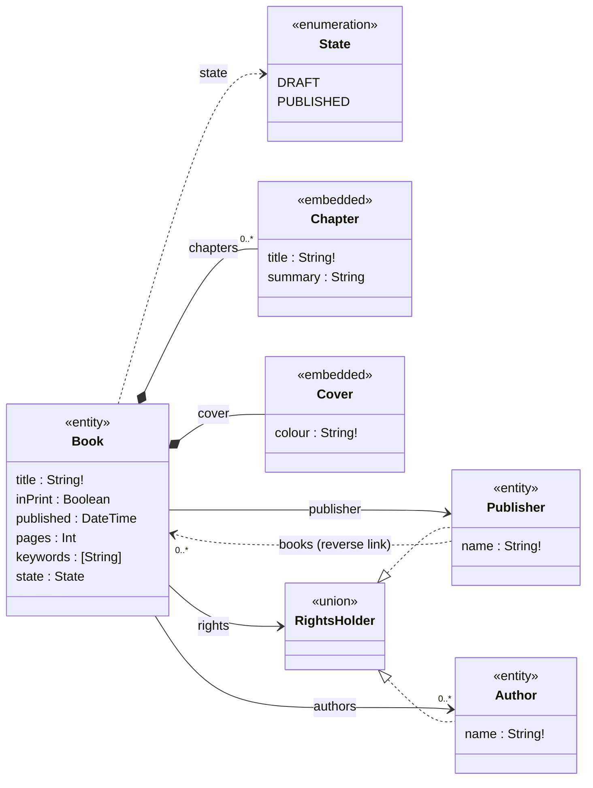

# The model

This document tells how to write a [model](../glossary.md#model) for Linked Data Store (LDS), how to give it to LDS, and
what LDS checks in a document against the model when the document is written. It is for people who use LDS: they run it,
give it a model, and read and write documents over HTTP.

## What a model says

The model says what LDS keeps:

- the **[entity types](../glossary.md#entity-type)**: the types of document, such as `Book`. A document of the entity
  type `Book` with the id `winter` has the address `/ns/Book/winter`, where `ns` is the
  [namespace](../glossary.md#namespace);
- the fields of the documents of each entity type, and the kind of value of each field;
- the fields a document must have;
- the fields that are **[links](../glossary.md#link)**, and the entity types each of them may link to;
- the **embedded types**. An embedded type is not an entity type: it has no documents of its own. Its values are
  [embedded objects](../glossary.md#embedded-object), parts of the documents they are in, such as the chapters of a
  book.

[Concepts](concepts.md#what-a-field-holds) explains these ideas. This document shows how they are written:

| A field holds | In a GraphQL schema | In a JSON Schema file of the entity type |
|---|---|---|
| a value | `title: String!` | `"title": {"type": "string"}`, and `"title"` in `"required"` |
| an embedded object | `cover: Cover`, with `type Cover { ... }` without `@domain` | `"cover": {"$ref": "#/$defs/Cover"}`, with `Cover` as a further definition in the same file |
| a link | `publisher: Publisher @link` | `"publisher": {"type": "string"}` and `"_link_property_publisher": {"type": "object", "properties": {"Publisher": {"type": "null"}}}` |
| a document of its own | `type Book @domain { ... }` | the file `Book.json`, which defines `Book` |

A model is written in one of two forms. LDS uses one of them, never both.

|  | A GraphQL schema | JSON Schema 2020-12 files |
|---|---|---|
| How it is written | one file | one file for each entity type |
| [The GraphQL API](graphql-api.md), with reverse links and search | yes | no |
| A text, `true` or `false`, a number, a date, a time of day, a date-time, a name of an enum | checked | checked |
| A single embedded object, such as the cover of a book | not checked | checked |
| `null` as the value of a field | written as if the field were left out | written as if the field were left out |
| Limits, such as the shortest text or the smallest number | cannot be said | checked |
| A field the model does not have | accepted | refused when the schema says so |

LDS reads the model once, when it starts. To change the model, stop LDS and start it again with the new one.

## About the examples

The examples use a small model of a library, with the entity types `Book`, `Author` and `Publisher`. It is shown in
both forms below: as a GraphQL schema, here the file `/models/library/schema.graphql`, and as JSON Schema files,
here in the folder `/models/library-json`. Every request was run against LDS 3.0.1 in memory, with the model
shown. An answer is shown as its status line and its body; the headers are left out. LDS sends a body
on one line; here it is shown formatted, with the fields in the order LDS sent them.

The addresses have the port 9090 and the namespace `ns`, as LDS comes. `sync=true` in a write makes LDS answer when the
document is written (a [synchronous write](../glossary.md#synchronous-write)), and the answer of a write is the id of
its [saga](../glossary.md#saga). [The REST API](rest-api.md) tells both.

## Give LDS a model

Two keys of the configuration name the model. Each can be set with an environment variable.
[Configuration](configuration.md) tells the other ways to set a key.

| Key | Environment variable | Value | As LDS comes |
|---|---|---|---|
| `graphql.schema` | `LDS_GRAPHQL_SCHEMA` | The path of one GraphQL schema file. | `schemas/schema.graphql` |
| `specification.schema` | `LDS_SPECIFICATION_SCHEMA` | Folders and files with JSON Schema, separated by commas. | `schemas` |

- When `graphql.schema` is not empty, the GraphQL schema is the model. `specification.schema` is then not read,
  also when it is set.
- When `graphql.schema` is empty, the JSON Schema files of `specification.schema` are the model.
- A path is absolute, or relative to the directory LDS is started in.

As it comes, LDS reads an example model, the file `linked-data-store-server/schemas/schema.graphql` of the
repository. [Getting started](getting-started.md) uses it.

### A GraphQL schema

Start LDS as [Getting started](getting-started.md) tells, with the path of your file in
`LDS_GRAPHQL_SCHEMA`:

```sh
cd linked-data-store-server
LDS_GRAPHQL_SCHEMA=/models/library/schema.graphql java -cp "target/*:target/lib/*" io.descoped.lds.server.Server
```

The log names the entity types LDS has read, and the file. In its log and in its messages LDS calls an entity type a
"managed domain":

```
... - Managed domains: /Author /Book /Publisher
... - Creating specification using GraphQL schema: /models/library/schema.graphql
```

### JSON Schema files

Set `graphql.schema` to empty and name the folder with the files:

```sh
cd linked-data-store-server
LDS_GRAPHQL_SCHEMA= LDS_SPECIFICATION_SCHEMA=/models/library-json \
  java -cp "target/*:target/lib/*" io.descoped.lds.server.Server
```

```
... - Creating specification using json-schema: /models/library-json
... - Managed domains: /Publisher /Book /Author
```

The entity types are named in the order in which LDS read the files. That order is not fixed.

A model must have at least one entity type. With `LDS_GRAPHQL_SCHEMA=` alone, `specification.schema` is still
`schemas`; when that folder has no file whose name ends in `.json`, LDS ends at once with
`java.lang.IllegalStateException: The model schemas has no entity type`.

Not finished: the parts of `specification.schema` are not trimmed. A space after a comma makes the next path
start with a space, and LDS ends at start with `Unable to find resource:` and that path.

### In a container

In the image LDS is started in the directory `/lds`, so it reads its model from `/lds/schemas`. Mount a folder of
your own there. A GraphQL schema in that folder must have the name `schema.graphql`, or `LDS_GRAPHQL_SCHEMA` must
name it. The compose file of the repository mounts the folder `linked-data-store-server/schemas` there.
[Operations](operations.md) tells more about the image.

### See the model LDS has read

The address of the namespace with `?schema` after it lists the entity types LDS has read:

```sh
curl -i 'http://localhost:9090/ns?schema'
```

```http
HTTP/1.1 200 OK

["/ns/Author?schema", "/ns/Book?schema", "/ns/Publisher?schema"]
```

The address of an entity type with `?schema` after it gives the JSON Schema of the entity type. With a GraphQL schema as
the model, it is the JSON Schema that LDS has made from the schema, and it is what LDS checks documents with. Read it
when LDS accepts or refuses a document and you do not see why. This is the answer for `Book` of the library model
below:

```sh
curl -i 'http://localhost:9090/ns/Book?schema'
```

```http
HTTP/1.1 200 OK

{
  "$schema": "https://json-schema.org/draft/2020-12/schema",
  "$ref": "#/$defs/Book",
  "$defs": {
    "Book": {
      "type": "object",
      "properties": {
        "authors": {
          "displayName": "",
          "type": "array",
          "items": {"type": "string"}
        },
        "_link_property_authors": {
          "properties": {"Author": {"type": "null"}},
          "type": "object"
        },
        "chapters": {
          "displayName": "",
          "type": "array",
          "items": {"$ref": "#/$defs/Chapter"}
        },
        "cover": {"displayName": ""},
        "inPrint": {"type": "boolean", "displayName": ""},
        "keywords": {
          "type": "array",
          "displayName": "",
          "items": {"type": "string"}
        },
        "pages": {
          "type": "integer",
          "minimum": -2147483648,
          "maximum": 2147483647,
          "displayName": ""
        },
        "published": {
          "type": "string",
          "format": "date-time",
          "displayName": ""
        },
        "publisher": {
          "displayName": "",
          "type": "string",
          "description": "A publisher"
        },
        "_link_property_publisher": {
          "properties": {"Publisher": {"type": "null"}},
          "type": "object"
        },
        "rights": {"displayName": "", "type": "string"},
        "_link_property_rights": {
          "properties": {
            "Author": {"type": "null"},
            "Publisher": {"type": "null"}
          },
          "type": "object"
        },
        "state": {
          "displayName": "",
          "type": "string",
          "enum": ["DRAFT", "PUBLISHED"]
        },
        "title": {
          "type": "string",
          "description": "The title on the cover",
          "displayName": ""
        }
      },
      "required": ["title"],
      "displayName": "A book",
      "description": "A book"
    },
    "Chapter": {
      "type": "object",
      "properties": {
        "summary": {"type": "string", "displayName": ""},
        "title": {"type": "string", "displayName": ""}
      },
      "required": ["title"]
    },
    "Cover": {
      "type": "object",
      "properties": {"colour": {"type": "string", "displayName": ""}},
      "required": ["colour"]
    }
  }
}
```

`cover` has no `type`: LDS does not check it. `displayName` is not a keyword of JSON Schema. It is a name
to show to people and says nothing about what is valid. From a GraphQL schema LDS writes it on an entity type that has a
description, as the first line of that description, and on every field, always empty.

With JSON Schema files as the model, the answer is the file of the entity type as it is, without white space.

[The REST API](rest-api.md) has every form of `?schema`.

## A model as a GraphQL schema

### An example

This is the library model, the whole file:

```graphql
directive @domain(searchable: Boolean) on OBJECT
directive @link(pagination: Boolean, reverseName: String) on FIELD_DEFINITION

"""
A book
"""
type Book @domain {
  "The title on the cover"
  title: String!
  inPrint: Boolean
  published: DateTime
  pages: Int
  state: State
  keywords: [String]
  chapters: [Chapter]
  cover: Cover
  publisher: Publisher @link(reverseName: "books")
  authors: [Author] @link
  rights: RightsHolder @link
}

enum State {
  DRAFT
  PUBLISHED
}

type Chapter {
  title: String!
  summary: String
}

type Cover {
  colour: String!
}

"""
An author
"""
type Author @domain {
  name: String!
}

"""
A publisher
"""
type Publisher @domain {
  name: String!
}

union RightsHolder = Author | Publisher

type Query {
}

scalar DateTime
```

`Book`, `Author` and `Publisher` are entity types. `Chapter` and `Cover` are embedded types. `publisher`, `authors` and
`rights` are links:



A filled diamond is an embedded type: its values are embedded objects, part of the document they are in (composition).
An arrow is a link: the document holds the text `/Entity/id`, and what it points at is a document of its own
(association). A dotted arrow back is the [reverse link](../glossary.md#reverse-link), which only the GraphQL API has.

These three documents fit the model: a publisher, an author and a book.

```sh
curl -i -X PUT 'http://localhost:9090/ns/Publisher/north?sync=true' \
     -H 'Content-Type: application/json' \
     -d '{"name": "North Press"}'
curl -i -X PUT 'http://localhost:9090/ns/Author/ada?sync=true' \
     -H 'Content-Type: application/json' \
     -d '{"name": "Ada"}'
curl -i -X PUT 'http://localhost:9090/ns/Book/winter?sync=true' \
     -H 'Content-Type: application/json' \
     -d '{
       "title": "Winter",
       "inPrint": true,
       "published": "2026-11-20T10:00:00Z",
       "pages": 212,
       "state": "PUBLISHED",
       "keywords": ["snow", "north"],
       "chapters": [
         {"title": "One", "summary": "It snows."},
         {"title": "Two"}
       ],
       "cover": {"colour": "white"},
       "publisher": "/Publisher/north",
       "authors": ["/Author/ada", "/Author/not-written-yet"],
       "rights": "/Author/ada"
     }'
```

Each of the three is answered like this, with an id of its own:

```http
HTTP/1.1 201 Created

{"saga-execution-id": "01a1f9d7-22e3-7aac-9590-538bf9593e80"}
```

The book is written although there is no document `/ns/Author/not-written-yet`: LDS does not check that the
document a link points at is there.

### What the file must have

The model is one file. Beside the types of the model it must have three things.

**The declarations of the directives it uses**, with the arguments it uses. A directive is a word with `@` in front
that marks a type or a field; LDS reads `@domain` and `@link`. LDS does not add the declarations. These two lines
fit everything LDS reads:

```graphql
directive @domain(searchable: Boolean) on OBJECT
directive @link(pagination: Boolean, reverseName: String) on FIELD_DEFINITION
```

**A type `Query`.** GraphQL asks for it. LDS does not use its fields; it makes its own queries from the entity types.
A `Query` with no field, as in the example, is accepted.

**A declaration of each of the scalars `DateTime`, `Date`, `Time` and `Long` that it uses**, as `scalar DateTime`
in the example. A scalar is a kind of single value. Beside these four LDS knows the scalars of GraphQL: `String`,
`Boolean`, `Int`, `Float` and `ID`. A file that declares any other scalar is refused at start.

### Entities and embedded types

A type with `@domain` is an entity type. LDS keeps documents of it, and the name of the entity type is the name of the
type, as it is written: `type Book @domain` gives documents the addresses `/ns/Book/` and an id. A model must have at
least one entity type. The name of an entity type is at most 128 bytes in UTF-8; LDS does not start with a longer
one, and says `The name of an entity type is at most 128 bytes in UTF-8: ` and the name.

A type without `@domain` is an embedded type. Write an embedded object as a field whose type is an embedded type, or a
list of one: `chapters: [Chapter]`.

`@domain` has one argument, `searchable`. With `@domain(searchable: false)` the documents of the entity type are not
put in the search index, so [search](graphql-api.md#search) does not find them. The entity type is in the model as
every other entity type. See [What search reads of a model](#what-search-reads-of-a-model).

A type may implement an interface. An entity type may link to itself, as in `friends: [Person] @link` of the example
model that comes with LDS.

### Fields

The table says what the value of a field is in a document. "Checked" says whether LDS refuses a document with
another value there.

| Field in the model | Value in a document | Checked |
|---|---|---|
| `String` | a text | yes |
| `Boolean` | `true` or `false` | yes |
| `Int` | a whole number of 32 bits, from -2147483648 to 2147483647 | yes |
| `Long` | a whole number of 64 bits | yes |
| `Float` | a number | yes |
| `DateTime` | a text that is a date-time of RFC 3339, with a time zone: `2026-11-20T10:00:00Z`, `2026-11-20T10:00:00+01:00`, `2026-11-20T10:00:00.123456789Z` | yes |
| `Date` | a text that is a date of RFC 3339: `2026-11-20` | yes |
| `Time` | a text that is a time of RFC 3339, with a time zone: `10:00:00Z` | yes |
| `ID` | anything | no |
| an enum, a type that lists names: `state: State` | one of the names of the enum, as a text: `"PUBLISHED"` | yes |
| a list of a scalar: `[String]`, `[Int]`, `[DateTime]` | an array whose items are values of that scalar | yes |
| a list of an embedded type: `chapters: [Chapter]` | an array of objects | yes, each object by the fields of the embedded type |
| an embedded type, single: `cover: Cover` | anything | no |
| an entity type with `@link` | a link | yes: see below |
| `!` after the type: `title: String!` | the field must be in the document | yes |

A value that is out of range for its scalar is refused: `"pages": 2147483648` is answered `400` with
`Schema validation error: [$.pages: must have a maximum value of 2147483647]`, and `"pages": 2.5` with
`[$.pages: number found, integer expected]`. So a value is written only when GraphQL can give it back.

A field without `!` may be left out of a document. A field whose value is `null` is written as if it were left
out, at any depth: a book written with `"inPrint": null` is read back without `inPrint`, and a field with `!` that
is `null` is refused as missing, `[$: required property 'title' not found]`. A `null` as an item of an array is
checked as the item: in `"keywords": ["a", null]` it is refused with `[$.keywords[1]: null found, string
expected]`.

A document may have fields that the model does not have. LDS stores them and gives them back.

Not finished: an `ID` field and a single field of an embedded type are not checked: nothing inside the embedded
object is, and the field may hold any value. GraphQL gives an object in an `ID` field back as a text:
`"id": {"x": 1}` came back as `"{x=1}"`. A list of embedded objects is checked. This document was written,
and read back as it was:

```sh
curl -i -X PUT 'http://localhost:9090/ns/Book/spring?sync=true' \
     -H 'Content-Type: application/json' \
     -d '{
       "title": "Spring",
       "cover": "none",
       "weight": 300
     }'
```

```http
HTTP/1.1 201 Created

{"saga-execution-id": "01a20fea-0f43-79d9-9cca-5da7eebc19e6"}
```

A cover written as `{}`, which has no `colour`, as `{"colour": 7}`, or as `[1, 2]`, was written in the same way.

### Links

A field with `@link` holds a link. The type of the field says which entity types it may link to:

| Field in the model | Value in a document |
|---|---|
| an entity type: `publisher: Publisher @link` | a text of the form `/Entity/id`: `"/Publisher/north"` |
| a list of an entity type: `authors: [Author] @link` | an array of such texts: `["/Author/ada","/Author/bo"]`. An empty array is valid. |
| a union, a type that names several entity types: `rights: RightsHolder @link` | a link to a document of any entity type of the union: `"/Author/ada"` or `"/Publisher/north"` |

A link is a slash, the name of the entity type, a slash and the id. It does not have the namespace. LDS checks that the
value has this form and that the entity type is one the field may link to. It does not check that the document is there.

`@link` has two arguments. Both are for [the GraphQL API](graphql-api.md) and change nothing in what a
document must look like.

- `pagination`, `true` when it is left out. With `pagination: false` a list of links is a plain list in GraphQL,
  without pages.
- `reverseName`: the name of the reverse link.

### Reverse links

For every link LDS adds a field to the entity type the link points at, in the GraphQL API only. That field gives the
documents that link to a document: the reverse link. It is not a field of the documents themselves.

With `publisher: Publisher @link(reverseName: "books")` a publisher has the field `books`:

```sh
curl -i 'http://localhost:9090/graphql' -H 'Content-Type: application/graphql' \
     -d '{
       PublisherById(id: "north") {
         name
         books {
           edges {
             node {
               title
             }
           }
         }
       }
     }'
```

```http
HTTP/1.1 200 OK

{
  "data": {
    "PublisherById": {
      "name": "North Press",
      "books": {
        "edges": [
          {
            "node": {"title": "Winter"}
          }
        ]
      }
    }
  }
}
```

Without `reverseName` the name is `reverse`, the name of the entity type and the name of the field, each with a capital
first letter: `authors` of `Book` gives `reverseBookAuthors` on `Author`. A link to a union gives the field to every
entity type of the union: `rights` gives `reverseBookRights` on `Author` and on `Publisher`.

Not finished: LDS does not check a `reverseName` against the fields of the entity type it is added to. With
`reverseName: "name"` on the link to `Publisher`, the field `name` of a publisher is the reverse link in GraphQL, and
its own `name` can no longer be asked for. Choose a name that the entity type does not have.

LDS marks the fields it adds with a third directive, `@reverseLink`. Do not write it in a model. A model that
declared it and had `books: [Book] @reverseLink(mappedBy: "publisher")` in `Publisher` was tried: LDS did not
start, and said `java.lang.IllegalArgumentException: json-path must start with '$' in its first element`.

### Descriptions

A text in quotes above a type or a field is its description. It is in the schema of the GraphQL API and in the
JSON Schema of `?schema`. A comment, a line that starts with `#`, right above a type or a field is taken as its
description too.

Not finished: in `?schema` a field that holds one link has the description of the entity type it links to, not
its own. In the answer for `Book` above, `publisher` has `"description":"A publisher"`. A field that holds a list of
links has its own description.

### Shapes that do not work as written

Not finished: LDS does not read every shape of a GraphQL schema as it is written. The table lists the shapes
that were tried, and what LDS does with them today. In it, "the first" means the first in the order of the names
of the fields, not in the order of the file.

| In the model | What LDS does today |
|---|---|
| A single field of an embedded type: `cover: Cover` | The value is not checked. The part can be read as a whole at `/ns/Book/winter/cover`. A field of it cannot be addressed: `GET /ns/Book/winter/cover/colour` is answered `400` with `Not a valid path element: "colour"`. |
| Two fields of one type with the same list type: `a: [String]` and `b: [String]` | Only the first is a list. `b` must be a single text: `"b":["x"]` is refused with `$.b: array found, string expected`. With two lists of one embedded type, the second is not checked at all. Lists with `@link` are not touched by this. |
| Two fields of one type with the same enum: `earlier: State` and `state: State!` | Only the first is checked. `state` takes any value. |
| A list of an enum: `states: [State]` | When no field of that enum comes before it, it must be one name of the enum, and an array is refused. When one does, any array is accepted. |
| A list of lists: `[[String]]` | Read as `[String]`. |
| A field whose type is an entity, without `@link`: `owner: Author` | Read as a link: an object there is refused with `$.owner: object found, string expected`. Write `@link` on every field whose type is an entity or a union of entities, unless the values of the entity are to be held in the document (the next row). |
| A list of an entity without `@link`, when that entity has a link: `support: [Support]` with `technical: [Contact] @link` in `Support` | The values of a `Support` are held in the document as an embedded object, as [Concepts](concepts.md#what-a-field-holds) tells. The field holds one object: a list is refused with `$.support: array found, object expected`. Each list field of `Support` is read as a list of links, also `[String]`; its other fields are not checked. The GraphQL API answers the field with `null` and `type mismatch error, expected type LIST`. A list of an entity that has no link is read as a list of links. |
| A `!` inside a list of links: `works: [Book!]! @link` | When the entity linked to has a link field itself, the field is no list of links: an array is refused with `$.works: array found, object expected`. Write `[Book] @link` or `[Book]! @link`. |
| `@link` on a field whose type is an embedded type: `cover: Cover @link` | Not refused. The field must then hold a text of the form `/Cover/id`, which points at nothing. |
| A field whose type is an interface: `known: Labelled` | The field is not checked, and the fields of the interface become fields of the entity. With `interface Labelled { label: String! }` every document of the entity must have a field `label`. |
| A field with an argument that has `!`: `title(upper: Boolean!): String` | The field must be in every document, as if it had `!` itself. |
| A directive of your own on a field, declared with an argument that has `!` | The field must be in every document. `@deprecated` on a field changes nothing. |

### Schemas that LDS refuses at start

When LDS cannot read the file, or cannot make its GraphQL API from it, it ends at once with exit code 1. The log
says `LDS could not be made; what was made is stopped`, and the reason follows in a line that starts with
`Exception in thread "main"`. The two numbers in `[@6:3]` are the line and the column in the file.

| In the file | Message |
|---|---|
| A directive that is not declared | `SchemaProblem{errors=['A' [@1:1] tried to use an undeclared directive 'domain']}` |
| An argument that the declaration of the directive does not have | `SchemaProblem{errors=['b' [@6:3] use an unknown argument 'pagination' on directive 'link']}` |
| No type `Query` | `SchemaProblem{errors=[A schema MUST have a 'query' operation defined]}` |
| A scalar LDS does not know: `scalar Money` | `SchemaProblem{errors=[There is no scalar implementation for the named  'Money' scalar type]}` |
| `DateTime` used and not declared, or a type that is not in the file | `SchemaProblem{errors=[The field type 'DateTime' is not present when resolving type 'A' [@4:1]]}` |
| A fault in the writing, here a field without its colon | `SchemaProblem{errors=[[@4:16] The schema definition text contains a non schema definition language (SDL) element 'OperationDefinition']}`. The field was in line 5 of the file. The place in the message is the `{` of its type, in line 4. |
| The file is not there | `java.lang.RuntimeException: java.nio.file.NoSuchFileException: /models/not-there.graphql` |
| An embedded type that holds itself: `type Branch { branches: [Branch] }` | `java.lang.StackOverflowError` |
| No type with `@domain` | `java.lang.IllegalStateException: The model /models/library/schema.graphql has no entity type: a GraphQL schema needs a type with @domain` |
| A link to an interface: `friends: [Named] @link` | `java.lang.ClassCastException: class graphql.schema.GraphQLInterfaceType cannot be cast to class graphql.schema.GraphQLObjectType ...` |
| An entity type whose name ends in `Connection`, or a type named as an entity type with `Edge` after it: `BookEdge` | `java.lang.NullPointerException: Cannot invoke "graphql.schema.GraphQLFieldDefinition.getType()" ...` |
| An entity type named `PageInfo` that a list of links points at | `graphql.AssertException: All types within a GraphQL schema must have unique names. ...` |
| An entity type named `SearchResult`, when search is on (the key `graphql.search.enabled` is `true`) | `java.lang.IllegalArgumentException: type map already contains SearchResult` |
| A field marked with `@reverseLink` (see [Reverse links](#reverse-links)) | `java.lang.IllegalArgumentException: json-path must start with '$' in its first element` |

LDS makes types with these names itself for the GraphQL API: for an entity type `Book` they are `BookConnection`
and `BookEdge`, and one type `PageInfo`. When search is on, it also makes the types `TypeFilters` and `SearchResult`.
Do not use these names in a model.

## A model as JSON Schema files

With JSON Schema files as the model LDS has no GraphQL API: a request to `/graphql` is answered `400` with
`Unsupported namespace: "graphql"`.

### The files

- There is one file for each entity type. The name of the entity type is the name of the file without `.json`:
  `Book.json` is the entity type `Book`.
- A folder in `specification.schema` gives every file in it whose name ends in `.json`. Other files are skipped.
  Folders inside it are not read.
- A file can be named itself: `LDS_SPECIFICATION_SCHEMA=/models/Author.json,/models/Publisher.json`, with no
  space after the comma. Its name must end in `.json`.

### The form of a file

A file is a JSON Schema 2020-12. It has `$defs` with one definition for the entity type, and at its root a `$ref`
that points at that definition. The definition has the same name as the file. This is `Author.json`:

```json
{
  "$schema": "https://json-schema.org/draft/2020-12/schema",
  "$ref": "#/$defs/Author",
  "$defs": {
    "Author": {
      "type": "object",
      "properties": {
        "name": {"type": "string"}
      },
      "required": ["name"]
    }
  }
}
```

`Publisher.json` is the same with `Publisher` for `Author`. `$schema` may be left out; the file is then read as
JSON Schema 2020-12.

This is `Book.json`. It says the same as the GraphQL schema above, and more:

```json
{
  "$schema": "https://json-schema.org/draft/2020-12/schema",
  "$ref": "#/$defs/Book",
  "$defs": {
    "Book": {
      "type": "object",
      "description": "A book",
      "properties": {
        "title": {"type": "string", "minLength": 1},
        "inPrint": {"type": "boolean"},
        "published": {"type": "string", "format": "date-time"},
        "firstSold": {"type": "string", "format": "date"},
        "pages": {"type": "integer", "minimum": 1},
        "state": {
          "type": "string",
          "enum": ["DRAFT", "PUBLISHED"]
        },
        "keywords": {
          "type": "array",
          "items": {"type": "string"}
        },
        "chapters": {
          "type": "array",
          "items": {"$ref": "#/$defs/Chapter"}
        },
        "cover": {"$ref": "#/$defs/Cover"},
        "publisher": {
          "type": ["string", "null"]
        },
        "_link_property_publisher": {
          "type": "object",
          "properties": {
            "Publisher": {
              "type": "null"
            }
          }
        },
        "authors": {
          "type": "array",
          "items": {"type": "string"}
        },
        "_link_property_authors": {
          "type": "object",
          "properties": {
            "Author": {
              "type": "null"
            }
          }
        },
        "rights": {"type": "string"},
        "_link_property_rights": {
          "type": "object",
          "properties": {
            "Author": {
              "type": "null"
            },
            "Publisher": {
              "type": "null"
            }
          }
        }
      },
      "required": ["title"],
      "additionalProperties": false
    },
    "Chapter": {
      "type": "object",
      "properties": {
        "title": {"type": "string"},
        "summary": {"type": "string"}
      },
      "required": ["title"]
    },
    "Cover": {
      "type": "object",
      "properties": {
        "colour": {"type": "string"},
        "designer": {"type": "string"},
        "_link_property_designer": {
          "type": "object",
          "properties": {
            "Author": {
              "type": "null"
            }
          }
        }
      },
      "required": ["colour"]
    }
  }
}
```

A document that fits it:

```sh
curl -i -X PUT 'http://localhost:9090/ns/Book/winter?sync=true' \
     -H 'Content-Type: application/json' \
     -d '{
       "title": "Winter",
       "inPrint": true,
       "published": "2026-11-20T10:00:00Z",
       "firstSold": "2026-12-01",
       "pages": 212,
       "state": "PUBLISHED",
       "keywords": ["snow", "north"],
       "chapters": [
         {"title": "One", "summary": "It snows."},
         {"title": "Two"}
       ],
       "cover": {"colour": "white", "designer": "/Author/ada"},
       "publisher": null,
       "authors": ["/Author/ada"],
       "rights": "/Publisher/north"
     }'
```

```http
HTTP/1.1 201 Created

{"saga-execution-id": "01a1f9d7-27cf-7820-9af5-5799970f3f1f"}
```

What to know about the form:

- An embedded type is a further definition in `$defs` of the same file, used with
  `{"$ref": "#/$defs/Cover"}`. A `$ref` inside a definition must have this form and name a definition of the
  same file. A part can also be written in place, as an object with `properties`.
- LDS gives the whole file to its JSON Schema validator, so what JSON Schema 2020-12 says about a value is
  checked when a document is written. These keywords were tried: `type` (one name or a list of names),
  `required`, `enum`, `minLength`, `minimum`, `format` (`date-time`, `date`, `time`, `email`), `items`, `$ref`,
  `anyOf` and `additionalProperties`.
- A single part written with `$ref` is checked, and so are the links in it. This differs from a GraphQL schema.
- A field whose value is `null` is written as if it were left out, whatever the schema says of it: the book above
  is read back without `publisher`, and `"rights": null` is accepted though `rights` is a text. A `null` as an item
  of an array is checked as the item.
- Without `"additionalProperties": false` a document may have fields that the schema does not name.
- `default` gives a document nothing: a document written without the field is read back without it.
- `displayName` may be written wherever a keyword can be; LDS gives it out in `?schema` and does nothing else
  with it. For any other keyword that JSON Schema does not have, LDS logs a warning at start:
  `Unknown keyword shownAs - you should define your own Meta Schema. ...`

### How a link is written

A link field is a property that holds a text, or an array of texts, and has a second property beside it with the name
`_link_property_` and the name of the field. That second property is an object schema. The names of its `properties` are
the entity types the field may link to:

```json
"rights": { "type": "string" },
"_link_property_rights": {
  "type": "object",
  "properties": { "Author": { "type": "null" }, "Publisher": { "type": "null" } }
}
```

- LDS reads only the names in `properties`. The value of each must be a JSON object; `{ "type": "null" }` is what
  LDS writes itself when it makes a JSON Schema from a GraphQL schema.
- With several names the field may link to any of them. With no `properties` at all the field may link to
  nothing, and every link in it is refused.
- For a list of links the field is `{ "type": "array", "items": { "type": "string" } }`, as `authors` above.
- A link field can be in an embedded object. Its second property is then beside it, in the same `properties`, as
  `designer` in `Cover`.
- The second property is not meant to be in a document. LDS does not refuse a document that has a field of that
  name with an object as its value.

The value in a document is the same as with a GraphQL schema: the text `/Entity/id`.

### Files that LDS refuses at start

LDS ends at start, with the reason in its log in a line that starts with `Exception in thread "main"`. In the messages
`T` and `Old` are the names of the entity types of the files that were tried.

| The file | Message |
|---|---|
| `$schema` names another draft | `java.lang.IllegalArgumentException: The JSON Schema of Old says it is "http://json-schema.org/draft-04/schema#". LDS reads JSON Schema 2020-12: https://json-schema.org/draft/2020-12/schema` |
| `definitions` at the root, and no `$schema` | `java.lang.IllegalArgumentException: The JSON Schema of Old has "definitions", which is the keyword of an earlier draft. In JSON Schema 2020-12 it is "$defs".` |
| A `$ref` in a definition to a definition that is not there | `java.lang.IllegalStateException: Referenced definition does not exist: #/$defs/Missing` |
| A `$ref` in a definition to another file | `java.lang.IllegalStateException: $ref present but unable to resolve: other.json` |
| The `$ref` at the root points at a definition that is not there | `com.networknt.schema.InvalidSchemaRefException: Reference /$defs/Missing cannot be resolved` |
| The file is not a JSON object | `java.lang.IllegalArgumentException: In the JSON Schema of T, the schema is not an object` |
| A property that is not an object: `"a": "text"` | `java.lang.IllegalArgumentException: In the JSON Schema of T, a is not an object` |
| `required` that is not an array | `java.lang.IllegalArgumentException: In the JSON Schema of T, required of T is not an array` |
| The file is not JSON | `java.lang.RuntimeException: tools.jackson.core.exc.StreamReadException: Unrecognized token 'this': ...` |
| A definition that holds itself through `$ref` | `java.lang.StackOverflowError` |
| A file or a folder named in `specification.schema` is not there | `java.lang.IllegalArgumentException: Unable to find resource: /models/Nobody.json` |

### Files that are not refused and do not work

Not finished: LDS does not check at start that a file can be used. With each of these files LDS starts, and
`GET /ns?schema` lists the entity type.

| The file | What happens |
|---|---|
| No `$defs`: a schema with `type` and `properties` at its root | Every request to the entity type is answered `400` with `Not a managed resource name: "T"`. |
| The definition has another name than the file: `Person.json` with the definition `Human` | The same for `Person`. A write to `/ns/Human/1` is answered `500` with no body. |
| `$defs`, and no `$ref` at the root | The entity type works, and its documents are not checked: `{}` is written although a field is required. |
| Two files that each have a definition of the same name in `$defs`, with different content | A document is checked by the definition of its own file. Its links are checked by the definition of the file that LDS read first, and the order in which LDS reads the files of a folder is not fixed. Give such definitions the same content in every file. |
| A file named itself whose name does not end in `.json`: `Firm.schema` | LDS cuts the last five characters of the name. The entity type is `Firm.s`. |

## What LDS checks when a document is written

LDS checks a document against the model ([schema validation](../glossary.md#schema-validation)) when the document is
written, and when a part of it is written: the whole document is then checked with the part in place. It does not check
the document when a part of it is removed, and not when a link is added or removed at an address of its own. [The REST
API](rest-api.md) has the requests, and tells what a removed part can leave behind.

There are two checks, in this order:

1. The JSON Schema of the entity type: the kinds of value, the fields a document must have, formats, and with JSON
   Schema files everything else the schema says. LDS gives every fault it finds.
2. The links, only when the first check found nothing. LDS gives the first link that is wrong.

A document that fails a check is refused. Nothing is written. The answer has the status `400`, the content type
`text/plain`, and a body that starts with `Schema validation error:`.

A body that cannot be read as JSON is not checked against the model and gets another answer.
[The REST API](rest-api.md) tells which.

### Faults in values

The faults are in square brackets, separated by commas. Each is the place in the document, a colon, and what is
wrong. The place is `$` for the document, `$.title` for a field, `$.chapters[0]` for the first item of an array
and `$.chapters[0].title` for a field of that item.

With the GraphQL schema of the library as the model:

```sh
curl -i -X PUT 'http://localhost:9090/ns/Book/spring?sync=true' \
     -H 'Content-Type: application/json' \
     -d '{
       "inPrint": "yes",
       "published": "20 November",
       "state": "SOLD",
       "keywords": "snow",
       "chapters": [
         {"summary": "No title"}
       ]
     }'
```

```
HTTP/1.1 400 Bad Request

Schema validation error: [$.chapters[0]: required property 'title' not found, $.inPrint: string found, boolean expected, $.keywords: string found, array expected, $.published: does not match the date-time pattern must be a valid RFC 3339 date-time, $.state: does not have a value in the enumeration ["DRAFT", "PUBLISHED"], $: required property 'title' not found]
```

With the JSON Schema files of the library as the model:

```sh
curl -i -X PUT 'http://localhost:9090/ns/Book/spring?sync=true' \
     -H 'Content-Type: application/json' \
     -d '{
       "title": "",
       "firstSold": "1 December",
       "pages": 0,
       "cover": {"designer": "/Author/ada"},
       "weight": 300
     }'
```

```
HTTP/1.1 400 Bad Request

Schema validation error: [$.title: must be at least 1 characters long, $.firstSold: does not match the date pattern must be a valid RFC 3339 full-date, $.pages: must have a minimum value of 1, $.cover: required property 'colour' not found, $: property 'weight' is not defined in the schema and the schema does not allow additional properties]
```

Other messages that were seen:

| What is wrong | Message |
|---|---|
| The document is not a JSON object | `[$: string found, object expected]` |
| A wrong value in an array | `[$.keywords[1]: integer found, string expected]` |
| `null` as an item of an array of texts | `[$.keywords[1]: null found, string expected]` |
| A wrong value where the schema gives a list of types | `[$.publisher: integer found, [string, null] expected]` |
| A number with a fraction where the schema says `integer` | `[$.pages: number found, integer expected]` |

A date-time must be a date-time of RFC 3339: the date, `T`, the time with seconds, and a time zone.
`2026-11-20T10:00:00` (no time zone) and `2026-11-20` (no time) are refused.

### Faults in links

The message names the field after `Navigation:`, with dots between a part and its field, and then the value.

| What is wrong | In the document | Body of the answer |
|---|---|---|
| The value does not have the form `/Entity/id` | `"publisher":"north"` | `Schema validation error: Not a valid link. Navigation: publisher: "north"` |
| The link is to an entity the field may not link to | `"publisher":"/Author/ada"` | `Schema validation error: Illegal linked-domain: "Author". Navigation: publisher: "/Author/ada"` |
| The same in a list of links | `"authors":["/Author/ada","/Publisher/north"]` | `Schema validation error: Illegal linked-domain: "Publisher". Navigation: authors: "/Publisher/north"` |
| The same in a part of a document (JSON Schema files) | `"cover":{"colour":"green","designer":"/Publisher/north"}` | `Schema validation error: Illegal linked-domain: "Publisher". Navigation: cover.designer: "/Publisher/north"` |

An empty text, a text with the namespace in it (`/ns/Author/ada`) and a text with more parts (`/Author/a/b`) do
not have the form of a link and are refused in the same way.

A field that is left out and a `null` are no links and are not checked as links. Whether a `null` is accepted is
for the first check to say.

A link can also be written at an address of its own; [the REST API](rest-api.md) tells how. The entity in
that address must be one the field may link to. `PUT /ns/Book/nine/publisher/Author/ada` is answered `400` with
`Reference resource does not support link to managed-domain "Author". Must be one of: [Publisher]`.

### What is not checked

- LDS does not check that the document a link points at is there. A link may point at a document that is written later;
  until then it is a dangling reference.
- LDS checks one document at a time. It does not compare a document with other documents.
- LDS checks a document only when it is written. Documents that are stored are not checked again when LDS starts
  with another model.

Not finished: the links inside the items of a list of embedded objects are not checked, with both forms of model. With
`chapters: [Chapter]` and a link field `editor` in `Chapter`, a book with
`"chapters":[{"title":"One","editor":"no link at all"}]` is written. With a GraphQL schema the links in a
single part are not checked either, as nothing in a single part is.

## What a model cannot say

- **That the document a link points at is there.** LDS is a [time machine](../glossary.md#time-machine): a link may
  point at a document that does not exist yet. [Concepts](concepts.md) tells why.
- **Anything about ids, versions and namespaces.** The model describes the content of a document. One LDS serves
  one namespace, and every entity type of the model is in it.
- **A rule that spans documents**, such as a value that only one document may have.
- **A value for a field that is left out.** LDS stores a document as it is given.
- **That a field may be `null`.** A `null` is written as if the field were left out.

A GraphQL schema as the model cannot say, in addition:

- what an id must look like: an `ID` field is not checked;
- a limit for a value, such as a shortest text or a smallest number;
- that a document must not have other fields than those of the model;
- what a single embedded object must look like: only a list of embedded objects is checked.

JSON Schema files can say these things, and with them LDS has no GraphQL API, no reverse links and no search.

## What search reads of a model

Search is a query of the GraphQL API, so it needs a model that is a GraphQL schema. With search on, LDS gives the
search index every version of every document, and reads the model to know what in it is text:

- Every text of a document is searched, wherever it is: in a field, in an embedded object, in an array, also in a
  field that the model does not have.
- A text in an object that has the fields `languageCode` and `languageText` is searched in the language of the code,
  by the stems of its words: `nb`, `nn` and `no` (Norwegian), `sv`, `en`, `de` and `fr`, in any case and with or
  without a region, such as `nb-NO`. The code itself is not searched. Every other text is searched word for word.
- A link is not text: neither is a field with `@link`. Nor is a value of a field whose scalar is `DateTime`, `Date`
  or `Time`, a number, `true` or `false`.
- An entity type marked `@domain(searchable: false)` has no entries in the search index: search does not find its
  documents.

A model that changes needs nothing of Solr; the versions that were indexed under the earlier model are searched as
they were indexed until the index is rebuilt ([Operations](operations.md#rebuild-the-search-index)).
[The GraphQL API](graphql-api.md#search) tells how to search, and how words are found.
