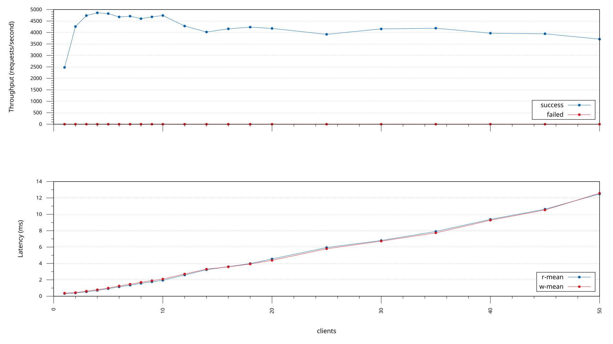
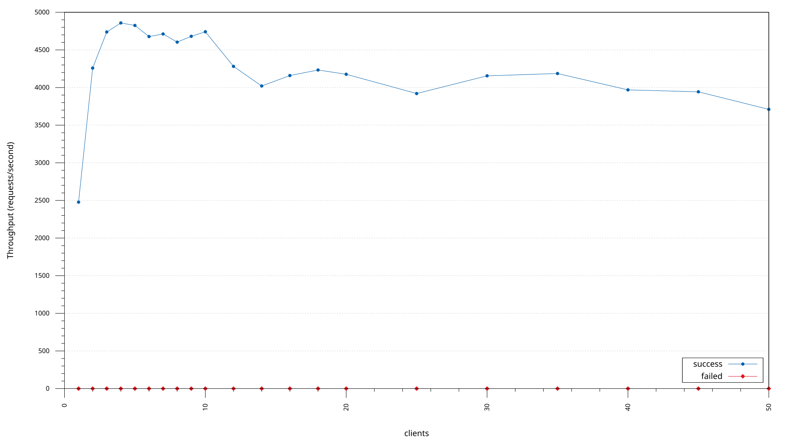
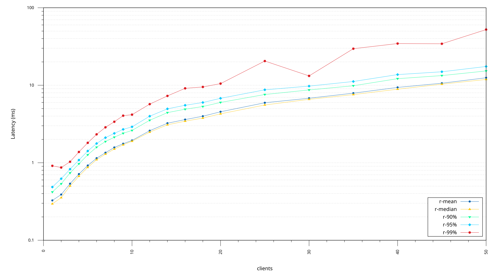
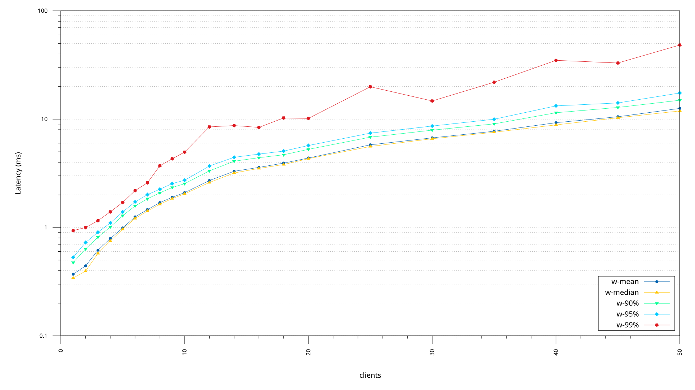

# Linked Data Store Load Test

A load test of LDS with each persistence provider: memory, Neo4j and PostgreSQL. It starts LDS from the image of
the server module, fills it, sends reads and writes from 1 to 50 threads, and draws throughput and latency by the
number of threads.

It is a tool for a developer's machine. It is not run by the build or by CI, and its numbers say how one LDS on
one machine behaves under this load, nothing more.

## Run it

It needs Docker with Compose, bash, and LDS built:

```sh
./mvnw package -DskipTests        # in the root of the repository
cd linked-data-store-loadtest
./ldsmemory.sh                    # or ./ldsneo4j.sh, ./ldspostgres.sh
```

A run takes about ten minutes and leaves about 2 GB, because the load tester records every request. The results
are in `ldsmemory/results`, `ldsneo4j/results` or
`ldspostgres/results`:

| File | What it is |
|---|---|
| `performance_by_threads.svg` | throughput, and the mean latency of reads and of writes |
| `performance_by_threads_total_throughput.svg` | requests each second that succeeded and that failed |
| `performance_by_threads_read_latency.svg`, `..._write_latency.svg` | mean, median, 90th, 95th and 99th percentile, on a logarithmic scale |
| `performance_by_threads_load.svg` | how many of the threads asked for were at work |
| `performance_by_threads.dat` | every statistic of every run, the data the plots are drawn from |
| `*.json`, `*.csv` | what the load tester recorded for each request of each run |
| `warmup/` | the same for the warm-up, which is not in the plots |

`./interactive.sh memory up`, `run 10 30`, `plot`, `down` runs the steps one at a time (`./interactive.sh help`).

## What a run does

1. Starts LDS with the provider, the engine of the provider (`neo4j:2026.10-community` or `postgres:18-alpine`),
   the load tester and a controller with the tools of the scripts (`compose.yaml`). Nothing is published on the
   machine: the load is driven from inside the network of the test.
2. Fills LDS: 256 documents of each of the 20 entities of the model (`prepopulate.sh`).
3. Gives the load tester the templates of the documents and what a read and a write is (`setup/gsim/read.json`,
   `write.json`): a read is a `GET` of one of the 256 documents of an entity, a write is a `POST` of one of
   them with `?sync=true`.
4. Warms up with 10 threads for 30 seconds.
5. Runs the load for 10 seconds with each of 1 to 10, 12 to 20 by two, and 25 to 50 by five threads. Of 100
   requests 80 are reads and 20 are writes, and a thread sends its next request when the answer has come.
6. Turns the results into statistics and plot files (`HTTPLoadTestBaselineStatistics`, the Java program of this
   module) and draws them with gnuplot.
7. Stops and removes the containers and their data.

LDS runs with the saga log in memory and without a transaction log and a search index, so the test measures
LDS and the persistence provider.

## The model

The model is the 20 JSON Schema files in `setup/gsim/schemas` (JSON Schema 2020-12), and
`setup/gsim/templates` has one document for each entity. In a template `#mrid` becomes the id of the document
and `#now` the time.

## The load tester

The load is sent by [HTTPLoadTest-baseline](https://github.com/Cantara/HTTPLoadTest-baseline), the image
`cantara/httploadtest-baseline:latest`. Three things to know about it:

- The image is from 2021 and does not start as it is: it gives its JVM an option that the JDK it holds does not
  have. `httploadtest/service_override.properties` is mounted over the file with the options, without that
  option.
- The image is for amd64 only. On another processor (Apple Silicon) Docker emulates it, which makes the load
  tester slower and LDS not; the highest throughput it can ask for is then lower than on amd64.
- It fetches a newer version of itself over HTTP every night when it is left running. A run of the load test
  stops it long before.
- It opens a connection for a request and closes it itself, which holds the port of the connection for a
  minute. With the ports a container has by default it has none left after some time above 5 000 requests a
  second, and every request then fails in the tester without reaching LDS (`TAG - Application authentication
  failed to execute` in its results). `compose.yaml` gives its container every port and lets it take one again
  after a second.

## When a request fails

`performance_by_threads_total_throughput.svg` shows failed requests in red. What failed is in the `.json` file
of the run (`test_success` false; `test_tags` has the address and the status), and what LDS and the load tester
logged is kept as `lds.log` and `httploadtest.log` in the results folder when a run ends.

## Example of the plots

From a run with the memory provider. They show what a run gives, not how fast LDS is.

##### Throughput and mean latency

##### Throughput

##### Read latency (logarithmic)

##### Write latency (logarithmic)

