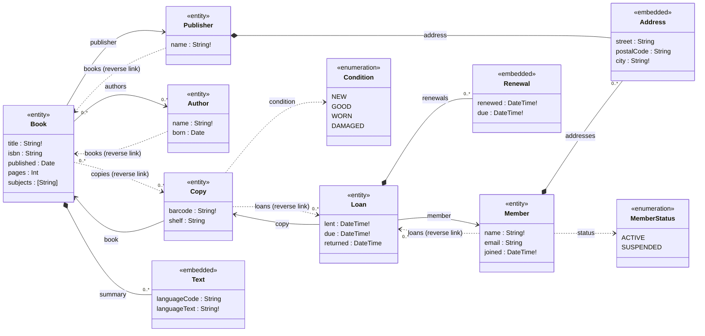

# Drawing the model

Show the user the model as a Mermaid class diagram before writing it to LDS, and ask them to confirm it. It is
drawn as the LDS documentation draws a model
([The model](https://lds.descoped.io/docs/user/model/#an-example)):

| In the model | In the diagram |
|---|---|
| an entity type (`@domain`, or a JSON Schema file) | `class Book {` with `<<entity>>` and its value fields |
| an embedded type | `class Chapter {` with `<<embedded>>` and its fields |
| an enum | `class State {` with `<<enumeration>>` and its names |
| a union of entity types | `class RightsHolder {` with `<<union>>`, and `RightsHolder <\|.. Author` for each member |
| a value field | a line in the class: `title : String!` |
| a single embedded object | `Book *-- Cover : cover` (a filled diamond: composition, part of the document) |
| a list of embedded objects | `Book *-- "0..*" Chapter : chapters` |
| a single link | `Book --> Publisher : publisher` (an arrow: association, a document of its own) |
| a list of links | `Book --> "0..*" Author : authors` |
| a field of an enum | `Book ..> State : state` |
| a reverse link (GraphQL only) | `Publisher ..> "0..*" Book : books (reverse link)` |

Write the fields as the model writes them (`[String]`, `!`), so the user sees which are required and which are
lists. Leave links, embedded objects and enums out of the class body: they are the lines between classes. Use
`direction LR` and put entity types first. Draw reverse links only for links with a `reverseName` the user asked for,
so that the diagram stays readable.

Below the diagram, say in plain words what it shows: "A filled diamond is a part of the document it is in. An arrow
is a link to a record of its own; LDS does not check that the record exists. A dotted arrow back is how GraphQL asks
from the other end." Then list what LDS will not check in this model (from [checklist.md](checklist.md)).

## An example

The library model of [graphql-schema.md](graphql-schema.md#a-whole-example):

What to say with it: "A book is written by authors and published by a publisher; the library holds copies of it.
A loan is one copy lent to one member, with its renewals as part of it. Addresses and summaries are parts of the
record they are in. LDS will not check a publisher's single address; everything else marked here is checked when a
record is written. Members and loans are not found by search."
